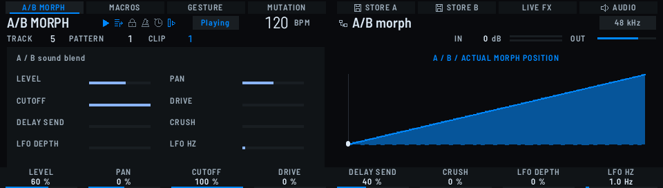
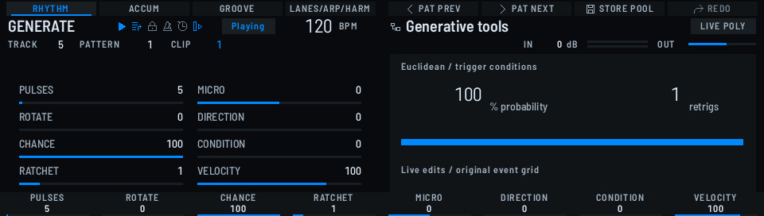
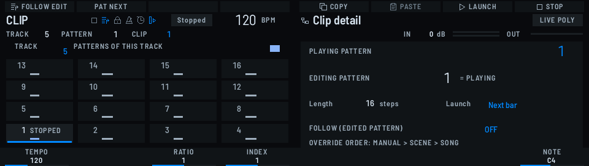
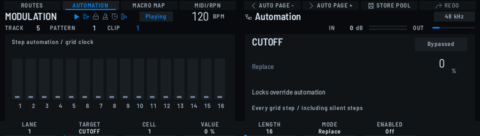
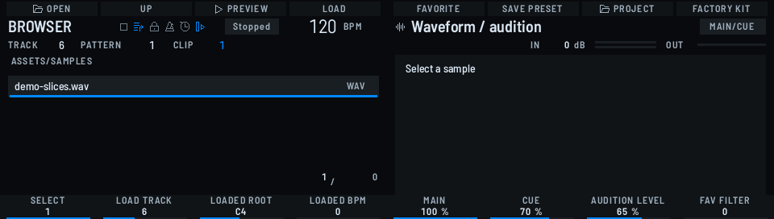
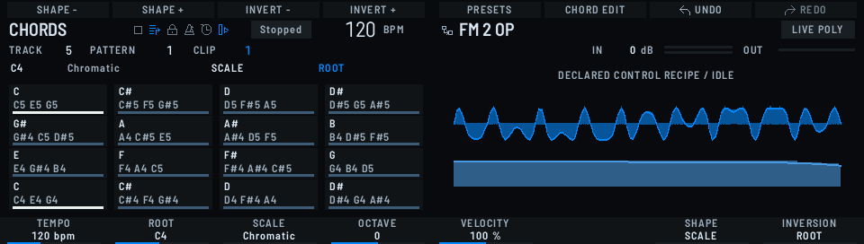
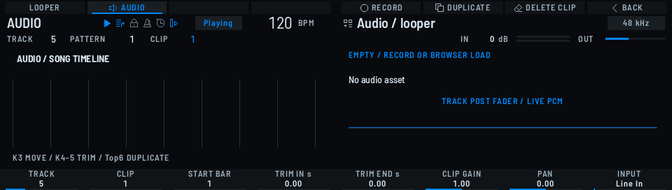
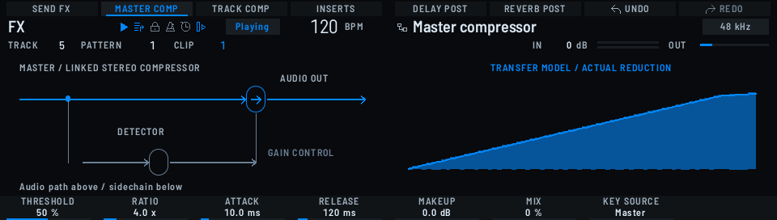

<!-- YADOKARI — public README. Keep the facts in step with the release;
     screenshots are real frames from the device's own renderer. -->

<div align="center">


# YADOKARI

### 🐚 VIBE GROOVEBOX

**A standalone groovebox firmware for the MASCHINE MK3 — no computer, no Linux, just a Raspberry Pi 4 and the controller.**

*Yadokari* (ヤドカリ) is Japanese for the hermit crab — an animal that
borrows an empty shell, lives in it without changing it, and walks away
when it outgrows it. That is exactly what this firmware does to a
MASCHINE MK3: it moves into the shell, brings its own brain, and leaves
the shell exactly as it found it.

[](LICENSE)
[](https://github.com/Bongorian/yadokari/releases)
[](https://github.com/Bongorian/yadokari/actions/workflows/ci.yml)
[](https://github.com/Bongorian/yadokari/releases)
[](#-requirements)
[](#-building-from-source)
[](#-how-this-was-made)

[🧰 Requirements](#-requirements) · [🚀 Quick start](#-quick-start) · [✨ Features](#-features) · [📸 Screenshots](#-screenshots) · [🔨 Building](#-building-from-source) · [📚 Docs](docs/) · [🤝 Contributing](#-contributing)


<sub>The boot splash on the right display — the firmware stamps its own version underneath at runtime.</sub>

</div>

---

An independent, from-scratch firmware that turns a MASCHINE MK3 into a
self-contained instrument: 16 tracks of synthesis, sampling and sequencing,
performed live on the controller's own pads, knobs and dual displays.
The Pi runs bare-metal code — no operating system underneath — and the same
C++ core also runs on a PC as a virtual MK3 for development and rendering.

**Your MK3 stays 100% stock.** No hardware modification, no flashing or
patching of the controller, nothing soldered, nothing opened. The Pi simply
plugs into the USB port and does the job a computer running MASCHINE would
do — so unplug the Pi, plug the MK3 back into your computer, and it is a
completely normal MASCHINE again. The conversion is fully reversible and
leaves no trace on the controller.

> **Unofficial, independent project.** Not affiliated with, endorsed by, or
> sponsored by Native Instruments. MASCHINE is a trademark of Native
> Instruments GmbH. This firmware is an original implementation and contains
> no Native Instruments code, binaries or assets — see [Legal](#-legal).

## 🧰 Requirements

| | |
|---|---|
| 🎹 Controller | MASCHINE MK3 |
| 🥧 Computer | Raspberry Pi 4 (4 GB RAM or more) |
| 💾 Storage | microSD (image) |
| 🔌 Connection | USB-A (Pi) → USB-B (MK3) cable; the Pi is powered over USB-C |

## 🚀 Quick start

1. **Download** the latest Pi image from [Releases](https://github.com/Bongorian/yadokari/releases).
2. **Copy** the zip's contents onto a FAT32-formatted microSD card.
3. **Insert** the card into a Raspberry Pi 4 (4 GB RAM or more), connect the MK3 to the Pi's USB-A port (USB-B on the MK3), power on.
4. **Play.** The factory library (187 presets & kits, level-normalised) is built in. 🎶

No SoundFont is bundled: SF2-based presets light up once you drop your own
`.sf2` onto the device over the file door (Ethernet or USB — see the manual).

## 📸 Screenshots

| Perform | Generate |
|---|---|
| <br><sub>16 tracks, live on the pads</sub> | <br><sub>Ideas on demand</sub> |

| Clip / Scene | Step automation |
|---|---|
| <br><sub>Clips, scenes, song sections</sub> | <br><sub>Per-step locks and curves</sub> |

| Browser | Chords |
|---|---|
| <br><sub>The factory library, on-device</sub> | <br><sub>One finger, full voicings</sub> |

| Audio tracks | Compressor |
|---|---|
| <br><sub>Recorded takes on the timeline</sub> | <br><sub>Values you can see as shapes</sub> |

<!-- Videos come later (user decision, 2026-11-11): when demo footage is
     ready, add an "In motion" section here. Until then, no section. -->

## ✨ Features

**🎛️ Performance-first**
- 16 persistent tracks · 16 patterns · 256 steps · 16 scenes · 32-section song arrangement
- Parameter locks, automation, macros, morph and gestures — Elektron-style control, rationed through the MK3's own surface grammar
- Looper and audio tracks, track FREEZE for bouncing heavy tracks to audio
- Built to be played: the design rule is *carry just this box* — performing, live sets and composing without a laptop

**🔊 Sound engines**
- VA (dual), FM 6-operator with DX7 bank import, Plaits, resonator (Rings), texture (Clouds), granular, wavetable, formant/VOSIM, phase distortion, additive
- Sampler with slicing, zones and recording/resampling; drum kits with per-pad GM declaration
- SoundFont (SF2) playback — bring your own bank
- Insert FX per track/group, delay/reverb sends, vocoder

**💾 Content & files**
- Songs `.mgxs` · kits `.mgxk` · presets `.mgxp` — one content model, stable GUIDs, factory library curated as data
- File door over Ethernet or USB for songs, presets, kits, WAV, SF2, MIDI and DX7 banks (Wi-Fi disabled in the 0.9.0 build)
- Standard MIDI file import/export; multitimbral external MIDI (Ch 1–16 → Track 1–16)

## 🔌 The dream build: a Pi inside the MK3

> 🚧 **Under construction.** This build has not been done yet — the
> measurements, photos and the full guide are still on the workbench.
> What follows is the plan, written down so the dream has an address.

> *For geeks who dream of the true standalone.*

Let's be honest about what this section is. You don't need it — nobody
needs it. The stock setup above already gives you a standalone instrument,
and your MK3 never has to be opened. This section exists for the other
kind of person: the one who looks at the little Pi hanging off the back
and thinks *…but what if it was all in one box?*

The dream, once built: no USB cable, no dongle, no second power brick.
One unit on the desk. Power in, audio out, pads lit — a MASCHINE that
grew its own brain. Pure romance, zero practical necessity, and all the
more fun for it.

If that's you, the shape of the quest (the full build log with
measurements and photos lives in [docs/internal-build.md](docs/internal-build.md)):

- **Move in** — the Pi 4 takes up residence inside the chassis:
  standoffs, an insulating sheet, polite distance from the MK3's own
  boards, and a thermal path for its heat, because a sealed box has no
  breeze and dreams run warm.
- **The handshake, internalised** — the USB conversation between Pi and
  MK3 moves inside: a short lead taps the MK3's USB lines at its rear
  connector. The price of romance: the rear socket is spoken for, and
  the "plug it back into a computer" trick is gone.
- **One heartbeat** — a single power inlet feeds both boards. Rails and
  tap points get measured on the real unit first; the Pi is a hungry
  guest (a solid 5 V / 3 A class appetite) and the host keeps its
  headroom at full display brightness.
- **Keep a rescue hatch** — even dreams need one. microSD access stays
  physical (a slot in the bottom plate, or an extender), because
  recovery and re-imaging live on that card. Seal it in and you've
  built a very stylish brick-in-waiting.
- **The ritual** — prototype with external cables, measure everything,
  photograph the boards, *then* pick up the soldering iron. Every solder
  point in the build log is one that was measured and photographed on a
  real unit. No guessed points, no heroics.

> Hardware mod: opening your MK3 voids its warranty, and this build is
> entirely at your own risk. But you knew that. You're the kind of
> person this section is for.

<!-- Tap points and measurements are transcribed into the build log only
     after being measured and photographed on a real unit. Never guessed. -->

## 🔨 Building from source

Tested environment: Ubuntu 24.04, GCC 13.3 (see
`tools/content/catalog_environment.lock.json`).

```sh
# Host test suite (no hardware needed)
make test

# PC simulator — the virtual MK3 (needs SDL2)
make simulator

# Firmware image for the Pi
scripts/build-firmware.sh   # fetches Circle at a pinned commit, applies the patch series
```

The Arm GNU toolchain version used by CI is pinned in the workflow file;
`scripts/build-firmware.sh` expects `aarch64-none-elf-` on your `PATH`.

**On a Mac (or if you'd rather not assemble the toolchain by hand):**
use the dev container — the same locked environment CI builds with,
on Linux and Mac alike. Windows works through WSL2 or the container,
best effort. Step-by-step: [BUILDING.md](BUILDING.md).

**Update signing.** Network/USB updates are Ed25519-signed, and no key —
public or private — is committed to this repository: the firmware's trust
anchor (`firmware/update_key.h`) is generated at build time from your own
key (`scripts/update-public-key.py`). Official images are signed with the
project's release key; a self-built image trusts *your* key instead, so
official and self-built installs cannot update each other — switching
between them means flashing a fresh card image.

## 📁 Project layout

| Path | What |
|---|---|
| `src/` | The instrument core (engine, sequencer, UI) — shared by firmware and PC builds |
| `firmware/` | Bare-metal Pi 4 entry, USB/MK3 surface drivers |
| `platform/` | Desktop (virtual MK3) and mock backends |
| `assets/factory-library/` | Factory presets & kits (data + generation) |
| `third_party/` | Vendored dependencies, each with provenance and licence |
| `docs/` | Architecture, formats, user manual |
| `tests/` | Host test suite |

## 📚 Documentation

- [User manual](docs/user-manual.md) · [ユーザーマニュアル（日本語）](docs/user-manual.ja.md)
- [Architecture](docs/architecture.md)
- [Preset system](docs/preset-system.md) · [Project format](docs/project-format.md)
- [Known limitations](docs/known-limitations.md) — what is limited or unverified, stated plainly

## 🤝 Contributing

Contributions are welcome — the PC simulator means you don't need the
hardware to work on UI or sound. Start with [CONTRIBUTING.md](CONTRIBUTING.md):
CI must pass, and contributions are accepted under the DCO
(`Signed-off-by`), no CLA. Presets and kits are contributions too.

## 🤖 How this was made

Full disclosure: this firmware was **vibe-coded**. A human designed it,
argued with it, listened to every version on the real hardware and made
the final calls — and the code was written in long, joyful sessions with
AI pair programmers, Meta's **Muse** and OpenAI's **Codex**, then
tested against the actual machine until it behaved.

Which is a fancy way of saying what the GPL already says in capital
letters: **no warranty**. No support desk, no promises, no guarantees —
it might eat your Saturday. In exchange, it's free, it's open, and it's
genuinely fun: a full groovebox that grew out of "wouldn't it be cool
if…". Every known rough edge is written down in
[known limitations](docs/known-limitations.md) rather than hidden.

So come and enjoy it with us. Play it, break it, fork it, ship a preset,
file an issue, send a patch. Built by a human and some robots, for
humans. Robots welcome too.

*The long version — how a private experiment became this repository —
is told in [the story so far](docs/story.md).*

## 🙏 Credits

**Built on [Circle](https://github.com/rsta2/circle) by Rene Stange** —
the bare-metal C++ framework for Raspberry Pi that this firmware stands on.

**MASCHINE MK3 protocol knowledge from [encdr](https://github.com/Analog74/encdr)**
by Analog74 — its MK3 descriptor was the reference for the display framing,
LED encoding and control-report layouts.

DSP and components from Mutable Instruments (Plaits / Rings / Clouds),
DaisySP, msfa, TinySoundFont, Monocypher, FatFs and AKWF — full list with
licences and pinned revisions in [THIRD_PARTY_NOTICES.md](THIRD_PARTY_NOTICES.md).
UI font: Barlow Semi Condensed (OFL).

## ⚖️ Legal

This is an independent, unofficial open-source project. It is not affiliated
with, endorsed by, or sponsored by Native Instruments GmbH.

- **Trademarks.** MASCHINE, MASCHINE MK3 and NATIVE INSTRUMENTS are
  trademarks of Native Instruments GmbH. They are used in this repository
  only to identify the hardware this firmware runs on (nominative use) and
  to describe compatibility. No trademark rights are claimed or implied.
- **No NI material.** This repository contains no Native Instruments code,
  binaries, firmware, sounds, samples, artwork or other proprietary assets.
  The firmware is an original implementation, written from the authors' own
  hardware, published documentation and open protocol research (notably
  [encdr](#-credits)). Nothing here requires, distributes or circumvents
  Native Instruments software.
- **Hardware.** You need a MASCHINE MK3 you own; this project neither
  modifies the controller's hardware nor rewrites its firmware — the Pi
  talks to the stock controller over USB, in the role a computer would
  normally take. (The optional internal-build mod described above is the
  one exception, is plainly labelled as such, and is never required.)
- **Rights holders.** If you hold rights in material referenced here and
  believe something in this repository infringes them, please open an issue
  or contact the maintainer — it will be addressed promptly.

## 📜 License

GPL-3.0 — see [LICENSE](LICENSE). The firmware is built on GPL components
(Circle, encdr); the whole work is therefore GPL-3.0.

<div align="center">


<sub>🐚 Borrowed shell, own brain. — YADOKARI</sub>

</div>
