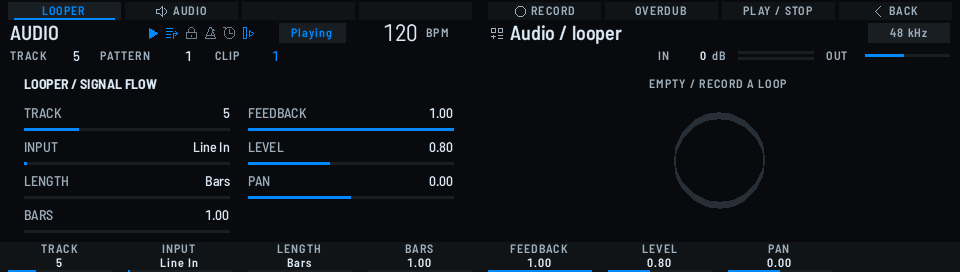
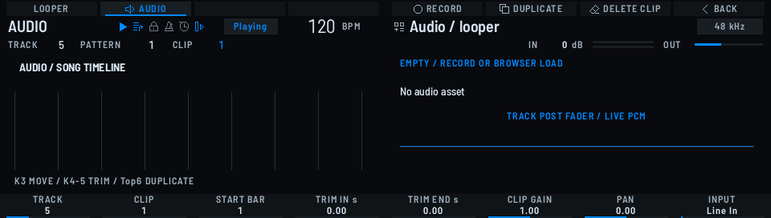

# Looper and AUDIO tracks

Implementation: [AudioLane](../src/audio_lane.h), [recording and file handling](../src/session_files.h), [control descriptors](../src/audio_controls.h).

**Hardware verification scope:** the queue overflow seen on the first recording in Final test F02 is resolved, as confirmed by a five-minute save and readback after the fix. This is separate from any guarantee about arbitrary SD cards, mixed sound sources, or perceived sound quality.

## Layout and limits

Choose the type of the existing 16 slots from INSTRUMENT / LOOPER / AUDIO. In the initial specification, up to 4 slots in total can be assigned to LOOPER and AUDIO combined; recording is a single system shared with the conventional Live Record / Resample / Overdub. This is not a figure that guarantees the processing budget when used simultaneously with the original sound sources.

AUDIO holds 8 clips per slot. Playback within a slot is monophonic: with overlapping placements, playback switches to the clip with the later start position. At the same start position, the clip with the later number is chosen. Placements are measured from the start of the Song at 960 PPQN, and the normal move knob steps in bars. Trim is in frames of the source WAV; on-screen operations step in 0.01 seconds. Speed is fixed at the real time of the source audio and does not stretch automatically with tempo changes. WAVs produced by the sampler's explicit Stretch process can also be assigned from the Browser.

Audio slots are not driven by steps, notes, or Pattern changes. The instrument settings and steps from before the switch are retained, and SHIFT+Top1 INSTRUMENT returns to them. The common Track FX / output settings use the channel settings of the persistent Track. The audio slot's Level/Pan and the clip Gain are dedicated values. Song section Mute is applied, and audio spanning a section boundary is not retriggered midway. At the end of the Song, AUDIO stops; on a Song loop it restarts from the placements at the beginning. LOOPER continues across Scene/Pattern changes. STOP halts everything; PLAY restarts bar-synchronously from the beginning.

## Recording and overdubbing in Perform

A host screen generated from the common renderer and real data — not a photograph of the hardware. On the left are values such as input, length and Feedback; on the right is the Ring at the actual playback position.

The canonical entry point is **PERFORM → Top8 AUDIO**. The implicit repurposing from an audio slot and the SONG shortcut have been removed. 4-D movement inside PERFORM is retained. **Top1 LOOPER** switches the selected track. Pads select tracks and K1 is also TRACK. Operating a Pad while holding MUTE/SOLO works as usual.

| Operation | LOOPER |
|---|---|
| K2 INPUT | Choose from the existing Input / Main / Cue / Track Dry / Insert / Fader / Group / Returns / Perform |
| K3 LENGTH | Bars / Pattern / Free |
| K4 BARS | With Bars, 1–64 bars. Pattern rounds the playing Pattern length at record-arm time up to whole bars |
| K5 FEEDBACK | The amount of the existing loop retained when overdubbing, 0–1 |
| K6 LEVEL / K7 PAN | The loop's output level and pan |
| Top5 RECORD | During PLAY, recording starts at the next bar line. Pressing again is a priority STOP |
| Top6 OVERDUB | At the next bar line, cues the existing loop from the top and overdubs the same number of frames |
| Top7 PLAY / STOP | Restarts / stops the loop at the next bar line |
| SHIFT+Top7 CLEAR → Top1 confirm | Releases the loop assignment |
| SHIFT+Top6 TAKE UNDO | Undoes the most recent audio-slot edit. Pressing again swaps back |
| Top8 BACK | Returns to the first page of Perform |

Free is up to 5 minutes. Recording starts on a bar line and ends when pressed, and on completion is rounded to the nearest bar. Rounding down removes the tail; rounding up fills with silence. Rounding beyond 5 minutes is not performed. The 64-bar limit of the Bars setting and the 5-minute limit of Free are separate.

An overdub mixes and verifies "existing PCM × FEEDBACK + the new input" on the service side before replacing the loop. While processing, the previous loop keeps playing. A STOP during recording or mixing takes priority, and if the target or generation has changed, the old assignment is kept. Main, the same Track, or the same Group — anything that includes the overdub input itself — cannot be chosen as the Overdub input. Wet audio can be layered by using another Track's Insert/Fader or another Group. Adjust the input gain to suit the layered result.

## Recording and placing into AUDIO

A shared host-generated screen. The upper diagram shows clip placements; the lower row shows the selected clip's start bar, trim and gain.

**Top2 AUDIO** on the same page. Return to Song with **SHIFT+Top8 SONG**, prepare sections, enable the Song, and PLAY. Go to **PERFORM → Top8 AUDIO** again, choose an empty Track and a CLIP, and press Top5 RECORD. Both start and end are confirmed on bar lines, and the WAV is placed automatically at the actual punch-in position. The input is K8. The recording destination is fixed at arm time. A fixed-length / AUDIO recording interrupted mid-bar by a global STOP is not substituted into the existing assignment. Use Top5 for a normal punch-out.

| Operation | AUDIO |
|---|---|
| K1 / K2 | TRACK / CLIP 1–8 |
| K3 START BAR | Moves the selected clip in bar units |
| K4 TRIM IN s / K5 TRIM END s | Edits the range within the source audio in 0.01-second steps |
| K6 CLIP GAIN / K7 PAN | The selected clip's Gain / the Track's Pan. Track Level is K1 in the MIXER |
| K8 INPUT | Chooses the recording input |
| Top6 DUPLICATE | Copies to an empty clip and places it at the next bar after the source clip's end |
| Top7 DELETE CLIP → Top1 confirm / SHIFT+Top7 CLEAR → Top1 confirm | Deletes the selected clip / clears all placements of the Track |
| SHIFT+Top6 TAKE UNDO | Undoes the most recent audio-slot change |

Simultaneous recording is a single system. Recording is possible for as many bars as fit within the existing 256 MiB limit for PCM WAV — at 48 kHz stereo PCM16 that is roughly 23 minutes at most. For long material, check the feel of operation and the tolerance to SD latency within the scope of hardware verification separately. Undo keeps one previous state per track and is independent of the step-edit history. A new audio-slot edit updates the previous state. The Undo history is not saved.

## Saving and resources

WAVs go in the existing recording directory, and references are registered in the shared asset bank of 64 entries. SAVE / SAVE AS / OPEN / COLLECT and the deletion guard for files in use are shared. Clear and Delete only release assignments; they do not delete the WAV itself. Registered materials, including past takes, are also covered by the existing COLLECT.

The type, input, loop settings, placements, trim and gain are saved in a standalone AUDO revision 1 chunk of MGXC format 11. The retention path for unknown chunks / unknown engines is unchanged. WAVs larger than 8 MiB are streamed with the existing 2048 frames × 8 pages; page requests are issued only by the DSP, and disk reads and replacement happen on the service side. To preserve lifetimes, the cache holds up to 64 stream references, distinct from the 4 slots that can play simultaneously. Recording PCM writes are processed on the service side through a reusable 16 KiB buffer, up to 4,096 frames at a time, and the queue is drained ahead of stream reads. When a Kit is loaded, materials referenced by audio clips are also retained.
