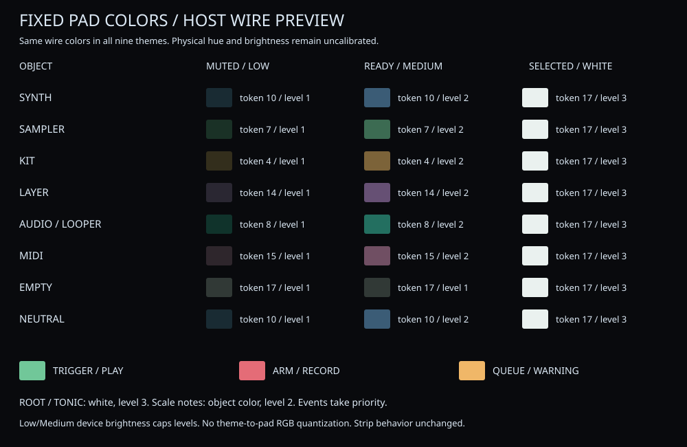

# LED Meanings and Lighting Rules

The pads use the fixed wire tokens in [PadPalette](../src/ui/pad_feedback.h) as the canonical definition. They use a set of hues close to the [on-screen kind chips](../src/ui/engine_kind.h) and are not quantized from theme RGB. The LED meaning colors are invariant across all nine themes, including MONOTONE. Themes affect the LCD surfaces, text and chips; the touch strip keeps its existing context/theme-following behavior. The page target and state come from [Performance::pad_role / pad_feedback](../src/performance.h); intensity and timing are decided by PadPalette.

## Colors and intensity

| State | Color meaning and intensity |
|---|---|
| Empty and unselected / invalid | Off (focus display if an empty edit target is selected) |
| Normally available pad | The current kind color of the target track, or a neutral color, 55% |
| Selected / being edited | focus = white (17), 100% |
| Mute (Global / Pattern / both) | The same kind color, 18%. Not replaced by off during Mute operations |
| Playback position / accepted performance input / active FX | Green (7), 100% |
| Start reservation / stop processing / warning | Amber (4). Reservations blink, stop processing is steady |
| Record standby / recording | Red (1). Standby blinks, recording is steady |

A pad's base color corresponds to its target, not its position. Track performance / selection / Mute / Solo / Song mask / Route use the target track; STEP / Kit / Slice / Keyboard / Chord / Clip / Scene use the track being edited; Files / Assets / Settings / Cells / Generate / Live FX use a neutral color. Normal and Mute use the same hue of the target kind; selection/editing is white. In KEYBOARD, scale notes are the kind color at brightness 2 and the root is white at brightness 3. In CHORD, the tonic is also white. Out-of-range or non-constituent notes are off. StepChord's selected notes are shown as white Editing, and events take priority while a note is sounding, recording, or a warning is active.

| Target | Fixed token | LCD chip (non-MONOTONE) |
|---|---|---|
| Synth | 10 blue | #8ab4f8 |
| Sampler | 7 green | #70d5aa |
| Kit | 4 amber | #e8b36a |
| Layer | 14 purple | #c4a4f2 |
| Audio / Looper | 8 teal | #61cde6 |
| MIDI | 15 pink | #ff94b8 |
| Empty | 17 white, normally brightness 1 | #8a94a0 |
| Neutral ready | 10 | — |
| Root / tonic / selection | 17 white, brightness 3 | — |

On the LCD, selection keeps a raised surface plus an accent underline, and playback keeps a motion top edge. The on-screen chips are projected to gray under MONOTONE, but the pads keep their fixed colors. Sampler and Audio form the closest pair.

The real MK3's existing wire uses fixed indices and three brightness steps. Because [the transport quantization](../src/mk3_led_transport.h) approximates logical colors, 55% / 18% and the full 16 RGB values are not claimed to be reproduced exactly on the physical LEDs. Single-color buttons such as REC drive their native single-color lamps. The LED previews on the LIGHTS and pad screens display the final wire code, including device dimming, through the same decoder; they are not calibrated LED/LCD colors. The wire token and brightness/blinking for every kind and state are identical across all nine themes. A green Sampler base versus note-on, and an amber Kit base versus reservation, are distinguished by role, intensity and timing. Low/Medium follow the existing wire step limit, so the intensity distinctions are reduced.

## Lighting timing and priority

- Editing, file selection and Mute operations do not overlay note-on display; they show the selection/Mute state after the change.
- A pad whose performance input was accepted shows motion only while held. Full shows even a short tap for 120 ms from acceptance; Reduced/Off clear on release. Note Off itself is not delayed. Held display is not carried over to File pages or other pages.
- Automatic note notifications go to track pads for at most 120 ms, in Full only. Individual Kit pads, slices or files are never fabricated from a track notification.
- STEP shows motion on the current cell only, returns to the previous state at the next position, and clears the playback display at STOP. Clip/Scene also show motion only while running; the reservation stage is warn.
- Reservations and record standby run 0.5 s strong / 0.5 s weak, independent of tempo. Warnings step every 0.25 s in Full, every 0.5 s in Reduced, and are steady in Off. Stop processing is steady.
- The recording-destination display is fixed to the track/kit pad at start and does not move when another track is selected.

Priority is: warning → recording → stop processing → record standby → start/stop reservation → active FX → Mute → performance input / automatic note notification → playback position → selection/editing → normal → empty. Note-on display indicates that input/notification was accepted; it is not a measurement of audibility or audio level.

## Pad targets per page

| Page / operation | What the LEDs represent |
|---|---|
| Normal performance (PAD, SYNTH, etc.) | Track. When a Kit is selected in PAD, the Kit pads |
| KEYBOARD / CHORDS | The notes / chords to play. SHIFT+KEYBOARD is the Step chord voicing |
| STEP | The current 16 steps. While SELECT is held in a Kit, Kit pad selection |
| CLIP / SCENE | The edited Pattern / selected Scene, and running/reserved configurations |
| SAMPLER / FX PAD INSERT | Slice / Kit pad. Note-ons from other tracks are not mixed in |
| Normal pages of ROUTING / AUDIO / Modulation | Track selection. Not lit as if a note had been played when pressed |
| MIXER / MUTE / SOLO | Mute/Solo of a track or a kit. On the AUDIO page, kit settings from before switching are not mixed in |
| SONG | The mute mask of the selected section. While SHIFT is held on a recorded section, the Playing mask |
| GENERATE | RHYTHM: the pulse count; others: cell selection. The step playback position is not misrepresented |
| AUTOMATION / MACRO MAP / SCALE | Cells, the target track of a Route, the active scale |
| BROWSER / PROJECT | File/Asset selection. Out of range is off |
| PRESETS / KITS | The note / kit pad being auditioned. Cleared when audition stops or the list is left |
| SETTINGS | Pads 1–7 directly select the seven setting categories. Independent of the three top classification banks. Unassigned/invalid are off |
| PERFORM | Stutter/Fill, active slots on the Live FX page, Morph position. Pads that do nothing are off |
| DIAGNOSTICS / name entry | Normal pad operations are off. The explicit LED TEST is a separate diagnostic display |

## Buttons and the recording destination

| Button | Lighting meaning |
|---|---|
| Top 1–8 | Off = invalid, dim = operable, strong = selected/active. The displayed label takes priority |
| Screen selection buttons | That screen is currently displayed. PAD MODE etc. also follow the main screen currently displayed |
| Page arrows (independent left/right buttons) | Lit when back/forward history exists |
| 4-D up/down/left/right | Lit in directions where the current screen/range has a destination. Not an increase/decrease indication for setting values |
| A–H | Theme neutral color / selection accent / Mute low saturation / recording danger. Sticky lower layer: unselected 1, selected 2; upper layer: unselected 2, selected 3. Unselected Mute: lower layer off, upper layer dim. While recording: strong steady red; waiting to start: blinking only; stop processing: weak steady red. Medium is 1/2 per layer; Low: lower-layer unselected off, upper layer dim. In Group contexts, bus selection |
| PLAY | Playing. Blinks on the beat in Full only; steady in Reduced/Off |
| STOP | Stopped. A warning display takes priority while a warning is active. STOP operation is never prohibited by the lighting state |
| REC | Standby = slow blinking, recording = strong steady, stop processing = weak steady |
| RESTART | Normally dim, strong while held. Operable with SHIFT. A reservation to the next bar line |
| DUPLICATE | The operation entry is shown dim, strong while held. Does not mean the copy succeeded |
| EVENTS | Lit when Undo history exists; while SHIFT is held, lit when Redo history exists. Off during modals |
| LOCK | The snapshot held state. Not an indication that Step Locks exist |
| MUTE / SOLO / SELECT / ERASE / SHIFT | The modifier operation being held |
| FIXED VEL / NOTE REPEAT / FOLLOW | The corresponding function is active |
| PITCH / MOD / NOTES | The strip's selected mode |
| VOLUME / SWING / TEMPO | The state of operating the main encoder while the button is held |
| TAP | Metronome active. Toggled with SHIFT+TAP |

The audio recording destination is fixed when requested. Even if you move to another track during recording, the recording display on A–H and the AUDIO page stays with the recording destination. REC shows the overall recording state. While file processing runs on a target that was released after recording stopped, REC indicates processing, and the selected track is not lit as if it were the recording destination by mistake. Gesture/MIDI capture is indicated by REC.

The REC lighting for note recording means "recording is enabled"; it is not a measurement that notes keep being input. Material existing in an AUDIO slot, or a pad being lit, is likewise not proof that sound is actually being produced.

## Settings and visual checks

In SETTINGS → LIGHTS, LED LEVEL / STRIP PROFILE are chosen with the 4-D encoder and changed with K1. MOTION is K1 of APPEARANCE. An Uncalibrated strip turns the wire off; PaletteHypothesis / MonoHypothesis are explicit provisional profiles. The diagnostic LED TEST is an operation that directly checks wire color numbers, separately from the normal meaning colors.

1. In DISPLAY → THEME, switch between CYBER 2 and MONOTONE 1, and check that the approximate base color of the pads changes while the engine chip color on PAD does not change. In LIGHTS, check the intensity differences between normal / selected / Mute.
2. STEP → PLAY → STOP. The selection underline and the playback top edge coexist, and the playback position disappears at STOP. Touching / turning / stopping / releasing K1 opens the 46px in-cell display, the ARC returns accent → motion → accent, and it closes after about 1.2 s.
3. Open a different song and check that the theme is retained, and that the same theme is active after a restart.

Automated tests check the target, state, final wire preview, quantization, release, expiry and STOP; they are not a substitute for confirming the physical colors. The legend is generated with `make led-preview`.

The legend image renders the actual transmitted values of `build/test-insights-rework <palette.json>` with `python3 tools/led-legend.py <palette.json>`. It is generated after confirming that the wire values agree across all nine themes; LCD colors are not to be called measured LED values.
