# YADOKARI 取扱説明書

MASCHINE MK3を単体グルーヴボックスにする、Raspberry Pi 4／5用ファームウェアの取扱説明書です。

操作の全体像は[UI・目的別ワークフロー](ui-pages.md)、LEDの強弱・点滅と録音表示は[点灯規則と凡例](led-behavior.md)を参照してください。SETTINGSの4-D左右はAPPEARANCE／DISPLAY／LIGHTS／PAD／AUDIO／MIDI／SYSTEMを移動します。SYNTHの左右は同一画面の編集ページに限定し、MODULATION／TRIM等の入口は表示されたTopを押します。パッドは対象Track色または中立色で通常55%／選択100%／Mute18%、motion＝演奏／再生、warn＝待機、danger＝録音、空きは消灯。SETTINGS → Top3 LIGHTSで凡例と現在の16 Pad出力を確認できます。

対象はPi 4またはPi 5（RAM 4GB以上）とMASCHINE MK3の組合せです。推奨環境はPi 4です。NI純正MASCHINEソフトウェアとは操作が異なります。

機能と制限は[機能表](feature-matrix.md)、通常画面のTop/ノブ一覧は[操作表](manual/controls.tsv)を参照してください。

---

## 目次

- [1. 最初に知っておくこと](#1-最初に知っておくこと)
- [2. パネルと画面の読み方](#2-パネルと画面の読み方)
- [3. まず1小節の曲を作る](#3-まず1小節の曲を作る)
- [4. サンプルから作る／DRUM KITで作る](#4-サンプルから作るdrum-kitで作る)
- [5. 音声を録る：4種類を使い分ける](#5-音声を録る4種類を使い分ける)
- [6. ClipからScene、Sceneから1曲へ](#6-clipからscenesceneから1曲へ)
- [7. ミックス、Automation、演奏効果](#7-ミックスautomation演奏効果)
- [8. 保存して再開する／PCへ持ち出す](#8-保存して再開するpcへ持ち出す)
- [9. 外部MIDI機器と連携する](#9-外部midi機器と連携する)
- [10. 実例：1曲を通して作る](#10-実例1曲を通して作る)
- [音源の詳細](#音源の詳細)
  - [追加音源 RESONATOR / TEXTURE](#追加音源-resonator-texture)
  - [Plaitsの編集](#plaitsの編集)
  - [FM 6とDX7バンク](#fm-6とdx7バンク)
  - [SoundFontバンク](#soundfontバンク)
  - [大きいSoundFontを開くとき](#大きいsoundfontを開くとき)
  - [追加音源 ADDITIVE／PHASE DIST](#追加音源-additivephase-dist)
  - [LAYER](#layer)
  - [VA DUALの同時発音](#va-dualの同時発音)
  - [シンセ拡張の操作](#シンセ拡張の操作)
  - [LFOの拍同期](#lfoの拍同期)
- [演奏機能の詳細](#演奏機能の詳細)
  - [音源別Morphと素材の持ち出し](#音源別morphと素材の持ち出し)
  - [音源ごとのLock・automation・Macro](#音源ごとのlockautomationmacro)
  - [Vocoder INSERT](#vocoder-insert)
  - [STEPのTRACKER表示](#stepのtracker表示)
  - [MULTITIMBRAL](#multitimbral)
- [画面の読み方](#画面の読み方)
  - [拡張画面とノブ一覧](#拡張画面とノブ一覧)
  - [文字・凡例・一時表示](#文字凡例一時表示)
  - [アイコンの読み方](#アイコンの読み方)
  - [可視化の読み方](#可視化の読み方)
  - [操作文法](#操作文法)
  - [色・ピーク・サンプルの読み方](#色ピークサンプルの読み方)
  - [ステップのSLIDE／ACCENT](#ステップのslideaccent)
- [設定](#設定)
  - [明るさ・パッド感度・設定保持](#明るさパッド感度設定保持)
  - [入力ゲイン・チューナー](#入力ゲインチューナー)
  - [MIDI Local Control](#midi-local-control)
- [ファイル・接続・起動](#ファイル接続起動)
  - [DATAとファイルの整理](#dataとファイルの整理)
  - [Wi-Fiでファイルを追加・持ち出す](#wi-fiでファイルを追加持ち出す)
  - [USB-C転送とデバイステーマ](#usb-c転送とデバイステーマ)
  - [起動時の表示と標準データ](#起動時の表示と標準データ)
- [制限について](#制限について)

---

## 1. 最初に知っておくこと

本機は、<strong>16トラックでビートとメロディーを作り、ClipとSceneを演奏し、Songとして保存する楽器</strong>です。Pi上でLinuxやNIソフトウェアを動かす方式ではありません。MK3の2画面・8ノブ・16パッドを使います。

本書の画面はレンダラーで生成したイメージで、実機の写真ではありません。Browserなどの一覧に表示されるファイル名は説明用の例です。

### 用語と容量

| 用語 | 本機での意味 |
|---|---|
| Track 1–16 | 音源・サンプル・外部MIDIを担当する16本。A–Hは現在の層の8本。SHIFT+A–Hで1–8／9–16の層を切替えて選択 |
| Pattern 1–16 | 16トラック分の編集データ。各トラック最大256ステップ。通常の16分音符なら16ステップ＝4/4の1小節 |
| Clip | 各トラックがどのPatternを再生するか。トラックごとに異なるPatternを同時に鳴らせる |
| Scene 1–16 | 複数トラックのClip構成をまとめて呼び出すスナップショット |
| Song | 最大32セクションの曲構成。Sceneを並べる方法と、実演をArrangementとして記録する方法がある |
| DRUM KIT | 1トラック内に16パッドのドラム。A–Hが純正MASCHINEの「Group×16 Sound」になるわけではない |
| Group bus 1–8 | 複数Trackをまとめる音声バス。CHANNELのGroup系ページではA–Hで選択 |
| Sample asset | プロジェクトのWAV参照。最大64枠。Undo用に保持される素材も枠を使う |
| Automation / Macro / Lock | 2レーン／Track、8 Macro×4ルート、1ステップ最大4 Parameter Lock。音源固有のKit編集は別の表示・構造を持つ |

### 接続して音を出す

1. 既に準備済みのPiとMK3を使用します。MK3はPiのUSB-Aにつなぎ、MK3のLINE OUTをモニターへ、PHONESをヘッドホンへつなぎます。初回SD作成は[セットアップ](pi4-development-setup.md)を参照してください。
2. スピーカー側の音量を下げて起動します。画面が表示されたら、<strong>PAD MODE</strong>を押してパッドを鳴らします。保存済みプロジェクトによって最初の音源は変わります。
3. 音が出なければ<strong>CHANNEL</strong>でROUTINGへ移り、`MAIN`、`TRACK BUS`、Mute/Soloを確認します。Cueへ送った音はMainから出ません。
4. <strong>SETTINGS → 4-D左右でSYSTEM → Top7「DIAGNOSTICS」</strong>で接続状態を確認できます。`No audio`は音声デバイス未稼働で、パッドLEDが光ることだけでは出音の確認になりません。

---

## 2. パネルと画面の読み方

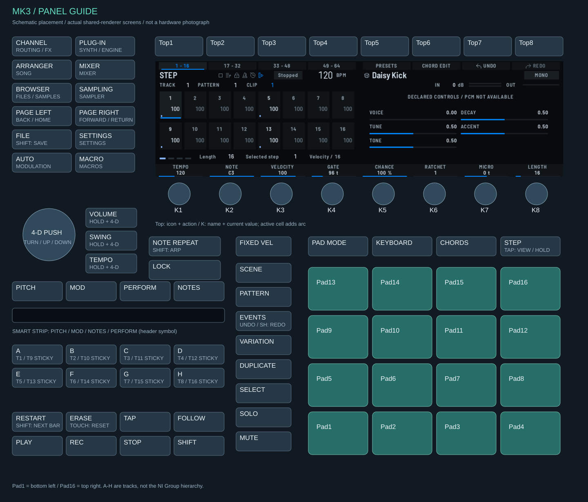

<strong>Top1–Top8</strong>は左右の画面の上にある無印ボタンを左から数えたものです。<strong>K1–K8</strong>は画面の下の8ノブです。Topの役割は画面上端、Kの名前と現在値は下端2行に常時表示します。触れる／回したセルにARCが重なり、離して約1.2秒後にARCだけが消えます。`SHIFT + Top1`はSHIFTを押し続けてTop1を押す操作です。

<strong>Pad1は左下、Pad16は右上</strong>です。STEPの16個のセルもこの番号で入力します。ノブ操作中はヘッダーのTrackとPattern、音源名を確認します。<strong>編集Patternと実際に再生中のClipは異なることがあります。</strong> 値を変えても音が変わらないときは最初にここを確認してください。

| 実ボタン | 動作 | 併用操作・注意 |
|---|---|---|
| PAD MODE / KEYBOARD / CHORDS / STEP | Track／Kit演奏、音階演奏、和音演奏、ステップ入力 | PADでKit選択中は16パッドがKitの音。通常TrackではパッドがTrackを鳴らす |
| A–H | 現在層のTrackを選ぶ | SHIFT+A–Hで層を切替え、その層を保持。約400ms保持でMIXERをPeek、離すと元の編集画面へ。Track選択は維持 |
| MUTE / SOLO / SELECT + A–H | TrackのMute／Solo／選択してCLIPへ | KitでもTrack単位。CHANNELのGroup系ページではGroup bus 1–8選択を優先 |
| STEP再押下／長押し | 短い再押下で16 STEP → 64 STEP → TRACKER | 約400ms保持でノート編集。SHIFT+Top4も同じ表示循環 |
| PLUG-IN | SYNTHを開く | SYNTHで再押下するとENGINE。SHIFT+PLUG-INは音源を順送り |
| CHANNEL | ROUTINGとFXを切り替える | 他ページからはROUTING。GROUP FX内ならTop1「MAIN / CUE」で録音ページへ |
| MIXER | MIXER | パッドを押すとTrackのMuteを切り替える |
| ARRANGER / PATTERN / SCENE | SONG / CLIP / SCENE | ARRANGERはCLIPではない |
| BROWSER / SAMPLING | BROWSER / SAMPLER | SAMPLINGは押しただけでは録音を開始しない |
| AUTO / MACRO | MODULATION / PERFORMのMACROS | AUTOを押すだけでノブの自動記録が始まるわけではない |
| FILE | PROJECT | SHIFT+FILEで通常保存 |
| SETTINGS | 設定 | SHIFT+SETTINGSは停止中に更新確認。制作中のページ移動用には使わない |
| VOLUME / SWING / TEMPO | 押しながら4-Dを回すと、その値を変更 | ボタンを離すと4-Dは通常の役割へ戻る |
| 4-D回転／上下 | 画面に応じてStep、Clip、Scene、Fileなどを選ぶ | 押下で実行・編集。左右はページ移動。Browserでは親／Open |
| 独立したページ左右ボタン | ページ・サブページ・フォーカスの履歴を戻る／進む | 両方を約400ms保持でPADへHOME、再度でRETURN。4-D左右による画面内移動とは別 |
| SELECT + Pad | 発音や起動をせず対象選択 | <strong>SCENEでは保存</strong>。KitのSTEPではKit pad選択。画面によって意味が異なる |
| MUTE / SOLO + Pad | Mute / Solo切替 | Kitを選んでいる場合はKit padが対象 |
| DUPLICATE | STEPでは次のStepへ複製、他ではPattern複製 | SHIFT+DUPLICATEは長さ倍化。Patternコピー／貼付けはCLIPのCOPY／PASTEを使う |
| ERASE + STEP Pad | 該当Stepを消す | SHIFT+ERASEは選択StepのLock消去。SCENEではChain消去 |
| ノブtouch + ERASE | 宣言されたパラメータの初期値へ戻す | ERASE: RESETがヒント。複数touchはまとめてUndo可能。選択／移動ノブは対象外 |
| EVENTS / SHIFT+EVENTS | Undo / Redo | 全ページ共通。確認画面・名前入力中はその入力所有者を優先 |
| FIXED VEL | 固定Velocity ON/OFF | 弱打・強打によらない一定Velocityで演奏。解除でPad感度設定へ戻る |
| PLAY / STOP / RESTART | 再生／停止／先頭再開 | PLAYは通常先頭から。SHIFT+RESTARTは次の小節頭に再開予約、SHIFT+STOPはPanic |
| REC | SAMPLER以外はノート記録ON/OFF | SAMPLERでは選択busの音声録音。SHIFT+RECはSAMPLERならInput録音、それ以外はCount-inノート録音 |
| TAP / SHIFT+TAP | Tap tempo / メトロノームON/OFF | STEPのSHIFT操作でClick出力先とCount-in設定 |
| NOTE REPEAT | 押している音を反復 | SHIFT+NOTE REPEATはArp。上部キーでレート、K1–K4で表示された設定 |
| FOLLOW | STEP再生位置の表示追従 | SCENEのTop1「FOLLOW」とは別 |
| PERFORM / Smart Strip | 演奏ページ。Top8 AUDIOが正規入口 | PITCH／MOD／NOTESは他の編集画面でも演奏可能。下記のStrip操作を参照 |

パッド表面の副印字（Undo、Redo、Quantizeなど）がすべて対応するわけではありません。Undoは<strong>EVENTS</strong>、Redoは<strong>SHIFT+EVENTS</strong>です。確認画面は<strong>4-D押込みで確定、左で取消</strong>。進行中の処理は取消だけ可能です。ノブのPAN等は、低速で中央を跨ぐと中央へ吸着し、高速回転では通過します。

---

## 3. まず1小節の曲を作る

### 3-1. 新規プロジェクトとドラム

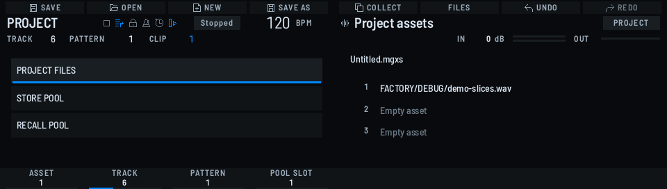
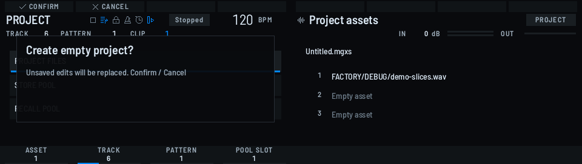

1. 残したい編集は<strong>SHIFT+FILE</strong>で保存し、完了表示を待ちます。
2. <strong>FILE → Top3「NEW」</strong>。工場Song棚 `FACTORY/DEMOS` にテンプレート曲がある場合は、<strong>EMPTY／テンプレート一覧</strong>が開きます。K1または4-Dで選び、<strong>Top1 OPEN</strong>。Top2 CANCELで戻れます。EMPTYを選ぶかテンプレートが0件なら、従来の<strong>CONFIRM／CANCEL</strong>へ進みます。既存編集の自動保存はありません。同梱のイメージにテンプレート曲は入っていないため、通常はCONFIRM／CANCELへ進みます。
EMPTYの16トラックはすべて **EMPTY**（無音・音源未割当）。テンプレートから始めても曲名は **Untitled** になり、初回保存は **SAVE AS** です。工場の元曲は上書きしません。

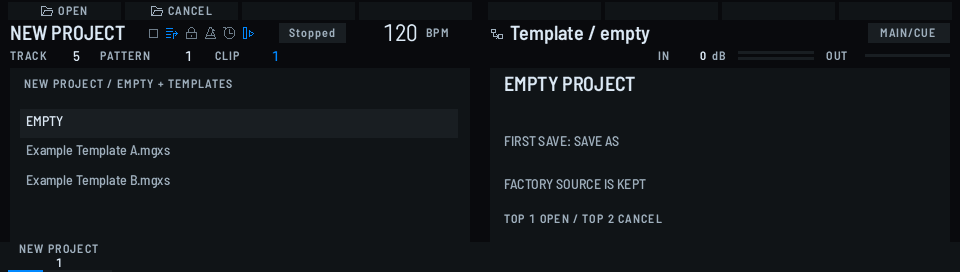

3. <strong>A → PLUG-IN → Top5 ENGINE</strong>。K2で<strong>DAISY ANALOG DRUMS</strong>を選び、<strong>4-D押込み</strong>で音色一覧へ進みます。<strong>Top2 ORIGINALS</strong>から<strong>Daisy Analog Kick → Top6 LOAD</strong>。選択だけでは鳴らず、聴きたいときだけ<strong>Top5 PREVIEW</strong>を押します。
4. <strong>STEP → Top1「1 - 16」</strong>。K1 `TEMPO`を120にし、<strong>Pad1・5・9・13</strong>で4つ打ちを入れ、<strong>PLAY</strong>。
5. <strong>B</strong>で別Trackへ。手順3と同じ入口で<strong>Daisy Analog Snare</strong>をLOADし、<strong>STEP → Pad5・13</strong>をONにします。
6. <strong>C</strong>へ<strong>Daisy Analog Hat</strong>をLOADし、<strong>STEP → Pad3・7・11・15</strong>。ハットのK3 `VELOCITY`を少し下げます。変更するStepはSHIFT+Padで選び、パッドから手を離してノブを回すと通常のStep項目を編集できます。

ドラムは単体PresetでもKitでも使えます。DAISY ANALOG／SYNTH DRUMSの単体PresetはVOICEも編集可能です。VA DUAL／FM 2 OPにもKick・Snare・Hat・Rim・Tomの工場Presetを用意しました。名前のVA／FM／Daisyが生成元です。Browserの<strong>FACTORY → PRESETS → DRUMS</strong>から直接OPENすることもできます。

1 Trackにまとめたい場合は<strong>BROWSER → FACTORY → KITS → VA + FM Percussion.mgxk → Top1 OPEN</strong>。Pad1–6はKick／Snare／Tick Hat／Air Hat／Rim／Tom、7–16は空です。<strong>SELECT+Pad</strong>で音を選び、SELECTを離してStepを入力します。このKitは実際のVA／FM出力をWAVに焼いたSampler Kitで、各Padのシンセノブを編集するものではありません。シンセから編集したいときは単体Presetを使います。旧KICK／SNARE／HI HAT／NOISEの独立エンジンは撤去しました。

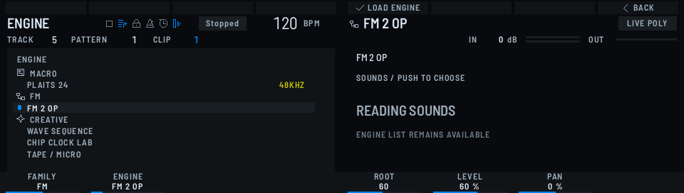
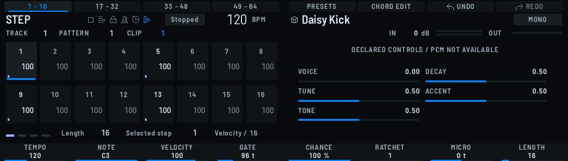

パッドを押し続けた状態のノブは、音色Lockなど別の編集になることがあります。<strong>普通の音符値を編集する場合は、Stepを選んだあとパッドを離す</strong>と迷いにくくなります。もう一度同じStep Padを押すとON/OFFが切り替わります。

### 3-2. ベースと和音

1. <strong>D → PLUG-IN</strong>で<strong>ACID BASS</strong>、または<strong>VA SAW</strong>を選びます。
2. <strong>STEP</strong>でPad1・7・9・15をON。SHIFT+Padでそれぞれ選び、K2 `NOTE`を変えてフレーズにします。音源の`ROOT`とStepの音高の組合せで鳴る高さが決まるため、画面と耳で確認してください。
3. <strong>PLUG-IN</strong>の`GENERATOR`／`TONE`／`ENVELOPE`で音色調整。ACIDのCUTOFF、RESONANCEを少しずつ変えます。SHIFT+ノブは選択StepのLockになるので、全体の音色を変えるときはSHIFTを離します。
4. <strong>E</strong>に和音向きの<strong>VA SAW</strong>等を用意し、<strong>CHORDS → Top1/2 SHAPE −/+ または K7 SHAPE</strong>などを選んでパッドを弾きます。KEYBOARDは単音の入力、CHORDSは和音入力です。

**KEYBOARD／CHORDのroot／tonicは白、その他の音階パッドはトラック種別の固定色です。** テーマを変えてもLED色は変わらず、発音・録音・待機のイベント表示が優先します。

**KEYBOARD**の左Top1/2で21種のSCALEを巡回、Top3/4でOCTAVEを下げ／上げます。パッドは半音を吸着させる方式から、重複のない連続する16スケール音へ変更しました。上限を超えるパッドは空欄で発音しません。K2 ROOTは基準音とscaleのrootをまとめて変え、K3 SCALE、K4 OCTAVEでも調整できます。通常のK5 VELOCITYはTrackのベロシティ倍率です。Step和音編集中だけK5/6がSTEP VEL／STEP GATEになります。OCTAVEはTrackのROOTを変更せず、Songに保存されます。

**CHORDS**のTop1/2は13種のSHAPE、Top3/4は転回です。現在値は画面上部、各セルには和音名と音名が出ます。K7/8でも選択できます。SHIFT中の左TopはSCALE／OCTAVE。SCALE形のみダイアトニック三和音となり、MAJ7などの明示形は指定した音程を保ちます。押下中はKEYBOARDと同じ面・枠で強調されます。

**STEP → Top6 CHORD EDIT**で選択Stepの和音を編集します。パッドで音を追加／削除し、Top6でSTEPへ戻ります。主音を外すと残った音が主音になり、最後の音を外すとStepがOFFになります。KEYBOARDのSHIFT＋パッドも同じ編集を行い、画面はKEYBOARDのままです。右Top7/8 UNDO／REDOは維持します。

**音色選択**：PAD／KEYBOARD／CHORDのTop5 PRESETS（KitならKITS）、またはPLUG-IN→Top5 ENGINE→4-D押下で同じ一覧へ進みます。ENGINEには選択中エンジンの音色が下段に表示され、空ならNO SOUNDS FOR THIS ENGINEと表示します。既定音色はENGINEのTop5 LOAD ENGINE。独立一覧はK1／4-D回転／Top3 PREV・Top4 NEXTで無音のまま選択します。選択だけでは試聴用の原本・素材を読み込みません。聴くときだけTop5 PREVIEWを押し、その後パッドで試奏します。別の行へ移ると試聴を停止し、次の音を自動では鳴らしません。Top6 LOADまたは4-D押込みで装着します。Top1 KIND、Top2 ORIGIN（MY VERSIONS／ORIGINALS）、K3 ENGINEで絞り込み、Top5 STOP PREVIEWで元の音へ戻します。Top8 BACK／ページ戻るは元画面へ戻り、再訪時は絞り込み・位置を復元します。BROWSERキーと一覧Top7 FILESはファイル棚専用。SELECT＋4-D左右は画面を離れず現在種別の前後音色を装着します。SHIFT＋Top5 STORE FILE／Top6 STORE AS／Top7 DUPLICATEはファイル保存、STORE POOLは曲内256枠への保管です。

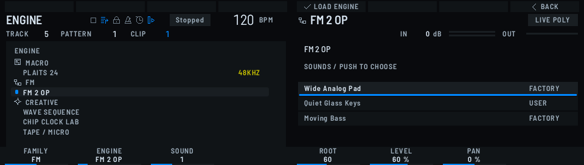

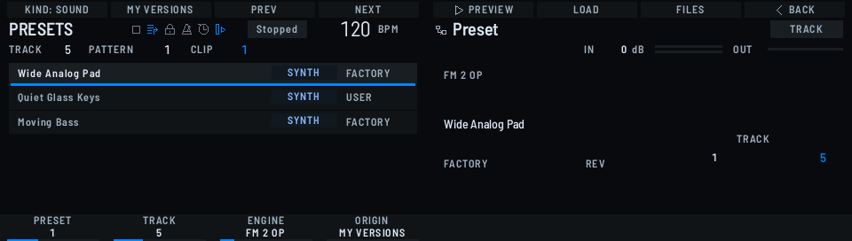

ORIGINのMY VERSIONSはUser優先で、User版のない音色はFactoryを表示します。ORIGINALSはFactory原本を表示します。ENGINE下段で選んだ位置は一覧へ引き継ぎ、戻ると元の位置を復元します。

保存形式はMGXC13です。旧形式のファイルは移行せず、エラーを表示して現在の内容を保持します。KitのSMF／外部MIDIは境界でGM変換し、パッドの内部順序は変わりません。SMFで未対応の音はEmptyの空きTrackへ元のGM音高で退避し、空きがなければ件数を表示して落とします。Emptyには発音音源がないため、音源を装着してから聴いてください。SF2のbank 128はパッドのフレーズをGMキーへ変換し、旋律bankは変換しません。

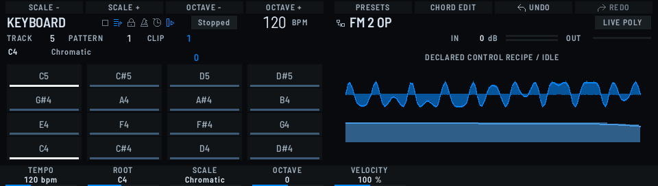
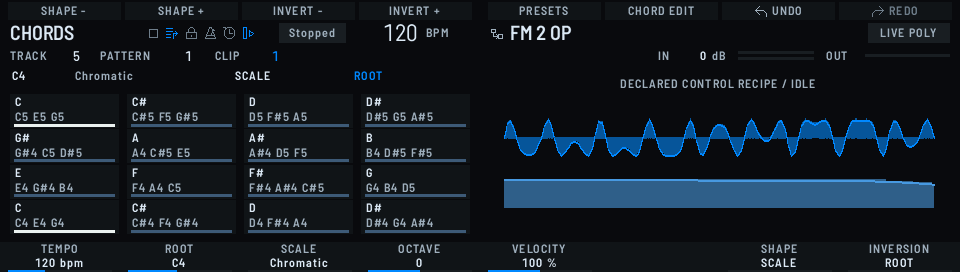

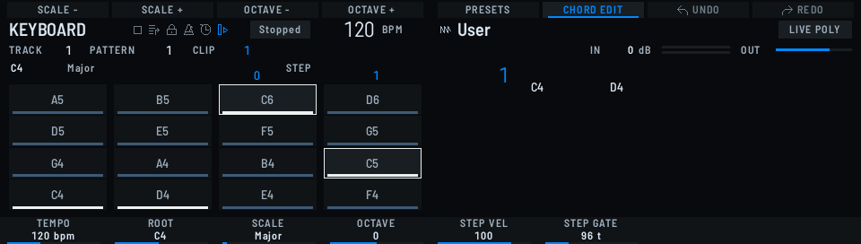

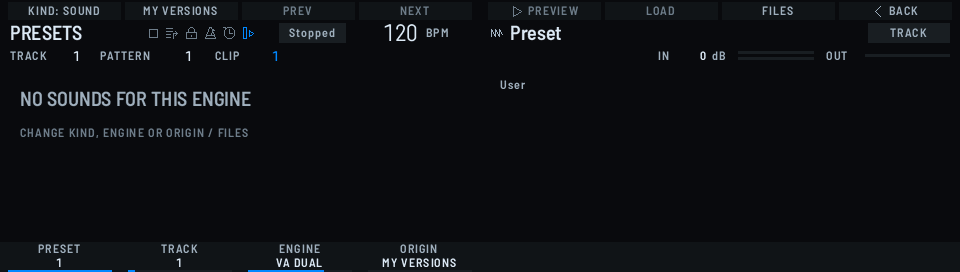

和音の保存・入力は最大8音／Stepですが、発音数は音源と共有ボイスの空きに依存します。Plaitsはモデル別のcostに従い最大1／2／4音となり、たとえばモデル8は最大2音です。追加DSPの4枠とweighted予算4を全Trackで共有します。全16Trackで同時に4音を保証しません。Creative系は単音のままです。

### 3-3. 手弾きを録る

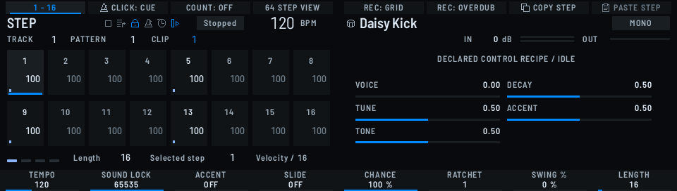

1. <strong>STEP + SHIFT + Top5</strong>で`REC: GRID`を選びます。自由なタイミングを残したい場合は`REC: FREE`。
2. <strong>SHIFT+Top6</strong>は`REC: OVERDUB`にします。`REC: REPLACE`はRECを入れたTrackの既存ノートを通過位置で消して入れ替えます。最初はOVERDUBを使います。
3. 必要なら<strong>SHIFT+TAP</strong>でクリック、<strong>STEP + SHIFT + Top2</strong>で`CLICK: CUE`または`MAIN`、<strong>SHIFT+Top3</strong>で`COUNT: 1 BAR`。
4. <strong>KEYBOARD</strong>または<strong>PAD MODE</strong>へ移り、<strong>REC → PLAY</strong>。または停止中に<strong>SHIFT+REC</strong>でCount-inつき記録開始。
5. 1小節弾いて<strong>REC</strong>を再度押し、記録を解除。<strong>STOP → PLAY</strong>で聴き直します。
6. 必要ならSTEPへ戻り、EVENTS／SHIFT+EVENTS。ノート開始と長さ更新などは複数のUndoになる場合があります。

このRECは<strong>音符の記録</strong>です。SAMPLER画面のRECは音声録音に切り替わります。Count-in中は弾けますがノートは記録されません。外部Clock追従中はCount-inを使いません。

### 3-4. ノリと音色の動きを付ける

| やりたいこと | 操作 | 聴くポイント |
|---|---|---|
| ハットに揺れ | STEPでSHIFT+K7 `SWING %` | 偶数側のタイミングが変わる |
| ときどき鳴る装飾 | 対象Stepを選びK5 `CHANCE`を下げる | 毎周鳴らない。Seed等の条件に従う |
| 細かい連打 | K6 `RATCHET`を増やす | Gateと重なりを聴く |
| 1打だけ暗くする | Step選択→PLUG-INのTONEでSHIFT+Cutoffノブ | 次のStepで基底／他の層に戻る |
| 16/32/64…Stepに伸ばす | STEPのK8 `LENGTH`、4-D左右でページ | ページ変更は長さ変更ではない |
| リズム生成 | VARIATION → GENERATE / RHYTHM | 現在Trackを書き換える。UNDO可能 |

KitではEUCLIDEANとDICEが現在選択中のPadを編集します。ROTATEはTrack内の全16 Padと共有ロック列を一緒に移動します。対象PadはSTEP＋SELECT＋Padで選びます。UNDOで戻せます。

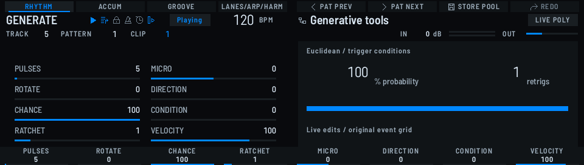

---

## 4. サンプルから作る／DRUM KITで作る

### WAVを試聴して割り当てる

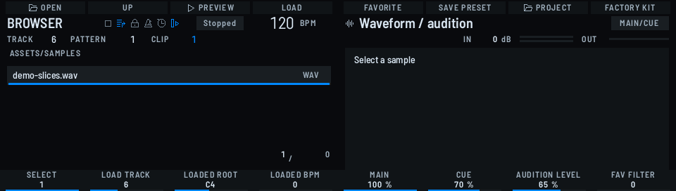

1. <strong>BROWSER</strong>。4-D回転またはK1 `SELECT`で選択。Top1 `OPEN`でフォルダーへ、Top2 `UP`で親へ戻ります。WAVのOPENは試聴として働きます。
2. WAVを選び<strong>Top3「PREVIEW」</strong>。Cueへ鳴ります。K6 `CUE`とK7 `AUDITION LEVEL`を確認。Mainだけ聴いていると聞こえません。Top3 `STOP PREVIEW`で終了します。
3. K2 `LOAD TRACK`で割当先を確認し、<strong>Top4「LOAD」</strong>。TrackがSamplerになります。Kitを選んでいれば選択Kit padへの割当です。
4. <strong>SAMPLING</strong>へ移り、パッドで再生。Kなどの`SAMPLE ROOT`／`SAMPLE BPM`は素材のメタデータで、BPM自動解析や受信機からの値読戻しではありません。同じ素材を使う保存済みPresetや他Trackがある場合でも、ROOT／BPMの変更は選択中の作業音色だけへ分岐します。素材PCMを複製する操作ではなく、Undoで戻せます。

対応WAVはPCM8/16/24/32とFloat32。素材参照は保存時にコンテナ相対、実行時にDATAルートへ解決されます。音が鳴っているWAVをPCから同じ名前で上書きする運用は避け、別名で読み込みます。読み込み失敗時はメッセージと元のTrackを確認し、OPENを連打しないでください。

### トリム、スライス、ループ

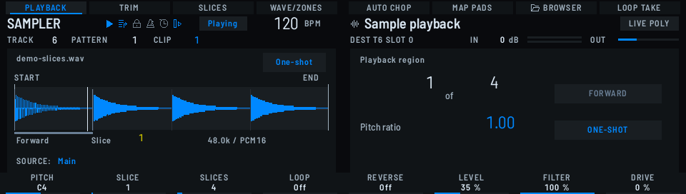
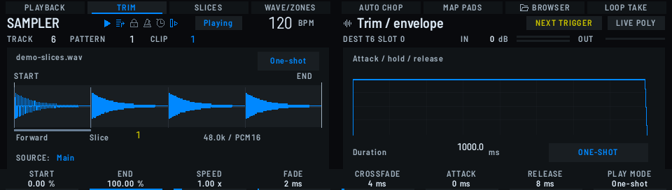
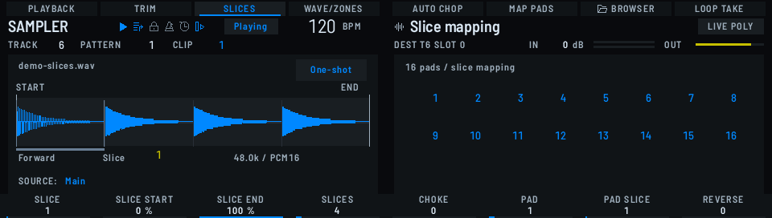

| 操作 | 手順 |
|---|---|
| 余分な前後を切る | SAMPLING → Top2 `TRIM` → K1 `START`、K2 `END`。K4 `FADE`、K5 `CROSSFADE`で境界を調整 |
| 自動スライス | Top3 `SLICES` → Top5 `AUTO CHOP` → Top1 CONFIRM。K1でSlice、K2/K3で境界を修正 |
| スライスをパッドへ | Top6 `MAP PADS` → Top1 CONFIRM（SHIFTなし）。DrumKitは同一Kit内の16 padへ、Samplerは選択素材のsliceを16 Trackへ割当て、Track設定と編集中patternのstepsを置換する。UNDOで戻せる。SHIFT+Top8 `CHOP STEPS` → Top1 CONFIRMは選択Trackのstep列へslice順のフレーズを配置する |
| WAV内のループを使う | WAVE面のSHIFT+Top8 `FILE LOOP` → Top1 CONFIRM。対応する前向き無限`smpl` loopのみ。SliceとReverseを解除。ループ前のアタックは再生しない |
| 波形・時間伸縮 | 4-D右でWAVEまで移動。Top5 `STRETCH`で確認画面。表示された比率を調整して実行／取消 |
| キー／Velocity範囲 | 4-D右でZONESへ。K5 `ZONE`、K6/K7範囲、K8 `ROOT`。4-D押下でKey/Velocity編集切替 |

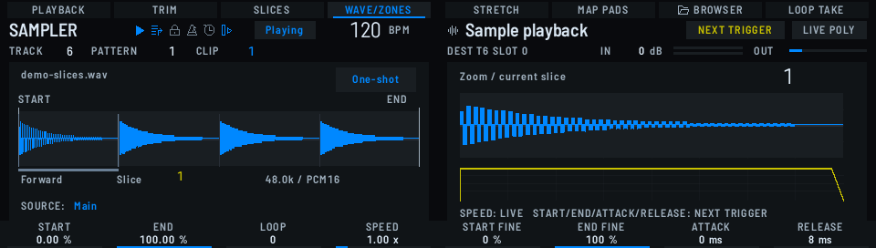
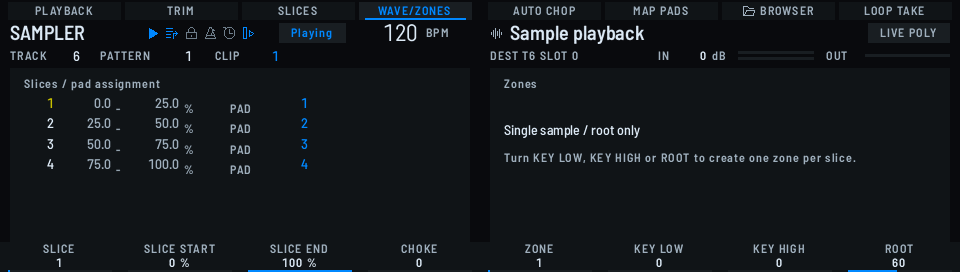

ZONESで<strong>SHIFT+4-D押下</strong>は選択SliceのWARPを切り替えます。素材BPMとTempoに従う再生速度変更で、WAVE/STRETCHのオフライン処理とは別です。波形は素材のPreview/Load後に解析されます。Browserの一覧を開くだけでは素材の解析・試聴は始まりません。

鳴らしている最中に素材を差し替えても、保持中のノートは元の素材と音高基準のまま鳴り続け、新しく発音するノートから新しい素材を使います。

### DRUM KITの入力

1. ENGINEで<strong>DRUM KIT</strong>を選ぶか、BROWSERの<strong>Top8「FACTORY KIT」</strong>で既定の`FACTORY/KITS/Techno-01.mgxk`を読み込みます。カードにその素材が必要です。
2. <strong>PAD MODE</strong>では16個のパッドがKit内の音になります。A–Hは依然としてTrack選択です。
3. <strong>STEP + SELECT + Pad</strong>で編集するKit padを選びます。SELECTを離してStepを入力します。SamplerでもSELECT+Padで対象を選べます。
4. <strong>SAMPLING → LAYERS</strong>でVelocity layer等、<strong>CHANNELでFX → PAD INSERT</strong>でKit padのFX。画面上のPAD番号を常に確認します。
5. <strong>MUTE/SOLO + Pad</strong>はこのKit内部の音を対象にします。Kitを選んだままTrack muteのつもりで操作しないでください。

---

## 5. 音声を録る：4種類を使い分ける

| 機能 | 使う場面 | 保存先／結果 |
|---|---|---|
| REC INPUT / REC SOURCE | これから入る外部音・内部busを録音 | `RECORDINGS/Live-NNN.wav`。対象へ割当 |
| CAPTURE | 今鳴った音を最大4秒さかのぼる | `RECORDINGS/Take-NNN.wav`。通常録音とは別のRAM履歴 |
| RESAMPLE | 再生中の1–4小節を録音して素材化 | 通常録音と同じLive系WAV。FX込みのbusも選択可能 |
| OVERDUB IN / SRC | 条件の合うSamplerループに入力を足す | 検証・ミックス後`RECORDINGS/Dub-NNN.wav`。任意のループへの無条件重ね録りではない |

### 外部Inputを録音する

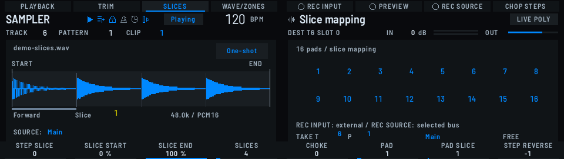

1. 外部音源のLINE OUTをMK3のLINE INへ接続。最初はROUTINGの`MONITOR`をOFF、外部音源側を低めの音量にします。
2. <strong>録音を入れたいTrack</strong>をA–Hで選びます。KitならSAMPLINGでSELECT+Padを使い、録音先padも指定します。
3. <strong>SAMPLING + SHIFT + Top5「REC INPUT」</strong>。外部Inputを録ります。ROUTINGのCAPTURE BUSがMainでも、この操作はInputです。
4. 音を鳴らします。再生中で`REC MODE`の量子化がONなら次小節まで`ARMED`。<strong>Transport停止中なら量子化設定ONでも即時録音</strong>です。
5. <strong>SHIFT+Top5「STOP RECORD」</strong>で止めます。`STOPPING`中は保存処理の完了を待ちます。物理STOPはTransport停止で、通常の自由録音が終わるとは限りません。
6. 完了後、<strong>SHIFT+Top6「PREVIEW」</strong>でCue試聴。パッド／Stepで鳴らすとTrim等も適用されます。最後に<strong>SHIFT+FILE</strong>で割当を含むProjectを保存します。

本機では<strong>録音ボタンを押した時点のTrack・Pattern・Kit pad・source・量子化設定を固定</strong>します。録音中に別Trackを選んでも、そのTrackへ勝手に割り当てません。ただし元の対象を編集して整合しなくなった場合などはWAV保存だけになり、自動割当は拒否されることがあります。下部の録音先・source表示と完了メッセージを見ます。

`REC SOURCE`でInputを選んだ場合、音声源は同じInputでもハイライトはREC SOURCE側です。これは操作の開始元を示します。`BAR / FREE`は<strong>録音開始時の同期状態</strong>で、停止量子化の全挙動を示す表示ではありません。

### Main/Cue、Track、Groupを録音する

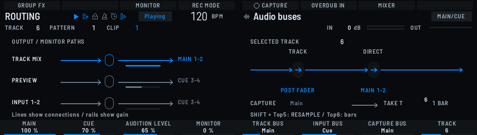
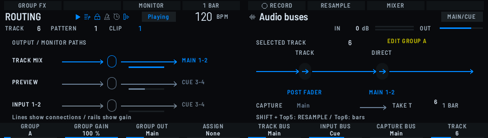

1. <strong>CHANNEL → ROUTING</strong>。GROUP FXが出ている場合はTop1 `MAIN / CUE`。
2. K7 <strong>CAPTURE BUS</strong>で録音源を選びます。Main / Input / Cueのほか、TrackのFader／Dry／Insert、Returns、Perform、Groupがあります。Track/Group番号も同じ値欄で確認します。
3. 連続録音は<strong>SHIFT+Top5「RECORD」</strong>、またはSAMPLINGの<strong>SHIFT+Top7「REC SOURCE」</strong>。停止は画面の`STOP RECORD`／`STOP SOURCE`。
4. 小節単位なら<strong>PLAY</strong>で再生し、ROUTINGの<strong>SHIFT+Top4</strong>で`1 BAR`～`4 BARS`を選び、<strong>SHIFT+Top6「RESAMPLE」</strong>。
5. `ARMED`→録音→完了を待ちます。途中で取り消すには<strong>CANCEL RESAMPLE</strong>。録音先の既存素材を保ち、その処理が所有する途中ファイルを取り除きます。

音声録音とArrangement takeは同時に開始できません。録音中は録音源や小節数を変更できません。Browserの一覧更新は録音等のファイル要求とは分けて扱います。録音の開始・終了は状態表示で確認します。

### CAPTUREでさかのぼる

1. 先にROUTINGのK7 `CAPTURE BUS`を決めます。<strong>sourceを変えると4秒履歴が消えます。</strong>
2. 数秒演奏し、割当先Track／Kit padを選び、<strong>SHIFTを離してTop5「CAPTURE」</strong>。
3. 保存／割当のメッセージを待ち、SAMPLINGで試聴します。Mainの1秒Performance FX履歴とは別です。

CaptureとOverdubも要求時の対象を固定します。対象の内容を後から編集して整合しなくなった場合は、別のTrackへ割り当てず処理を拒否します。完了メッセージを確認してください。

### 条件付きOverdub

1. まず1–4小節ちょうどの通常Sampler素材を用意します。<strong>SAMPLING + Top8「LOOP TAKE」</strong>は、確認後にその素材に合うStep構成を作る補助操作です。表示を読んで4-Dを押し込んで確定します。Kitは対象外。
LOOP TAKEは素材のrootに合わせたTrackと基準Stepを用意します。通常の速度で小節全体を再生できるか試聴してからOverdubへ進みます。

2. 対象は再生中のSampler Clip。素材は同サンプルレート、全範囲、速度1、Forward、One Shot、Sliceなし、Reverseなし。Step1だけを根音・確率100%で鳴らし、長さは小節数×16。Pitch変換やArp等の条件も制限されます。
3. ROUTINGでInput、または<strong>録音先を含まない別Track／Group</strong>をsourceに選びます。Main/Cue/Returns/Performを選んでもOverdubではInputへ置き換えられます。自分自身を録って増幅する経路は拒否します。
4. 再生中に<strong>Top6「OVERDUB IN」または「OVERDUB SRC」</strong>。source確認→小節録音→ミックス・検証→割当を待ちます。
5. うまくいかなければ、元の素材が残っていることを確認。`Overdub: 1-4 bar take / Input or other track/group`は総合的な拒否表示で、個別原因をまだ説明しません。

wet Resampleが使えることと、任意のFX付きループを自由にOverdubできることは同じではありません。迷ったら新しいTrackへRESAMPLEし、素材を比較してから構成を変えます。

---

## 6. ClipからScene、Sceneから1曲へ

### 別パターンを作る

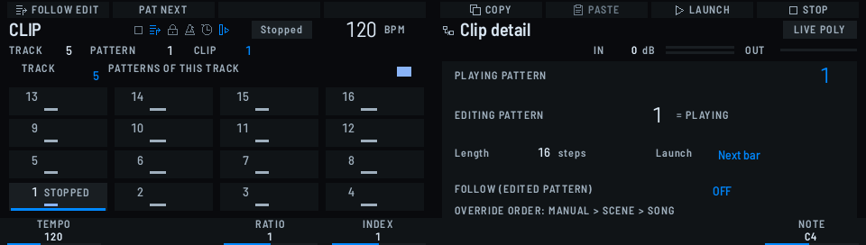

1. <strong>PATTERN</strong>でCLIPへ。4-DまたはSELECT+Padでコピー元の編集Patternを選び、<strong>Top5「COPY」</strong>。
2. SELECT+Padで別Patternを選び、<strong>Top6「PASTE」</strong>。Patternコピーは複数Trackのフレーズ・ロック・automation・起動時PRESET参照を含みます。音色の装着状態、ミキサー、insert FX、MIDI設定は永続Track側に残り、貼付けやそのUndoで巻き戻りません。
3. STEPへ戻りハットの密度やベースを変えます。
4. CLIPへ戻り、目的のTrackを選んでPadを押すか<strong>Top7「LAUNCH」</strong>。`NEXT`等の待機と、実際の再生Patternを区別します。<strong>SHIFT+Top7「LAUNCH NOW」</strong>は即時切替。
5. <strong>Top8「STOP」</strong>は選択TrackのClip停止。TransportのSTOPとは別です。

KitのPatternコピーは全16 Padの列も含みます。CLIPのSHIFT側「DOUBLE TRACK」は選択Trackを、SHIFT＋DUPLICATEはPattern全体を倍化し、Kitの打点も同じ長さだけ繰り返します。空きPatternの自動選択はKitの打点やautomationも使用中として扱います。

### フレーズを速く増やす

<strong>CLIPでSHIFT+K8 COPY SCOPE</strong>を **TRACK ONLY** にしてからTop5 COPY。別Patternを選んでTop6 PASTEすると、コピー元と同じTrack番号のフレーズだけを貼ります。locks、automation、Kitの全Pad列を含み、他Trackと永続Track設定は保持します。ALLへ戻すと従来の全Patternコピーです。

<strong>SHIFT+Top6 DUP + VAR</strong>ではK1で **THIN／TRANSPOSE／DROP TRACK**、K2で密度0–100%／±1–12半音／消すTrackを選び、Top1 APPLY。編集中Patternから次の空きPatternへ複製し、元は変えません。THINは同じproject seedと指定なら同じ結果。TRANSPOSEは既存のスケール吸着を通します。DROP TRACKは音源を残してフレーズを空にします。空きがなければ理由を表示し、作成全体を1回のUNDOで戻せます。

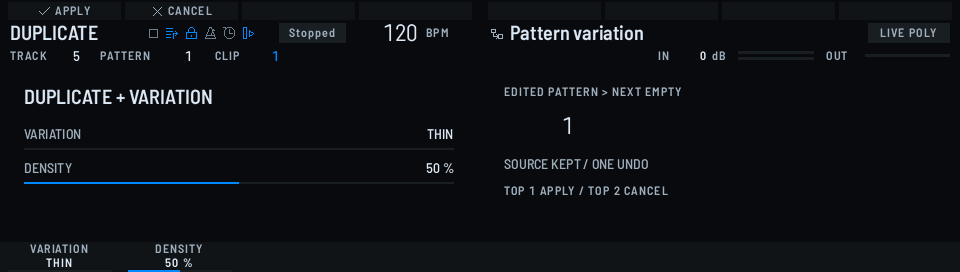

<strong>VARIATION → Top4</strong>を順に押すと **LANES → ARP → HARMONY**。HARMONYではK1 SOURCE TRACK、K2 TARGET TRACK、K3 MODEを選び、<strong>Top5 GENERATE</strong>。BASSは和音Stepの位置に対象Trackのオクターブのルート、ARPはコードトーンを16分で巡回する通常Stepを書きます。対象フレーズの置換は1回のUNDO。素材に保存された和音Stepがなければ拒否します。同じTrack同士やKit／AUDIOは使えません。

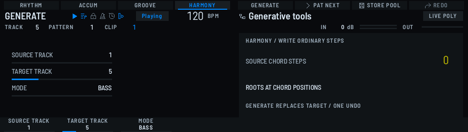

<strong>VARIATION → Top3 GROOVE → SHIFT+Top6 APPLY ALL</strong>で、EXTRACT済みのGroove（なければ表示中TrackのGroove）を16Trackへ一括適用し、1回のUNDOで戻します。現行のGrooveは永続Track設定のため、他Patternの同じTrackにも効きます。名前付きGrooveライブラリはありません。

### Clip Followを設定する

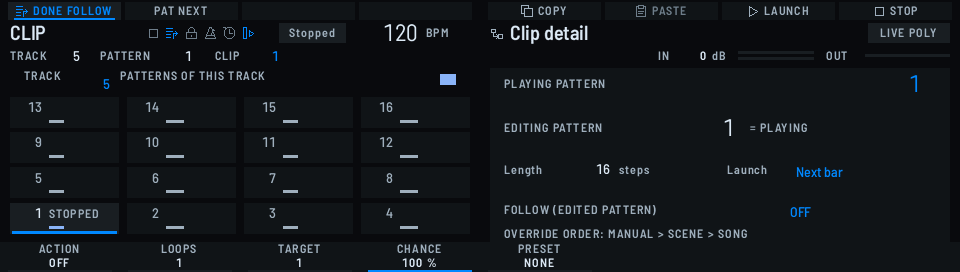

<strong>PATTERN → Top1「FOLLOW EDIT」</strong>。K1 `ACTION`はOff / Stop / Next / Target / Random、K2 `LOOPS`は1–64、K3 `TARGET`は1–16、K4 `CHANCE`は0–100%。K5 `PRESET`でNONE／1–256を選びます。NONEは現在の音色を維持し、番号を指定するとクリップ起動時にそのpool値をコピーします。起動後のpool編集は装着先へ波及せず、STOPでは再装着しません。空き枠・素材欠落の場合は起動を保留します。Top1 `DONE FOLLOW`で戻ります。

例: Pattern1を2周したらPattern2へ進めるには、ACTION=Target、LOOPS=2、TARGET=2、CHANCE=100%。Pattern2側にも設定すれば循環できます。手動launchやSongとの優先関係があるため、最初はSongをOFFにして単独で確認します。

### 画面で編集と再生を見分ける

CLIP左は<strong>選択TrackのPattern一覧</strong>。下端の短い棒は打点密度です。右の **PLAYING PATTERN** と **EDITING PATTERN** が違えば **NOT PLAYING** が出ます。FOLLOWは編集中Patternの設定です。SCENE左の **LIVE** と選択Sceneも別で、右は **TRACK → PATTERN** の対応表。琥珀の下線はlaunchで割当が変わるTrackを示します。

### Sceneを保存する

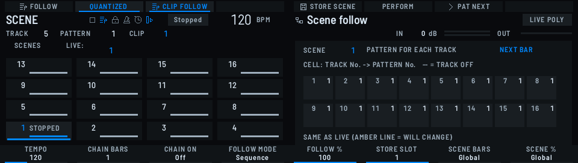

1. イントロ用に各TrackのClipを起動／停止し、切替が実際に反映されるまで待ちます。
2. <strong>SCENE</strong>でK6 `STORE SLOT`を1にし、<strong>Top5「STORE SCENE」</strong>。または<strong>SELECT+Pad1</strong>でそのslotへ直接保存。
3. ベース・ハットを加えた構成を作り、slot2へ保存。
4. SCENEのPad1／Pad2で切り替えます。Top2 `QUANTIZED / IMMEDIATE`が切替タイミングです。
5. SHIFT+Scene PadでChainに追加し、Top1 `FOLLOW`で自動進行。物理FOLLOWボタンは画面追従なので区別します。

<strong>SHIFT+Top5 DUP SCENE</strong>は、選択中Sceneを空きslotへ複製します。K1 DEST SCENEを選びTop1 APPLY。複製だけではlaunchせず、1回のUNDOで戻せます。現在LIVE／待機中／Song・Chain参照中／設定入りのslotは拒否します。保存済みflagがないため、初期値と同じSceneを意図的に保存したかは識別できません。

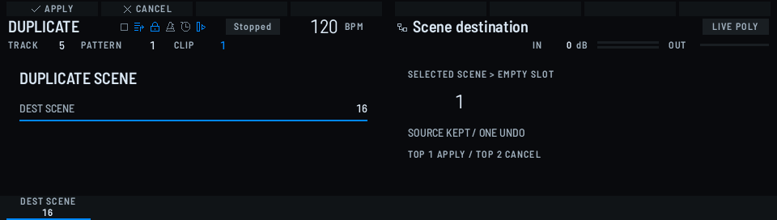

### 手で並べてSongを作る

空のSONGで<strong>Top6 SKELETON</strong>を1回押すと、Scene1–5を参照する **4／8／8／8／4小節**の5セクションを置き、LOOPをONにします。Scene・小節数・移調は既存ノブで編集できます。3種類のSceneを使う場合は参照を差し替えます。既存セクションがある場合は上書きせず拒否し、骨格全体を1回のUNDOで戻せます。

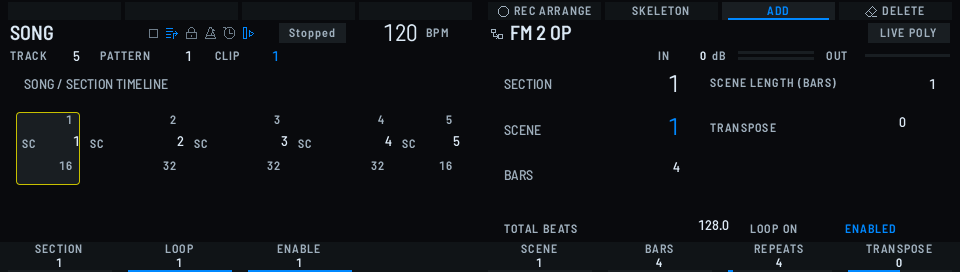

SONGのタイトルは常にSONG。Chainだけを覗いている場合は **CHAIN PREVIEW**、演奏を記録した区間は **SNAPSHOT (FROZEN CLIPS)** と表示し、右の表はSceneと同じTrack→Patternの読み方です。タイムライン下の長さは拍数、右のBARSは小節数です。

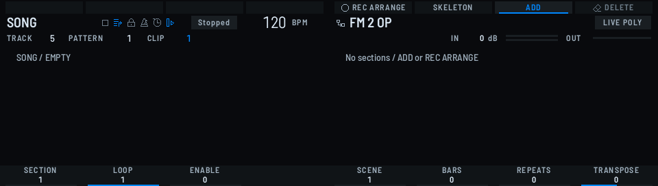

<strong>ARRANGER → SONG</strong>。Top7 `ADD`、Top8 `DELETE` → Top1 CONFIRMで最大32セクション。K1 `SECTION`、K2 `LOOP`、K3 `ENABLE`、K5 `SCENE`、K6 `BARS`、K7 `REPEATS`、K8 `TRANSPOSE`を使います。例としてScene1を4小節、Scene2を8小節、Scene1を4小節にします。<strong>K3 `ENABLE`をONにし、STOP → PLAYで曲として再生</strong>します。K2 `LOOP`で曲全体を繰り返すか選びます。

Chainから取り込む場合は空のSongで<strong>SHIFT+Top7「IMPORT」→ Top1 CONFIRM／4-D押込み</strong>。既存Songを消すSHIFT+Top8 `CLEAR` → Top1 CONFIRMも二段階です。パッドはセクションのMute編集で、Scene launchではありません。

### 実演をArrangementへ記録する

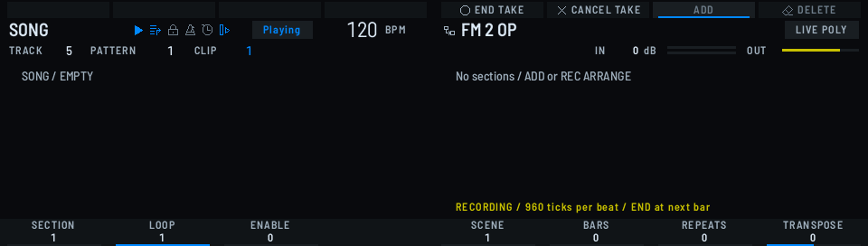

1. ノート録音・音声録音を終え、Transportを<strong>STOP</strong>。
2. <strong>ARRANGER → Top5「REC ARRANGE」</strong>。開始操作自体がTransportを始動します。
3. <strong>SCENE</strong>や<strong>PATTERN</strong>へ移って演奏します。Clip／Scene切替、停止、Mute、Followによる構成変化を記録します。
4. <strong>ARRANGERへ戻る → Top5「END TAKE」</strong>。次の小節境界まで待ち、`Arrangement stored / one Undo restores previous Song`を確認。
5. <strong>PLAY</strong>で先頭から聴き直し、<strong>SHIFT+FILE</strong>でディスクへ保存。取り消すなら記録中のTop6 `CANCEL TAKE`。完了後はEVENTSで前のSongへ戻せます。

記録後はセクションのK5/K6/K7が<strong>TRACK / TICKS / PATTERN</strong>になります。960 ticks＝4分音符、4/4の1小節は3840 ticks。混在Clipの位相と再始動情報を保持しますが、<strong>選択セクションからの途中再生・捕捉位相へのSPP/Continueは未対応</strong>です。これは音声ファイルの録音ではなく、ノブ操作すべてを録る機能でもありません。32区間を超えるtakeは失敗として元のSongを保持します。

---

## 7. ミックス、Automation、演奏効果

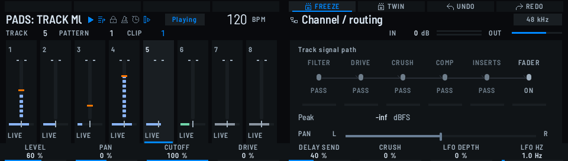

MIXERのTop5はFREEZE、Top6はTWINです（上図の凡例とは異なります）。PAT NEXTはSHIFT＋Top5。TWINの詳細は[TWIN](twin.md)を参照してください。

メーター本体はTrackの種別色、ピーク保持の短い横線はmotion色です。警告域はwarn、過大・クリップはdangerが優先します。MASTER／入力の本体は中立色。MONOTONEでは本体の種別色を灰へ投影します。
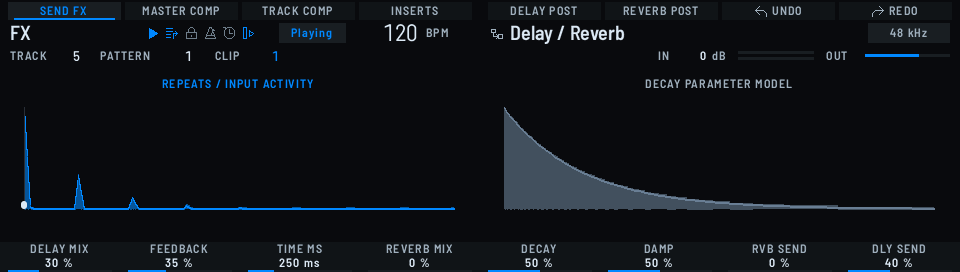
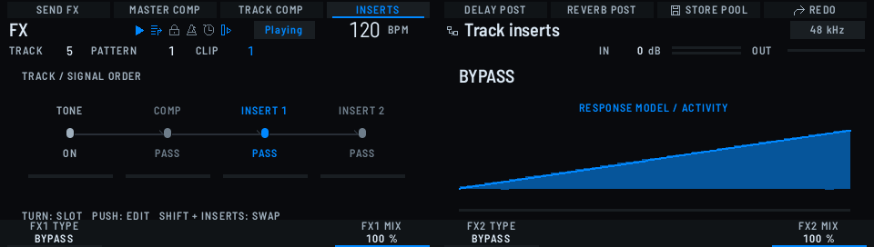

<strong>MIXER</strong>でレベル、<strong>CHANNELでFXへ</strong>移ってDelay／ReverbのSend、Master／Track Compressor、INSERTSを調整します。ラベルは選択ページで変わるため、K番号だけを暗記せず名称を見てください。FX INSERTSは2slot、Kit padやGroupにも専用編集があります。任意の配線を自由に作るFXグラフではありません。

<strong>MIXER → Top5「FREEZE」</strong>は選択Trackを音声素材化して負荷を下げる操作です。`UNFREEZE`やUndoで元の音源へ戻せます。実行中の画面を見て完了を待ち、元の楽器と同じ音・長さになるか試聴します。

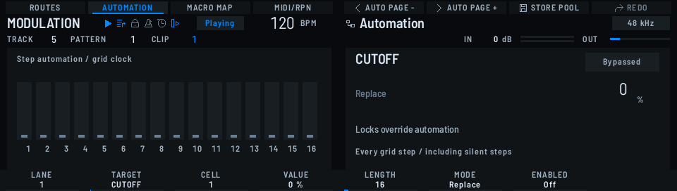
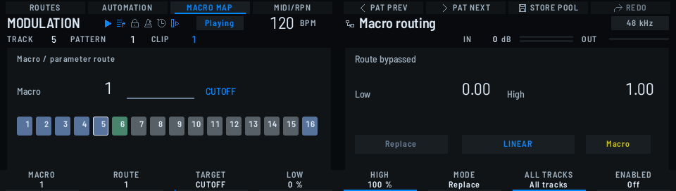

| 目的 | 手順 |
|---|---|
| Cutoffを周期的に動かす | AUTO → Top2 `AUTOMATION`。K1 LANE、K2 TARGET、K3 CELL、K4 VALUE、K5 LENGTH、K6 MODE、K7 ENABLED。PadでCell選択、Top5/6で16セルページ移動 |
| 1ノブで複数対象を動かす | AUTO → Top3 `MACRO MAP`。MACRO／ROUTE／TARGET／LOW／HIGH／MODE／ALL TRACKS／ENABLEDを設定。MACROボタンで8ノブ演奏 |
| 2つの音色状態を往復 | PERFORM → `STORE A`、音色を変えて`STORE B`。Smart StripかA/B MORPHを操作。STOREは永続基底値を捕捉し、Lock等の一時状態は含めない |
| 一時的に全Trackを変える | PERFORM → `CONTROL ALL`。4-Dで対象選択、Stripで相対変化、4-D押下で中心へ |
| 手の動きをループ | PERFORM → Top3 `GESTURE` → RECORD →ノブ操作→ END RECORD → PLAY LOOP。最大128点 |
| 演奏FX | PERFORM → Top7 `LIVE FX`。パッドの画面表示に対応したFXを保持。SHIFT併用はLatch。TRIGGER NOW/BEAT/BAR、RELEASE TAIL/DRYを選べる |

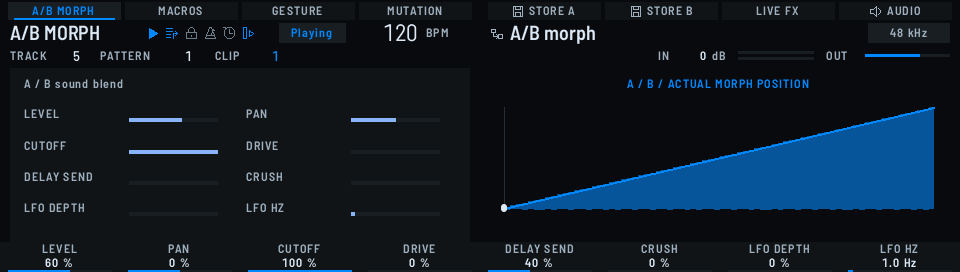
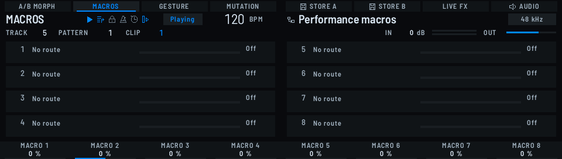
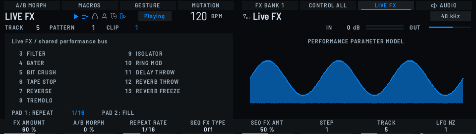
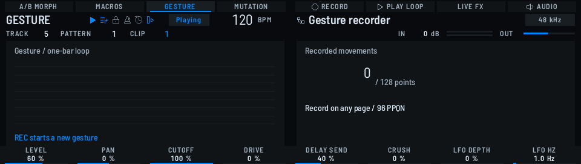

音色の最終値は概ね <strong>基底→Morph→Automation→Gesture→Macro→Lock→Control All→平滑化／Modulation</strong>の順で決まります。ノブの基底を変えてもLockやMacroが上書きしていると、その瞬間の音は変わらないことがあります。`RESET LIVE`はMorph・Macro・Control All・一時FXを解除しますが、Step側のAutomation／Lockまで消しません。

#### TWIN：重い音源を準備済みのサンプル版へ切り替える

**MIXER → Top6 TWIN** は、未準備なら自動取り込みを始めます。先に
**SHIFT＋Top6 TWIN** で範囲を設定できます。K1 LOW NOTE／K2 HIGH NOTE／
K3 INTERVAL（半音）／K4 VELOCITY／K5 HOLD MS／K6 LIMIT MSです。
最大16音・ベロシティ1層。設定画面の音数が上限を超えるとPREPAREできません。
Transportを止めるか、対象Clipを停止してください。取り込み音はMain／Cueへ出ず、
進捗が表示されます。Top1 CANCELまたはSTOPで取消すと元の割当を保持します。

**TWIN READY** のTrackでTop6を1回押すと、再生を続けたまま次小節で
**TWIN ACTIVE**（Sampler版）へ切り替わります。同じTop6をもう1回押すと
次小節でシンセ版へ戻ります。停止中は直ちに切替。Top6 LEDはREADYで弱い点灯、
ACTIVEで強い点灯、予約中は速い点滅。音源を編集すると **TWIN STALE** と遅い点滅に
なり、Top6で再準備します。FREEZEはフレーズそのものの録音、TWINは各音高を
別々に収録した鍵盤用楽器です。PAT NEXTはSHIFT＋Top5にあります。

曲をSAVEすると対と素材参照が残ります。素材を移動するときはCOLLECTも使ってください。
ACTIVE中に通常のSAVE PRESET ASを使えば、サンプル版だけを名前付きPresetとして
保存できます。そのPresetを選んでCOLLECTするとWAVも持ち出せます。
サステインloopは自動生成せず、長い音はLIMITまでの長さです。初回準備にはPool2枠と
素材1枠が必要です。
詳しい制約は[TWIN](twin.md)を参照してください。

### Stripで演奏する

| 物理ボタン | Stripを触っている間 | 指を離すと |
|---|---|---|
| PITCH | 現在のTrackへ中心基準の約±2半音を加算。MIDI OUTでは14-bit bend | 元の解決済みbendへ戻る |
| MOD | 内部音源はフィルタLFO深さへ加算。MIDI OUTはCC 1 | 加算を除き、CC 1は元の値へ戻る |
| NOTES | Trackのrootから2オクターブの範囲。位置を動かすと旧Note Off→新Note On。既存のscale／transposeを適用 | Note Off |
| PERFORM | 従来のMorph／演奏FX | 従来の動作 |

PITCH／MOD／NOTESはPERFORM画面以外でも使える。触り始めたTrackに対象を固定し、Track／Pattern切替、モード切替、STOP、Panic、入力切断時の解放を処理する。DSPキューが満杯なら解放要求を保持して再送する。NOTESの入力識別子は外部MIDI入力・物理パッドと分けた。

Stripの値は保存されるパラメータbaseやUndo履歴を書き換えない。NOTESはNote録音経路を使用する。MODの動き自体を新しいオートメーションレーンへ録音する機能は追加していない。外部音源のbend幅は外部音源側の設定にも依存する。MODが聞こえるかはCutoff、LFO Rate、音源の発音状態に依存する。

#### シンセ編集とTop／ノブの使い分け

左LCDは既存K1–K8の名前・値・形を2列に並べます。右LCDは宣言に応じた実PCM、FFT、倍音、scan位置、またはTONE／ADSRの模型を表示します。模型と実測の違いはcaptionで読みます。MIDI OUTはMIDIの経路と外部制御の編集を維持します。

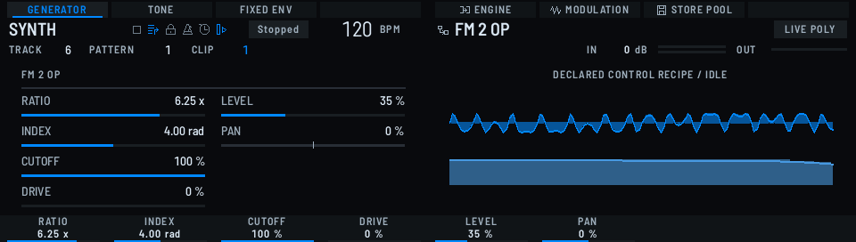
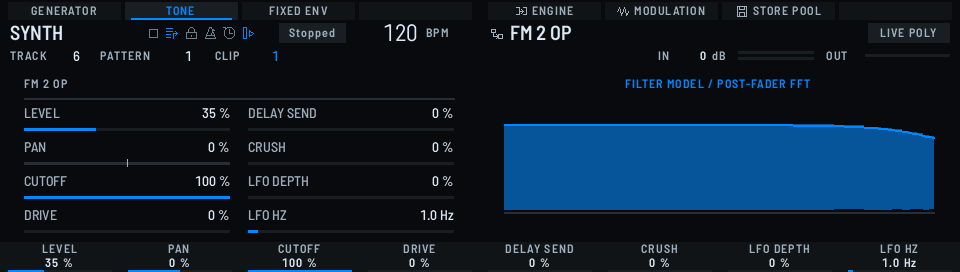
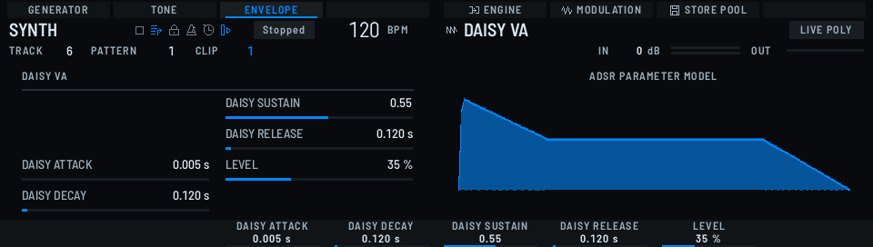
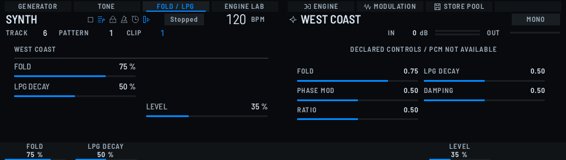

| Top | 割当と使い分け |
|---|---|
| 1 | GENERATOR。MIDI OUTはMIDI OUT、Drum KitはKIT |
| 2 | TONE。Filter／Drive／Sends／Level／Pan／LFOの共通編集 |
| 3 | 編集可能ならENVELOPE／LPG／FOLD / LPG。固定カーブはFIXED ENV。対応のない音源は空欄・無効。Sampler／KitはTRIMへ直接移動 |
| 4 | Creative音源はENGINE LAB、TEXTUREはINPUT / QUALITY。それ以外は空欄 |
| 5 | ENGINE選択。Family／Engine等の専用ノブに切替 |
| 6 | MODULATION。全音源共通。Sampler編集は物理SAMPLINGから |
| 7 | 空きslotではSTORE POOL。PROJECT K4 POOL SLOTで登録先を選ぶ |
| 8 | 登録枠がある場合だけRECALL POOL。ENGINE選択中はBACK。SHIFT+Top4はMIDI OUTのWAVE PROFILE |

Layerでは左Top1 LAYER／Top2 TONE、LAYER面の左Top3 USE CHILD／Top4 REMOVE（ページ選択の無い左枠を使う例外）。削除はTop1確認／Top2取消。ENGINEのTop5 LOAD ENGINEで既定音色を装着し、4-D押下は音色一覧へ降ります。ノブ回転だけでは装着しません。

装着できないLayerの理由を演奏画面右ヘッダーに表示します。`LAYER REFUSED`と、その下の予算・素材などの理由を確認してください。部分的に鳴らすために受付条件を緩める動作はありません。

音源別の操作名と有効状態は[生成したSynth操作表](manual/synth-control-audit.tsv)を参照してください。Kit以外の内部音源はSHIFT+Top8でBAKE PRESETへ進みます。

#### ルーパーとSongのAUDIOトラック

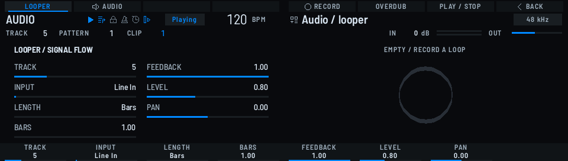

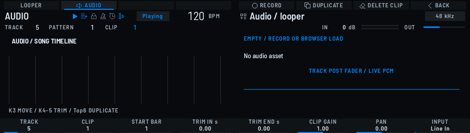

**PERFORM → Top8 AUDIO**を正規入口にします。音声枠を選んでもSTEP／SYNTH等を暗黙にAUDIOへ転用しません。**Top1 LOOPER**、**K2 INPUT**、**K3 LENGTH**、**K4 BARS**を選び、**PLAY → Top5 RECORD**。録音中の再押下がSTOPです。**Top6 OVERDUB**で重ね、**K5 FEEDBACK**で前のループを残す割合を調整。**SHIFT+Top6 TAKE UNDO**、通常**Top7 PLAY / STOP**。音声枠は合計4つ、録音は1つです。

**Top2 AUDIO**ではSongタイムラインへ録音できます。**SHIFT+Top8 SONG**へ戻って区間とSong再生を用意し、同じ入口からTrack／CLIPを選びます。**Top5 RECORD → 再押下**で小節単位のパンチイン／アウト。**K3 START BAR**、**K4／K5**でtrim、**Top6 DUPLICATE**、**Top7 DELETE CLIP → Top1 CONFIRM**、**SHIFT+Top6 TAKE UNDO**。**SHIFT+Top7 CLEAR**も確認を通ります。Tempoで音声速度は変えません。[全操作と境界](audio-tracks.md)。

---

## 8. 保存して再開する／PCへ持ち出す

### 通常保存・SAVE AS・再開

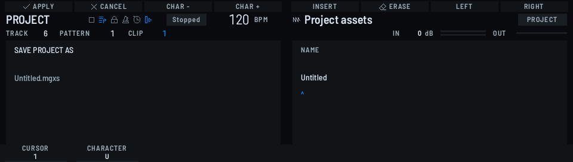

1. 音声録音をSTOP RECORDで終え、ファイル処理完了を待ちます。**FILE → Top1 SAVE**または**SHIFT+FILE**。
2. 新規曲の初回SAVEは命名画面を開きます。既存曲を別名に分けるときは**Top4 SAVE AS**。
3. **K1 CURSOR**で文字位置、**K2 CHARACTER**または4-D回転で文字。Top5 INSERT、Top6 ERASE、Top7 LEFT、Top8 RIGHTで編集します。
4. **Top1 APPLY**または4-D押下で保存、Top2 CANCELで中止。ソング用の`.mgxs`を自動補完します（入力したMGX家族の拡張子も置き換えます）。SAVE ASで既存名を指定しても上書きしないので、別名を入力します。
5. 完了後のSAVEはその曲自身を更新します。**Top2 OPEN / Top6 FILES**で現在曲のフォルダーを開き、Browserで別の曲をOPENすると、以後のSAVE先もその曲になります。大文字・大小混在のMGX/MGK/MGPも扱います。
6. 保存・読込み成功後、起動曲を`GROOVE/CURRENT.TXT`に記憶します。起動時の参照が無効・欠落なら`FACTORY/DEBUG/Benchmark.mgxs`を試します。再起動後に曲名・音符・音色・Song・素材を確認します。Undoや演奏中の一時状態は再開対象ではありません。

PROJECTのTopは **SAVE / OPEN / NEW / SAVE AS / COLLECT / FILES / STORE POOL / RECALL POOL**。素材番号は**K1 ASSET**。MGX家族の内部形式はMGXCです。`.mgx`／`.mgxs`／`.mgxk`／`.mgxp`はすべて読込み対象で、名前と中身が違っても内部種別で開きます。通常SAVEは既存の名前を維持し、SAVE ASで標準拡張子に揃います。通常保存は履歴バックアップを作らず、検証した`.tmp`から切り替えます。OPENは元ファイルが使えないときだけ同名`.tmp`も調べ、復旧時は`Recovered .tmp`を表示します。破損した元ファイルとtmpが残ってSAVEを拒否された場合は、OPENで復旧して別名SAVEしてください。過去の`.bak`／番号付き世代は読みません。書込み中の電源断に対する保証はありません。保存失敗・同期警告を成功と扱わず、完了を待ちます。

### 素材ごと持ち出す：COLLECT

1. **FILE → Top5 COLLECT**。BrowserのTop7 PROJECTからも同じ画面へ戻れます。
2. 完了表示の`<曲名>-Export/`を確認します。中に`project.mgxs`と`assets/`が入ります。
3. 録音・保存を終了して電源を切り、SDのDATAから**フォルダー全体**をPCへコピーします。Projectだけでは参照WAVは付いてきません。
4. コピー先のProjectを同じ版のDesktop backendなどで開き、素材欠落がないか確認します。

COLLECTは元曲の通常SAVE先を変えません。音声ミックスダウンでもありません。

### Kit / Presetを使い回す

| 操作 | 実際の手順／保存先 |
|---|---|
| Kit／Presetの通常保存 | SELECT＋4-D押下、または音色一覧でSHIFT＋Top5 STORE FILE。FactoryはUser版へ保存 |
| 名前付き保存／別物として複製 | 音色一覧でSHIFT＋Top6 STORE AS／SHIFT＋Top7 DUPLICATE → 名前入力 → Top1 APPLY |
| 読込 | BROWSERで内部表示がKIT／PATCHのファイルを選択しLOAD。対象Trackを先に確認 |

保存先は単体音色が`PRESETS/<名前>.mgxp`、Kitが`KITS/<名前>.mgxk`です。名前の入力はK1でカーソル、K2または4-D回転で文字を変更し、Top5 INSERT／Top6 ERASE、Top1 APPLYで保存します。同名ファイルがある場合はTop1 OVERWRITE／Top2 CANCELで選びます。ファイル棚BROWSERのSHIFT+Top6はRENAMEです。プリセットをOPENしてもTrackの音量・pan・MIDI ch・root noteとフレーズは維持します。FXは通常維持し、INCLUDE FXをONで保存したPreset／KitはInsert／sendをまとめて装着します。名前入力のK4 DUPLICATEをONにすると新GUIDの別音色になります。Kitはパッド定義だけを交換し、既存のパッドStepを残します。

STORE POOL／RECALL POOLは256枠を使います。Kitのパッド定義、MIDI OUTのProgram／CC、DaisyのADSRも保持します。RECALL後の編集は装着先だけに反映し、元のpoolを変えるにはSTOREし直します。名前付き保存／装着はGUID/revの同梱定義をpoolへ登録し、同じものの再装着では枠を増やしません。サンプルが未読込みのSampler／KitはRECALLできません。ファイル棚BROWSERでPreset／単一Drum Kitファイルを選び、Top3 PREVIEWで選択トラックへ一時装着して試聴できます。Top3 STOP PREVIEWで元へ戻ります。WAVのCue試聴とは異なり、そのトラックの音量・FX・出力先・ミュートを使います。停止中は1音を試聴し、再生中は選択トラックのフレーズにも反映します。ファイル選択・トラック・画面の変更、編集、Transport操作、プロジェクト読込みでも解除します。試聴中に保存しても元の音色が保存され、Undo履歴やpool枠は増えません。読込み中もSTOP PREVIEWで取消できます。

トラック名は音色名と独立しています。SYNTHでSHIFT＋Top6 TRACK NAMEから編集し、空欄で音色名／楽器名へ戻せます。音色交換・SMF名取込み後も曲へ保存され、Undoできます。曲の `NEW REV` はライブラリに新版がある印、`EMBEDDED` は保存済み同梱版を使う印です。自動で新版へ変わりません。

FILESのフォルダー表示は64件ごとのwindowです。4-D回転／K1 SELECT／4-D上下でそのまま先へ進め、選択番号／総数で末尾を確認できます。列挙やメモリ確保に失敗した場合はエラーとなり、先頭64件だけを全件として表示しません。

### 名前変更、削除、フォルダー作成

旧形式MGXCは一覧に `UNSUPPORTED` と表示され、OPENできません。不要なら停止後、SHIFT側のDELETEを選び確認して1ファイルずつ削除します。自動削除や旧版移行は行いません。

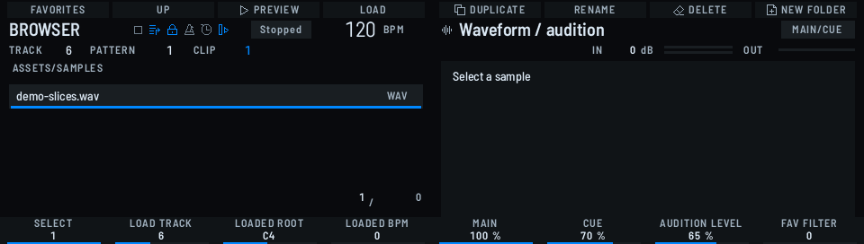
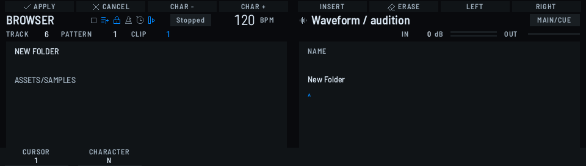

1. Transport、録音、Preview、ファイルjobを止めます。
2. BROWSERで対象を選択し、<strong>SHIFT+Top6「RENAME」／SHIFT+Top7「DELETE」／SHIFT+Top8「NEW FOLDER」</strong>。
3. 名前入力は4-D回転で文字、K1でカーソル。4-D左は取消、押込みは適用。Top3/4 `CHAR -/+`、Top5 `INSERT`、Top6 `ERASE`、Top7/8 `LEFT/RIGHT`。Top1 `APPLY`または`DELETE`で確定、Top2 `CANCEL`で戻ります。
4. 使用中、保存済みProjectから参照されるもの、保護領域、不明な参照があるものは拒否します。フォルダー削除は空の対象のみ。拒否を「削除機能が壊れた」と判断せずstatusを読みます。

中断録音の`.part`はBROWSERで選んで<strong>SHIFT+Top5「RECOVER」</strong>。復旧可能な録音だけをWAVへ回収します。すべての破損ファイルや電源断から必ず復旧できる機能ではありません。

### 音声として渡す

本体に「Songを全Track別WAVへ一括Export」する専用操作はありません。内部busをREC SOURCEで録ってWAVにするか、<strong>MK3 LINE OUT → 外部レコーダー／PCのオーディオ入力</strong>で録音します。内部録音は録音先Trackへの割当を伴うため、空きTrackを使い、元の曲への影響を確認してください。長尺を録る場合はSDの空き容量を先に確認してください。

本機のPi USB-CをPCにつないでも、汎用のUSBオーディオ／MIDIデバイスやSDストレージになるとは限りません。USB-Cのファイル操作は専用のMGF1 CLI、ネットワーク経由ではWi-FiのFILE TRANSFERを使います。詳しくは後段の転送手順を参照してください。

---

## 9. 外部MIDI機器と連携する

### 外部シンセを鳴らす

1. MK3 <strong>MIDI OUT → 外部音源MIDI IN</strong>、外部音源のAudio Out → MK3 LINE INまたは別ミキサーへ。
2. 空きTrackを選び、ENGINEで<strong>MIDI OUT</strong>。
3. <strong>AUTO → Top4「MIDI」</strong>。K1 `CHANNEL`を外部音源の受信chに合わせます。STEPで少数のノートを入力してPLAY。
4. CCはK2 `CC`、K3 `CC VALUE`。受信機の説明書のCC番号を使用します。SHIFTでLock編集になる項目があります。
5. 音声を本機へ戻す場合はCHANNELのROUTINGで`INPUT BUS`と`MONITOR`を設定。入力を音声素材にしたい場合はREC INPUT。

MK3のMIDI OUT → MIDI INの短いループバックでは、全16chのNote・CC・Program・Pressure・Pitch BendとClock／transportをやり取りできます。詳しくは[ハードウェア](hardware.md#din-midi)を参照してください。DIAGNOSTICSのMIDIカウンターは内部の送受信数で、外部機器へ届いたことの保証にはなりません。外部音源では最初に1音のNote On/Offを確認してからClockや複雑なCCを使います。

### 外部鍵盤で本機を弾く

外部鍵盤MIDI OUT → MK3 MIDI IN。<strong>AUTO → MIDI → SHIFTを保持しK1「INPUT CH」・K2「INPUT TRACK」</strong>でchをTrackに割り当てます。Offなら鳴りません。入力経路はプロジェクトに保存されます。Sustain、Pitch Bend、Pressureには処理がありますが、MPEの独立したノート表現ではありません。Pad pressureもTrack単位の表現です。

### Clock同期

AUTO / MIDIのK8 `SLAVE CLOCK`を使うと外部Clockのテンポに追従します。<strong>位相ロックを完成させたslaveではありません。</strong> BPM表示が合うことと、外部機器の頭拍が長時間一致することを分けて確認します。外部Clock追従では本機からのClockエコーを抑制します。DINループを作らず、まず一方向で試します。

### RPN / NRPN

<strong>AUTO + SHIFT + Top4「RPN / NRPN」</strong>。K1 SLOT、K2 ENABLED、K3 NUMBER、K4 VALUE、K6 TYPE。4slot／Trackを共有します。値はraw 14-bitで、受信機側の意味や許容値は機器ごとに異なります。使う番号を確認してから有効化してください。

### DAWとMIDIファイルを交換する

| 方向 | 手順と限界 |
|---|---|
| 外部MIDI向けの演奏を書き出す | FILE → SHIFT+Top4で開始／停止。`RECORDINGS/MIDI00.MID`等に連番保存。Engineが出力queueへ受理したイベントで、物理送達の証明ではない |
| 内部音源のノートを書き出す | FILE → SHIFT+Top5で開始／停止。Track1–16をMIDI ch1–16へ記録。外へノートを送る操作ではない |
| .MIDを取り込む | BROWSERで.MID/.MIDIを選び、K2 TRACK、K3 MIDI CHを設定。<strong>SHIFT+Top4「IMPORT MIDI」→ 4-D押込みで確定</strong>。確定時のPattern／TrackのStepをまとめて置換。進行中も左で取消。失敗・取消は元データを保持し、成功はEVENTSでUndo可 |

書出しはSMF0、1msのSMPTE時間。曲のtempo map、Clock、Transport、SysEx、すべての音色Modulationを完全保存するものではありません。取り込みはSMF0/1、最大256KiB・選択chの4096イベント、256Step、8音／Step、空きAutomation 2レーンの範囲です。<strong>Tempo mapは無視</strong>します。変換・省略メッセージを確認し、DAWで聞き比べてから採用します。音色自体を渡すにはWAVが必要です。

---

## 10. 実例：1曲を通して作る

この章では、新しい曲を1つ作り、ドラムとFMの手弾き録音、FX、曲の録音、保存と再開までを順に操作します。各実例は独立しているので、必要なものだけを参照しても構いません。実例は同じ曲で続け、Track A＝Kick、B＝FM、C＝内部録音の素材として使います。

### 準備

残したい編集があれば、SAVEの完了を待ちます。MK3とPi、出音を聴く機器を用意します。MainとCueの聴き分けには、LINE OUTの試聴先とPHONESの両方を使います（片方だけでも、聴き分け以外の実例は進められます）。

画面上のTopは左から1–8、下のノブはK1–K8、Pad1は左下です。

### 新規曲でドラムを鳴らす

**FILE → Top3 NEW → 4-D押込み CONFIRM**で新規曲を作ります。**A → PLUG-IN → Top5 ENGINE**からK1 FAMILY／K2 ENGINEでKICKを選び、Top5 LOAD ENGINEで決定。**STEP → Top1「1 - 16」**でK1 TEMPO＝120、K8 LENGTH＝16にし、**Pad1・5・9・13**を押して**PLAY**。

画面の4ステップ、パッドLED、4つ打ちの出音が一致します。パッドを離しても押下表示は残りません。

### FMを手弾き録音し、音色とStripを触る

**B → PLUG-IN → Top5 ENGINE**でFMを選ぶ。**KEYBOARD → REC**、再生中の1小節に2音だけ弾き、再度**REC**で解除。**STOP → PLAY**で記録を聴く。**PLUG-IN → Top1 GENERATOR → K2 INDEX**を少し変え、**EVENTS → SHIFT+EVENTS**。**Top2 TONE → K3 CUTOFF**を動かす。**PITCH → Stripを動かして離す、MOD → 同様、NOTES → 同様**。MODの変化が分かりにくければTONEのK8 LFO HZを動かし、Cutoffを少し下げて聴く。

手弾きした音がそのまま再現し、INDEXの値・図・音が連動します。Undo/Redoで操作を戻せます。Stripを離すと音程／変調の加算が戻り、NOTESの追加発音が止まります。FMのTop3 FIXED ENVは編集用ADSRではありません。

### FXとMain/Cueを聴き分ける

Bを選んだまま**CHANNEL**でFXへ移り、**Top1 SEND FX**。K8 DLY SENDとK1 DELAY MIXを少し上げて反復音を聴く。**CHANNEL → ROUTING**へ戻り、K5 TRACK BUSを**Main → Cue → Main**と切り替える。GROUP FXが出た場合はTop1 MAIN / CUE。

FXの表示と聴こえる効果が対応し、Bの直接音が指定した出力へ移ります。AのKickはMainで鳴り続けます。Sendの残響は別経路なので、直接音と区別して聴きます。

### 曲を録音し、波形とトリムを整える

再生を続け、空き**C → CHANNEL → ROUTING**。K7 CAPTURE BUS＝Main、**SHIFT+Top4**で2 BARS、**SHIFT+Top6 RESAMPLE**。録音開始表示後に**D**へ切り替え、完了を待って**C → SAMPLING**へ戻る。**SHIFT+Top6 PREVIEW**で録音を聴き、表示されたSTOP PREVIEWで止める。**Top2 TRIM**で波形とK1 START／K2 ENDを見て、STARTを少し動かす。**STOP → PAD MODE → Pad3**で編集後の素材を鳴らす。

2小節で録音が終了し、Cに素材が割り当たります。Dは変わりません。KickとFMが録れ、波形とトリム位置が表示されます。PreviewはCueで鳴り、停止できます。MainとCueを別々に聴ける場合は、Preview中もMainで元の曲が流れ続けます。

### 名前を付けて保存し、開き直す

録音とPreviewが終わった状態で、**FILE → Top4 SAVE AS**で未使用の曲名（例`My Song 01`）を入力し、**Top1 APPLY**。完了後、**STEP → K1 TEMPO**を123へ変更して**SHIFT+FILE**で上書き保存します。いったんTempoだけを110へ変え、保存せずに**FILE → Top2 OPEN**。Browserで今保存した曲を選び**Top1 OPEN**、確認画面が出たらCONFIRM。

曲名が付き、Tempoは保存した123へ戻ります。PLAYでA/Bのノート・音色・FXが再現し、Cの素材とトリムも残ります。

### 次回の起動から制作を再開する

次に電源を入れて起動すると、保存した曲が自動で開きます。**PLAY**し、Cの素材も**STOP → PAD MODE → Pad3**で鳴らせます。曲名・Tempo 123・A/Bの演奏と音色・FX・Cの素材／トリムがそのまま残っています。Undo履歴と演奏中のStrip位置は復元されません。

### ルーパーとAUDIOトラックを加える

同じ曲へ、ルーパーと線形のAUDIOトラックを追加します。

- **Wetループと追録** — 空きDでPERFORM → Top8 AUDIO → Top1 LOOPER。K2 INPUTをBのInsertまたはFader、K3 Bars、K4 2に設定。PLAY中にTop5 RECORD。2小節で終了後、BをMuteすると、Dから録音した音とFXが聴こえます。Bを戻し、K5 FEEDBACKを0.5、Top6 OVERDUB → 完了待ち → SHIFT+Top6 TAKE UNDO。Top7で停止／再開します。ループは小節頭で動作し、追録とUndoで音の違いが分かります。周回表示と出音が対応します。
- **線形音声を録る** — Songに8小節の区間を用意して有効化。空きEをTop2 AUDIOへ切替、K8 INPUTをMain。SongのPLAY中、Top5 RECORD、1小節以上待って再押下。K3で配置を後ろへ1小節移動、K4／K5で端を少しtrim。Top6 DUPLICATE、Top7 DELETE CLIP → Top1 CONFIRM、SHIFT+Top6 TAKE UNDO。**STOP → PLAY**で配置を聴きます。録音開始位置・移動・trim・複製が図と音で一致します。保存すれば、次回の起動時にもDのループとEの配置が残ります。

### Patternを替えても音作りとミックスが残る

Bの音量・pan・insertを設定し、CLIPのCOPY／PASTEで別Patternへ複製。1打だけ変えて交互にlaunchし、PASTEのUndoも実行します。切り替わるのはフレーズだけで、設定した音色・音量・pan・insertは残ります。

### PRESETの起動時コピーとNONE

自分でSTORE POOLした枠を、CLIP → FOLLOW EDIT → K5 PRESETで指定してlaunch。起動後に同じpool枠を編集し、NONEのPatternへ移ってから指定Patternを再launchします。pool編集だけでは再生中の音色は変わらず、NONEでも装着音色を維持し、指定Patternの再launch時に新しいpool値へ変わります。STOPだけでは再装着されません。

### 外部機器と組み合わせる

DIN接続の外部機器がある場合の実例です。機器がなければ読み飛ばしてください。

- **DINで外部音源を鳴らし、その音を録る** — **MK3 MIDI OUT → 外部音源MIDI IN**とつなぎ、外部音源の音声を聴けるようにします。空きDをENGINEでMIDI OUTにし、**AUTO → Top4 MIDI → K1 CHANNEL**を受信chへ合わせる。**STEP → Pad1 → PLAY**で1音を繰り返し、**STOP**で止めます。外部音源が指定した音高で鳴り、停止後にノートは残りません。LINE接続もできる場合は外部音源OUT → MK3 LINE IN、ROUTINGのMONITORはOFF、空き**E → SAMPLING → SHIFT+Top5 REC INPUT**。PLAYで数秒録り、**SHIFT+Top5 STOP RECORD**の完了後にSTOP、**SHIFT+Top6 PREVIEW**で聴きます。EのWAVに実音が入り、意図した片ch／両ch構成で再生できます。
- **外部鍵盤で内部音源を弾き、音符を録る** — DIN出力ケーブルを外し、**外部鍵盤MIDI OUT → MK3 MIDI IN**とつなぎます。空きFをVA SAWなどの内部音源にする。**AUTO → Top4 MIDI → SHIFT+K1 INPUT CH／K2 INPUT TRACK**で鍵盤chをF（Track6）へ割当。**KEYBOARD**へ移り、鍵盤の1音を押して離すと、Fが鳴り、設定されたReleaseの後に止まります。**REC → PLAY**で1小節に2音を弾き、RECを解除して**STOP → PLAY**。録音した音符がFに残り、再現します。SAMPLERのRECは音声録音なので、この実例ではKEYBOARDを使います。
- **外部Clockへテンポを追従させる** — 同じ一方向のDIN接続で、Clock送信できる外部機器をmasterにし、**AUTO → MIDI → K8 SLAVE CLOCK＝ON**。120 BPMで短く再生し、100 BPMへ変更すると、本機のTempoと演奏速度が追従します。これはテンポの追従で、頭拍の位相同期ではありません。終了後はSLAVE CLOCKをOFFへ戻します。

### 音源を試す：WAVETABLEとVA

- **WAVETABLEの連続変化** — SYNTH → Top5 ENGINEでWAVETABLEを選ぶ、またはBROWSERのFACTORY/Presetsから`WT Glass Motion.mgxp`を装着。鍵盤／パッドで鳴らし、GENERATORのK1 POSITION、K2 SCAN DEPTH、K3 SCAN RATEを回す。K4 ATTACK、K5 RELEASEで立上がりと余韻を変えます。波形位置の変化が音に連続して現れ、ノートを離すとrelease後に消音します。Curveはテーブル資産の波形模型を塗り、下の帯に宣言scan範囲と実scan位置を表示します。無音時は宣言POSITIONの静止模型となります。
- **VAの波形とADSR** — ENGINEでVA DUAL、または`VA Wide Saw.mgxp`を装着。GENERATORのK1 OSC 1、K2 OSC 2、K3 DETUNE、K4 OSC MIX、K5 CUTOFFを動かす。Top3 ENVELOPEのK3 ATTACK／K4 DECAY／K5 SUSTAIN／K6 RELEASEを変更。波形・混合・うなり・フィルタと、押下中／離した後の包絡が操作に対応します。詳細値のPWM／SUB／NOISE／RESONANCE等はPreset／宣言スキーマに保持されます。

### 演奏を焼いてプリセットにする（BAKE PRESET）

音源Trackに1小節のフレーズを作り、SYNTHのSHIFT+Top8 BAKE PRESETへ進みます。初期入力はそのTrackのFader後。PLAYし、SHIFT+Top4で小節数、SHIFT+Top6 RESAMPLEで録ります。完了すると同じTrackがSamplerになりTRIMへ移ります。K1 START／K2 ENDで端を整え、Top8 ROOT / ZONEへ。K8 ROOTを録った音の基準鍵に、K6 KEY LOW／K7 KEY HIGHを鳴らす範囲に設定します（初期は1ゾーン、全鍵域、root 60）。Top8 SAVE PRESET → 名前入力 → Top1 APPLY → PROJECT Top5 COLLECT。

`PRESETS/<名前>.mgxp`と`PRESETS/<名前を大文字化>-EXPORT/PRESETS/preset.mgxp`＋`ASSETS/`ができます。Exportフォルダごと持ち出して装着でき、鍵盤で音高が変わります。素材欠落・CRC不一致では装着せず、元の音を保ちます。最後はTop8 DONE。SHIFT+Top8は案内終了です。

BAKEの入口は単体の内部音源Track用です。Kitは通常の録音操作で各Padへ割り当てます。BAKEは単一録音のピッチ再生です。自動マルチサンプル収録ではありません。録音先は選択Trackで、その音源をSamplerへ置き換えます。元の編集可能なシンセ音色も残したい場合は、先に名前付きPresetへ保存してください。Trackの音量・FXは録音後も残ります。FXを含む入力を焼いた場合は、必要に応じて元のFXをbypassし、重ね掛けを調整してください。Track変更／Project読込みで案内は終了し、録音失敗時は進みません。名前入力を取消したときはTop8 SAVE PRESETから再開できます。案内中のTop8以外は通常操作のままです。COLLECTは保存済みPresetを素材付きで出力するため、保存後に音作りを変更した場合は保存し直してください。

### 機能と操作の入口

基本の流れで扱わなかった機能は、使うときに次の入口から試せます。各操作の詳細は本書の該当章を参照してください。

| 機能 | 操作の入口 |
|---|---|
| Kit／Slice | 4章のFACTORY KITで2padを鳴らす、または録音した素材をAUTO CHOP→MAP PADS |
| Clip／Scene／Arrangement | 6章の手順でPatternを1つ複製・1打変更→2Sceneを保存→REC ARRANGEで順にlaunch→END TAKE→PLAY |
| Lock／Automation／Macro／Morph | 3・7章から使う機能を1つ選び、Cutoffだけを動かす |
| Overdub | 5章の条件に合う1小節takeへInputを1回重ねる |
| 別名保存／素材持出し | 8章のSAVE ASで別名保存→元曲をOPEN、またはCOLLECTのフォルダー全体をPCで開く |
| SMF交換 | 9章で1小節を.MID記録→DAWで確認→空きTrackへIMPORT MIDI |
| Browser管理 | 未使用の素材1件をRENAME、空フォルダーをNEW FOLDER→DELETE |

---

## 音源の詳細

### 追加音源 RESONATOR / TEXTURE

**PLUG-IN → Top5 ENGINE → K1 PHYSICAL → K2 ENGINE → 4-D押下**で選びます。RESONATORはパッド／ノートで内部エキサイタを鳴らす音源、TEXTUREは選択した入力を連続処理する音源です。

| 音源／ページ | Topボタンとノブ操作 |
|---|---|
| RESONATOR | Top1 RESONATOR。K1 Model、K2 Structure、K3 Brightness、K4 Damping、K5 Position、K6 Level、K7 Pan |
| EXCITER | Top3 EXCITER。K1内部Polyphony 1/2/4、K2 FM（半音）、K3 Transpose（0–60半音） |
| GRAINS | TEXTUREのTop1。K1 Mode、K2 Position、K3 Size、K4 Pitch、K5 Density、K6 Texture、K7 Freeze、K8 Level |
| BLEND | Top3。K1 Dry/Wet、K2 Spread、K3 Feedback、K4 Reverb、K5 Level、K6 Pan |
| INPUT / QUALITY | Top4。K1入力源、K2品質、K3 Freeze、K4 Trigger、K5 Gate |

TEXTUREで外部音を使う場合は**Top4 → K1 Line In**を選び、MK3のLINE INに入力します。TEXTUREのMODE=GRANULARでは**Top1 → K5 DENSITYを75〜100%**にして粒を出します。中央付近は原典どおり粒の発生が止まる範囲です。内部音を加工する場合は同じK1で`Dry 1`、`Fader 1`、`Group A`などを選びます。内部バスには1フレームの遅延が入ります。両音源ともTop2 TONEで本体共通フィルタ等を調整できます。TEXTUREのモジュレーション設定はTop6 MODULATIONです。

品質は`32k 16b ST / MO`と`16k 8b ST / MO`の4種類。原典どおり低品質／Monoほど記録時間が長くなり、音質も変わります。音が入った後にFreezeをONにして固定します。モード／品質変更で原典のバッファが初期化された場合は、画面中央の**BUFFER RECORDING / BUFFER FROZEN**が実状態を示します。FreezeをOFF→ONにして再固定してください。TriggerはOFF→ONで1回発火、GateはONの間有効です。ノート入力でもTriggerが発火します。

Project保存は設定値を保存します。TEXTUREの録音メモリ、Freeze済み音声、残響は保存しません。残したい音は既存のREC SOURCE／ResampleでWAV化してから保存・COLLECTしてください。停止中でもTEXTUREは入力を処理します。Panic後はStart／ノート／音源再選択で再開します。

画面はレンダラで生成したイメージです（実機LCDの写真ではありません）。

#### 操作例

- **RESONATORを鳴らす** — 空きTrackでENGINEから選び、パッドを鳴らしながらTop1のK1で3モデルを切り替えます。Top3 EXCITERでPolyphonyを4にすると、和音や連続したノートの響きが重なります。
- **TEXTUREの入力とFreeze** — 別Trackで音を再生し、TEXTUREのTop4 INPUT / QUALITY → K1でそのTrackの`Dry`を選びます。Top1でDensityを75%以上にし、Top3 BLENDでDry/Wetを100%へ。各モードを1回ずつ選び、数秒入力した後にFreezeをONにします。品質変更後はFreezeをOFF→ONにして再固定し、BUFFER表示と音の変化を見ます。
- **設定の保存** — 2音源を含むProjectをSAVE→OPENすると、Model／Mode・Input・Quality・ノブ値が戻ります。TEXTUREのFreeze済み音声は保存対象外なので、音を残す場合は先にWAVへResampleします。

### Plaitsの編集

ENGINEのPlaitsは「PLAITS 24」です。「PLAITS OSC」はありません。SYNTH → COREでMODELとHARMONICS／TIMBRE／MORPH／DECAY／COLORを選びます。MODELは24モデル、5値は0–100%の表示です。FMのRATIO／INDEXも同じ宣言値の操作系です。

### FM 6とDX7バンク

従来FMとは別にENGINEから**FM 6**を選べます。COREのK1 PATCH（0–95）、K2 BRIGHTNESS、K3 ATTACK、K4 RELEASE、K5 MOD DEPTHを使います。ATTACK／RELEASEは次の発音から反映。FACTORY/PresetsのFM6 Electric Piano／Wineglass／Metal Padも入口です。

外部32音色bankは停止してBROWSERから`.syx`を選び**OPEN**。`Presets/DX7-番号`に32個の名前付き`.mgxp`を作り、そのフォルダを開きます。音色を選んで装着・試聴してください。各Presetは元パッチを内包し、元syx不要、256枠poolは空きのままです。import音色のPATCH=-1を変更すると内蔵bankへ切り替わります。

- **操作例** — Electric Piano／Wineglass／Metal Padを順に装着して演奏します。BRIGHTNESSとMOD DEPTHを回し、ATTACK／RELEASE変更後に再発音します。手持ちの32音色syxをOPENし、32ファイルから1つ装着、保存・再装着します。音色・余韻・操作が反映され、元bankは保持されます。

### SoundFontバンク

BROWSERで`.sf2`を選び**OPEN**または**LOAD**。選択Trackへバンク内の最初の音色を装着します。**SYNTH → CORE**のK1 **BANK**、K2 **PROGRAM**（どちらも0始まり）、K3 **TUNE**、K4 **GAIN**で編集。存在しないBANK／PROGRAMの組合せは無音です。メーカーの音色一覧が1始まりならPROGRAMは1を引きます。入口には`FACTORY/DEBUG/SF2-Sine.mgxp`を使えます。

通常のSAVE PRESETはSF2のパスとCRCを参照する小さい`.mgxp`を作ります。持出しはCOLLECTを使い、Presetとassets内のSF2をフォルダごと運びます。元SF2を変更・削除してCRCが一致しない場合は装着を保留し、現在の音色を保持します。SF2はRAMへ読み込みます。大容量bankや全SF2機能の再現は保証していません。

- **操作例** — debug sineで発音し、離鍵で消音することを確かめます。手持ちSF2をOPENし、BANK／PROGRAMから音色を選んで、SAVE PRESET → COLLECTし、同梱Presetを再装着します。音色・velocity・音域・releaseがそのまま再現されます。存在しないprogramは無音で、素材が欠けた場合は現在の音色が保持されます。

### 大きいSoundFontを開くとき

BrowserでSF2またはSoundFont PresetをOPENすると、ロード中も現在の音色を保持します。画面・入力・音声とは別のworkerがデコードし、完了後に装着します。ロード中に割当て先Trackや音源の割当てを変えた場合は、その新しい内容へ上書きせず取り消します。容量・CRC・素材の検証に失敗した場合も元の音色を維持します。すべてのSF2が読み込める保証ではありません。

### 追加音源 ADDITIVE／PHASE DIST

1. SYNTH → ENGINEでADDITIVEを選びLOAD。GENERATORのノブ1–5でBRIGHTNESS、ODD / EVEN、FOCUS、WIDTH、MOTIONを変更する。
2. Top3 ENVELOPEへ移りノブ3–6でATTACK／DECAY／SUSTAIN／RELEASEを変更。鍵盤パッドの押下・保持・releaseを聴く。
3. PHASE DISTへ切り替え、GENERATORのWAVE／DISTORTION／ENV DEPTH／MOTION／RATEとENVELOPEを操作する。
4. BrowserからFACTORY/PresetsのADD Organ／ADD Moving Glass／PD Pulse Bass／PD Curved Padも装着できます。

### LAYER

1. 単独音源のSYNTH → PROJECTのK4 POOL SLOTで空き枠を選び、一覧のSTORE POOLを4-D押下で子用Presetを登録する。別の子も必要な分だけ登録。
2. ENGINEでLAYERを選びTop5 LOAD ENGINE。装着後のLAYER面でノブ3の候補poolを選択→Top3 USE CHILD。ノブ2で次のChildへ進み、最大4層まで追加する。
3. K8 EDIT PAGE=MIXでは、同じノートで全域の層が鳴ります。ノブ4 LEVEL／5 PAN／6 DETUNEの変更は次のノートへ反映されます。Top4 REMOVE → Top1 CONFIRMで子を取り除きます。
4. Browserで名前付きPresetとして保存し、COLLECTで持ち出して再装着できます。poolを変更しても保存済みLayerの音は変わりません。
5. K8 RANGEでKEY LOW/HIGHとVEL LOW/HIGHを設定すると、音域・強弱で鳴る子が切り替わります。K8 FX 1/FX 2でInsert、SENDSでSendとLEAF FXを編集する。外側のTrack FXも併用できる。
6. 長いreleaseで連打した場合、VOICE COSTがCAPACITYを超えると（CAPACITY EXCEEDED表示）、新しいノートの一部が鳴りません。既存のノートが片層だけ途切れることはありません。

### VA DUALの同時発音

VA DUALは**総同時16音保証／32音はベストエフォート**です。共有ボイスpoolは32枠で、他音源やLayerと共用します。32音の選択を禁止したり、音色・品質・保存データを変更したりするものではありません。16音の固定演奏窓は、Project切替・停止やすべてのFX併用時のdeadlineを保証するものではありません。DSP予算を超える場合は理由が表示されて装着が拒否され、再生中の音色・品質が勝手に変わることはありません。

### シンセ拡張の操作

ENGINEで **FORMANT** を選び、**GENERATOR**のK1 MODEでFORMANT／VOSIMを切替。K2 VOWELで母音を連続移動し、K3 FORMANT SHIFT、K4 SHAPE、K5 MOD DEPTHで声の響きを変えます。**ENVELOPE**はK3 ATTACK／K4 DECAY／K5 SUSTAIN／K6 RELEASE、**TONE**は従来のトラック共通処理です。

**GRANULAR** はTEXTUREの入力エフェクトとは別の、サンプルを鍵盤で弾く音源です。ENGINEでGRANULARを選び、BROWSERでWAVをOPENすると、その音源を保ったまま素材を割り当てます。BrowserのROOTを素材の基準鍵に合わせてください。GENERATORはK1 POSITION／K2 SIZE／K3 DENSITY／K4 TEXTURE／K5 SPREAD。ENVELOPEはFORMANTと同じADSR配置です。JITTER／FREEZE／PITCH OFFSETは詳細パラメータにあり、本体の演奏ノブには増設しません。FREEZEは初期buffer充填の256ms後に有効になります。専用資源は本体合計4音で、上限時は通常音の古いvoiceを置き換えます。素材欠落やCRC不一致では装着を止め、現在音色を保持します。

VA DUALの既存演奏ノブはそのままです。詳細区分にはHARD SYNC／CROSS MOD／PITCH ENV・DECAY／SUB WAVE／FILTER TYPE／SVF MODE／FILTER MORPHがあります。詳細エディタ本体はないため、これらは本体の演奏ノブからは編集できません。

**FX → INSERT**のTYPEで **PITCH SHIFT**（SHIFTは-12〜+12st、MIXは共通slot MIX）または **ROTARY**（SPEED=SLOW／FAST／BRAKE、DRIVE、共通MIX）を選べます。PitchのB操作は空欄です。Rotaryは2回転体と分岐線、Pitchは処理経路とdry/wet合流を表示します。線図は構造の説明で、回転位相の実測表示ではありません。

**SAVE PRESET AS／OVERWRITE PRESET** の **K3 INCLUDE FX** は保存操作開始時にOFFです（名前衝突の確認では選択を維持）。ONでそのトラックの2つのInsertとDelay／Reverb Sendを保存。再装着時に音色とまとめて反映し、Undoも一度で戻せます。OFFで保存したPresetは装着先のFXを変更しません。Track音量・pan・compressor・master FXは含めません。ホストで設定したPreset出力トリムはINCLUDE FXに関係なく保存・LOADされ、Layer／Kit全体のInsert後へ適用します。トリムのない既存ファイルは等倍です。本体の編集ノブは追加していません。pool登録は外側Track FXを含めません。Layerの各子は独立したLEAF FXを持ち、外側のINCLUDE FXに関係なく保持します。PREVIEWは同梱FXがあれば一時適用し、停止すると元の音色・FX・トリムへ戻ります。FXを含まない音色のPREVIEWでは現在TrackのFXを使います。持出す場合は従来どおりCOLLECTで素材を同梱してください。

### LFOの拍同期

**MODULATION → Top1 ROUTES → K5 LFO SYNC=ON**。K2がHZからDIVISIONへ変わります。K3 DEPTHを上げ、PLAYすると拍位置に同期します。分割は2/1から1/16まで12種類（付点・三連含む）。再生中のSYNC／分割変更は次拍から反映、STOPでは同期位相を止め、PLAYの先頭開始では拍0へ戻ります。OFFでは元のHZフリーラン。右画面には適用済み分割とライブ位相が出ます。ロック／Automation／MacroにもLFO SYNCとLFO DIVISIONを指定できます。

新保存形式はMGXC13です。MGXC12以前の曲・Preset・Kitは移行せず拒否します。GUIDの同一性は維持します。

Factory LibraryはMGXC13形式の187件（Preset 163＋Kit 24）です。KINDとENGINEで絞り込んで選び、PREVIEWは明示操作したときだけ再生します。保存画面のINCLUDE FXは外側Track FXを対象とし、Layer内のLEAF FXは子の音色定義として保持します。

---

## 演奏機能の詳細

### 音源別Morphと素材の持ち出し

PERFORMのSTORE A／STORE Bは、選択中のセットへ共通操作値と各音源の宣言値を保存します。4組のA/BにはMODELやADSRも含みます。音源を別エンジンへ変更すると、そのTrackの全セットを現在値に揃えるため、以前の音色のMorph値が新音源へ掛かりません。UNDOで音源と4組を戻せます。Group／MasterのMorphはそのままです。

PROJECTのCOLLECTは、曲のTrackだけでなくPreset pool、AUDIO、freeze、sample lockが参照する素材もまとめます。使っていない素材は出力へ含めません。元の曲・WAVは変更しません。WAVESEQ／Tape Micro／SpectralのSAVE PRESETも素材参照を保存します。空枠による内蔵波形は有効ですが、指定したWAVが見つからないPresetは装着を止めます。

### 音源ごとのLock・automation・Macro

AUTOのTop2 AUTOMATION／Top3 MACRO MAP、PERFORM A/B MORPHのSHIFT+Top6 CONTROL ALLでは、対象一覧から共通操作値または選択音源のパラメータを選びます。音源固有の対象には所有音源名を表示します。例えばFMのRATIOを設定してからPlaitsへ変更しても、PlaitsのHARMONICSには作用しません。FMへ戻すと元の編集が再び作用します。Macroの対象Track表示では、異なる音源のTrackが暗くなります。選択マスク自体は保持します。

LEVEL／PAN／CUTOFF等は音源を跨ぐ共通対象です。MODELもautomation／Macro／Lock／Gestureの対象で、次の発音から反映します。STEPでパッドを押したままK2 MODELを回すと、そのステップへMODELをLockします。SHIFT＋K2は従来どおりSOUND LOCKの選択です。Control Allで音源固有の対象を選ぶと、その音源のみに掛かります。新しいProjectのMacro 3既定対象はREVERB SENDです。

- **操作例** — FMのTrackでRATIOをステップLockし、AUTOで同じ音源の対象を選びます。Plaitsへ変更しても、FMの設定が別のパラメータへ掛かることはありません。FMへ戻すと設定が再び作用し、SAVE／OPENでも対象音源が残ります。MODELの変更は次の発音から反映します。

現在の保存形式はMGXC13です。旧形式は読み込みません。未登録エンジンを含むSong／Preset／Kitは `Unsupported engine / current content kept` と表示して装着せず、現在の内容を維持します。codec単体の未知データ保持と通常装着は別の契約です。登録済み音源の未対応宣言を指すLock／automation／Macro／Gestureは、GUID・宣言番号・値を保存したまま再生には適用しません。画面は `Unavailable` と表示し、その値の編集はできません。対象を対応する宣言へ選び直すことはできます。未知の参照先はProject全体で64 GUID、宣言番号は0–31までです。上限を超える場合は読込みを拒否し、現在のProjectを維持します。

### Vocoder INSERT

キャリアにする持続音をTrackで鳴らし、FX → INSERTの**K1 FX1 TYPE = VOCODER**。**K2 MODULATOR**で入力L／R／L+R、**K3 CARRIER = SLOT SIGNAL**、**K4 MIX**で効果量を選びます。マイク等は既存のMK3入力へ適切な信号レベルで接続します。外部音をキャリアにする場合はK3をINPUT L／R／L+Rへ。L+Rのモジュレータは平均mono、キャリアはstereoです。入力がなければwet音は無音です。

画面の上段は入力音の解析、下段はキャリアへの16-band適用を示します。FX2、pad/group INSERTでも同じ選択名と経路の意味です。

- **操作例** — 持続するVA等を鳴らし、Vocoderを上記で設定します。入力へ声や変化のある音を送り、MODULATORのL/R、内部／外部CARRIER、MIXを切り替えて聴き比べます。入力を止めるとwet音が減衰し、BYPASSで元の音へ戻ります。設定はSAVE／OPENで残ります。

### STEPのTRACKER表示

**STEPを短く再押下**すると16 STEP／64 STEP／TRACKERを循環します。SHIFT＋Top4も同じ動作です。TRACKERは左右LCDに4Trackずつ、合計8Trackを表示。4-Dノブの左右でTrack、上下・回転でstep、押込みで発音のON/OFF。NOTE／VELOCITY等は元のSTEPノブと同じデータを編集します。Padは従来の16step配置です。

**FOLLOW**を点灯してPLAYすると、各列の再生stepを中央に固定して上下のデータが流れます。Trackごとにlengthで折り返すため、異なる長さ・speedでは中央の番号が異なります。逆方向再生でも上下はstep番号順で、次の発火順の予告ではありません。別patternのclipが動く列は編集patternの静止表示です。編集を始めるとFOLLOWを解除し、選択stepを琥珀の枠で示します。再開はFOLLOW。

セルは**step番号／保存NOTE／velocity**。`*`はratchet、microtiming、通常以外のgate、Lock等の存在表示です。詳細は既存のSHIFTノブ／STEPへ戻って確認。DrumKitは同時hit数（H）と最大velocity、AUDIOはstep対象外です。NOTEは保存値であり、transpose等を加算した最終音高ではありません。

- **操作例** — 長さ7と12の2Trackで再生します。TRACKER＋FOLLOWで各列の中央固定と独立wrapを見て、4-D上下で編集を止め、押込み・NOTE・VELOCITYを変更すると、16 STEPに戻っても同じstepが変わっています。Undoで戻せます。ratchet／microtimingを加えると`*`が出ます。FOLLOWの再開と左右のTrack選択も同じ画面で操作します。

### MULTITIMBRAL

1. 使用するInstrumentトラックへ音色を装着し、必要な音色だけpoolへSTORE POOLする。AUDIO／Looper枠はMIDI発音対象外。
2. SETTINGS → 4-D左右でMIDI → 4-D上下でMULTITIMBRAL → K1をOn。再生が止まり、画面にMIDI Channel→Track対応が表示される。進入時は通知が表示され、演奏画面には`MODULE`が常時表示されます。MULTITIMBRAL中にPLAYを押すと`SETTINGS > MIDI > MULTITIMBRAL: OFF / THEN PLAY`の案内が表示されます。
3. 外部鍵盤／DAWからCh1、Ch2、Ch16へNote On/Offを送ると、それぞれTrack1、2、16だけが応答します。サステインとCC120／123にも応答します。
4. CC0=0・CC32=0/1→Program Change 1–128（生値0–127）でpool 1–256を選べます。空きslotを選んだときは現在の音色が維持されます。
5. 外部Start／Stopではシーケンサーは始動しません。SETTINGS → MIDIでMULTITIMBRALを選びK1をOffにすると通常へ戻ります。再開はPLAYを押してからで、それまでの通常MIDI入力routeが復元されます。

---

## 画面の読み方

### 拡張画面とノブ一覧

STEPのTRACKER表示では、ノブに触れると、そのノブのセルだけにARC＋値が表示され、選択行と本文の位置は動きません。ノブ名と現在値は常時表示されます。ノブを離して約1.2秒後にARCだけが閉じます。他のページでも同じ規則です。

STEPを短く再押下すると16 STEP／64 STEP／TRACKERを循環し、約400msの長押しで音符編集へ入ります。

### 文字・凡例・一時表示

画面下部の1行にはK1–K8の短い名前が常時表示されます。touch／回転したノブのセルだけにARC＋値が浮かび、各ノブを離して約1.2秒で個別に消えます。全面帯や名前の重複はありません。本文とTRACKERの選択行は動きません。ページを開くボタンをそのまま約400ms保持すると、その状態で使える「操作 > 効果」のヒントが表示され、離すと閉じます。STEPは従来どおり音符編集にも入ります。DIAGNOSTICSは入口のTop8を保持します。通常の入力はアニメーション中も受け付けます。

PLAY中にCLIPまたはSCENEでNEXT BAR起動を予約すると、予約先と枠の進行が小節位置に合わせて表示され、切り替わると予約表示は消えます。

画面の一覧は[ページ×テーマ索引](manual/screens.html)にあります。

### アイコンの読み方

Top1–8は絵＋文字を読み、操作は従来と同じです。ENGINE＝音源選択、波形の線＝MODULATION、ディスク＝STORE/SAVE、戻る矢印付き箱＝RECALL、熱線付き箱＝BAKE。SETTINGSの7カテゴリも文字を残しています。パラメータ名・値・ファイル名はアイコン化していません。

左ヘッダーの小さい符号は左から次の意味です。

| 位置 | 意味・点灯条件 |
|---|---|
| 1 | 三角＝再生、四角＝停止、円＝録音。録音待機は円の輪郭、再生／録音中は塗り。文字badgeも併記 |
| 2 | 行＋矢印＝FOLLOW有効 |
| 3 | 南京錠＝Lock編集（SHIFT／保持step） |
| 4 | メトロノーム＝クリック有効 |
| 5 | 時計＝外部Clock follower設定。同期精度を保証する表示ではない |
| 6 | 縦Strip＋形＝PERFORM／PITCH／MOD／NOTES。現在の割当てを形でも区別 |

右ヘッダー先頭とENGINE一覧の印は音源familyです。全9テーマで形と意味は同じで、色だけでは判断しません。

### 可視化の読み方

TopボタンとK1–K8の操作対象は従来どおりです。SYNTH左の値は「名前＋固定位置の値＋形」で読みます。連続値は下端bar、PANなど正負値は中央印、段階値はsegments、選択肢はchipです。SETTINGSも同じ規則、Browserは大きい主情報・小さい副情報・右側の状態、MIXERは縦meter＋音量とPANです。

| 表示 | 何を描いているか／操作例 |
|---|---|
| Scope | PCMまたは解析済みWAV peakの塗り波形。SYNTH通常音源、SAMPLER、Browser試聴、録音入力で共通。Browserの細い下段は実Cue音声、縦線は実試聴位置。素材peakは440列で停止・再解析中も残る。同じ素材の最終完了波形だけを保持する |
| Spectrum | TEXTURE／RESONATOR等のpost-fader音声の実FFT。48kHz時は512点＝約10.7ms、mono `(L+R)/2`。TEXTUREのFreezeと品質もcaptionに表示。粒子位置やstereo全体のpeakを表す図ではない |
| Bars | ADDITIVEのrecipe最大部分音を1とした相対成分×実envelope。停止時はNORMALIZED HARMONIC RECIPE。FXのVOCODERは16実followerで、入力が消えると減衰。Pad個別routeの未公開値はFOLLOWERS NOT PUBLISHEDと表示 |
| Ring | PERFORM → AUDIO/LOOPERの実再生位置、記録区間と入力level。内側はUndoへ保持した前take。追録はWAVへ混ぜて保存され、独立layer数の表示ではない。位置系Live FXにも実位相を表示 |
| Curve | WAVETABLEは実テーブル資産の波形模型とscan範囲の帯/実位置、ENVELOPEのADSR模型に実level、PERFORMのMorphにA/B間の実位置。DELAY／REVERBは設定から計算した減衰模型 |
| Response | TONE／Filterや各Insertの設定から計算した応答模型。薄いFFTは実音声。COMPRESSORは実detectorとGRを重ね、Chainは実際のTone→Comp→Insert 1→Insert 2順とactivityを示す |

`MODEL`／`RECIPE`は設定の説明、`LIVE PCM`／`MEASURED FFT`／`ACTUAL`は取得したデータです。FFTが未取得ならその旨を表示します。無音では表示も静まり、CPUが混雑した場合は可視化の更新を間引きます。音声品質や音数をこの表示のために落としません。入力sourceを切り替えた直後は古いsourceの結果を使いません。

PLAITS等の無音generatorは宣言済みパラメータの名前・値・静止barを表示します（PCMではなく、値から波形風の半正弦を描くこともしません）。発音中のScopeは実PCMを中心線から塗った表示へ切り替わります。WAVETABLEの波形はテーブル模型、下の帯がscan範囲と現在位置です。見出しとcaption、値行の文字位置は共通規則へ揃えています。

### 操作文法

左Top1–4は同じ対象の面・範囲、右Top5–8は処理と出口です。BROWSER／PROJECTの文書操作は既存位置を維持する例外です。Layerの左Top3 USE CHILD／Top4 REMOVEも、面固有ページの無い枠で面内操作を行う例外です。音色一覧PRESETS／KITSは左Topが絞り込み・選択、右TopがPREVIEW／LOAD／FILES／BACK。ENGINEは右Top5 LOAD ENGINE／Top8 BACK、4-D押下で音色一覧へ降ります。確認はTop1 CONFIRM／Top2 CANCEL、4-D押下／左も同じ役割です。名前入力は全保存先で共通です。両ページボタンを約400ms同時に押すとHOME／RETURNします。

Track選択は、対象Trackのボタン（A–H）を押します。SHIFTを押しながら選ぶと上層を保持したまま対象を切り替えます。MUTE／SOLO／SELECTを押しながらTrackを選ぶと、その操作の対象として指定します。Trackを長押しすると一時表示（Peek）になり、離すと元の画面へ戻ります。CHANNELのGroup系ではA–Hがbus選択です。

SHIFT+RESTARTは小節頭での再開を予約し、RESTART単独は即時に再開します。

GENERATEは物理VARIATIONから入り、RHYTHM／ACCUM／GROOVE／LANES・ARPでノートrecipeを生成します。Top4を再押下してLANES／ARPを往復します。PERFORMは左Top1 A/B MORPH、Top2 MACROS、Top3 GESTURE、Top4 MUTATION。Mutationは既存ノートの変異量・seedを扱い、右Top5 GENERATE／Top6 COMMIT、SHIFTでFREEZE／REVERT。Live FXはTop7、音声枠はTop8 AUDIOです。

SETTINGSは左Topの3分類＋Top4 MORE、または4-D左右で7分類。上下で行を選び、K1だけでその値を編集します。4-D押下後の回転でも編集可能。SYSTEMのSPACE UNITはDATA容量表示のGiB／MiB切替です。AUDIO Top5 ROUTING、MIDI Top6 MIDI ROUTES、SYSTEM Top7 DIAGNOSTICS／Top8 UPDATEが関連出口です。DIAGNOSTICSはUSB／HID／AUDIO／MIDI／LOGが同時に見える単一監視画面です。

チャンネル構成はLEVEL／PAN／CUTOFF／DRIVE／DELAY SEND／CRUSH／LFO DEPTH／LFO HZの順で、MIXER・SYNTH TONE・Morph/Gestureに共通です。SYNTH GENERATORは音源の宣言値をK1から配置し、TEMPO等の文脈値を混ぜません。DrumKit COREは子Pad選択型でK1 PAD、楽器型のPAD MODEではK1 TEMPO、Pad選択はSELECT＋Padか4-Dです。ノブに触れたままERASEを押すと初期値へ戻ります。PANは低速で回すと中央へ吸着します。

BROWSERのK7はAUDITION LEVEL、K8はFAV FILTER。試聴の開始停止とFAVORITE登録はTopです。COLLECTはFILE／PROJECTのTop5だけ。PROJECTは4-DでPROJECT FILES／STORE POOL／RECALL POOLを選択し押込み、登録先poolはK4 POOL SLOTで指定します。SAMPLERの左は波形作業面、右は再生の姿と値です。通常Top5 AUTO CHOP／WAVE面STRETCH、Top6 MAP PADS、Top7 BROWSER、Top8 LOOP TAKE。SHIFTはTop5録音／Top6試聴／Top7 source録音、Top8は通常CHOP STEPS、WAVE面FILE LOOP、ZONES面CLEAR ZONES。置換・削除は確認を通ります。

画像は[全画面索引](manual/screens.html)、ノブ割当ての一覧は[生成表](manual/controls.tsv)を参照してください。

### 色・ピーク・サンプルの読み方

PADの名前上にある固定色chipは音源種別です（SYNTH／SAMPLER／KIT／LAYER／AUDIO／MIDI／EMPTY）。パッドLED、ミキサーの帯、PADのchipは対象Trackの現在の種別色で統一します。SYNTH青／SAMPLER緑／KIT橙／LAYER紫／AUDIO水色（Looperを含む）／MIDI桃／EMPTY灰。同種別は同色で、番号・名前・選択の明るさで見分けます。MONOTONE 1の地色とchipは灰、録音・再生・警告の色は既存どおりです。STEP／KEYBOARD／KITでは編集中Trackの種別色を使います。PADのTrackマップは左下1、右上16。SELECT保持でTrackを選ぶSYNTH／FX／ROUTING／AUDIO／Modulation等では同じ4×4マップが一時表示され、離すと編集画面へ戻ります。Kit／Notes／Stepsの番号・演奏操作は変わりません。ミキサーやTrackerは読み順の一覧で、物理パッドの位置図ではありません。Keyboardは既存のスケール音配列のまま、ルート音を100%、他の構成音を55%、無効音を消灯します。StepChordで選んだ音も100%。LIGHTS右側の見本と左の16 Pad previewはwireの色相・明度段へ近似した色で表示します。

MIXERは動くバーに加え、到達した最上段を白い印で約1秒保持し、その後9dB/秒で下げます。右側の`Peak … dBFS`は同じ保持値です。PANは別の行、メーター上端の小さい目盛りは0dBFSです。

SamplerのSYNTH GENERATOR右は、無音でも発音中でも保存した素材の波形です。範囲外は暗くし、`START`／`END`と現在位置を重ね、`SPEED`は数値で示します。SAMPLING → TRIMでK1 START／K2 ENDに触れると対応markerとラベルがaccentになります。同じ素材の再解析中も直前の波形を残します。別素材の初回解析中は前の素材を表示せず、ANALYZINGを表示します。TONE／TRIMの明示的なページ切替ではフィルタや包絡を表示します。

### ステップのSLIDE／ACCENT

STEPで4-Dノブを回して対象stepを選びます。SHIFTを押しながら**K3 ACCENT**または**K4 SLIDE**を右へ回すとON、左へ回すとOFF。通常のK3 VELOCITY／K4 GATEと、Topのページ選択／COPY STEP／PASTE STEP／UNDO／REDOはそのまま使えます。padを保持している間は従来の音色lock編集が優先されるので、属性を変えるときはpadを離してください。

TRACKERへはSTEP再押下の表示循環、またはSHIFT＋Top4の表示切替で進みます。4-Dノブで行、左右でTrackを選び、同じSHIFT＋K3／K4で編集します。三角の印がACCENT、折れ曲がる線がSLIDEです。16/64-step gridにも同じ意味の印が出ます。disabledのstepにも属性は保持できますが、印は減光され発音はしません。Drum Kitのpad laneにはこの操作を追加していません。

SLIDEは滑り込む先のstepへ付けます。同じACID BASS、POLY SAWまたはFMの単音が前から続く場合、前のGATEが短くても次の到着までつなぎ、envelopeと発振位相を保って80msで音程を移します。最初の音、前のgateが切れた後、和音／arp／ratchet／Layer、別音源・別SOUND LOCKへ移る場合は通常発音です。SLIDE連続中も音源のDECAYは進み、自然に減衰しても再発音し直しません。長くつなぐときはDECAYを長めに設定してください。ACCENTはACID BASSで音量とfilter-envelope応答を強めます。VELOCITY値は変えません。他音源ではACCENTの音への効果はなく、データと印は保存します。MIDI OUT／SMFへ自動pitch bendやaccentのvelocity変換は出しません。

保存はPROJECT → SAVE／SAVE ASの通常操作です。MGXC13／PSEQ4で属性を保持し、旧MGXC12以前は移行せず拒否します。

---

## 設定

### 明るさ・パッド感度・設定保持

1. SETTINGS → DISPLAYのSCREEN LEVELで画面の明るさを変更します。これは画素強度で、バックライト制御ではありません。設定は次回起動後も保持されます。
2. LIGHTSのK1 LED LEVELをLow／Medium／Highに変更します。消灯は消灯のまま、待機中の点滅と演奏状態を区別できます。
3. PADのK1 VELOCITYをLinear／Soft／Hardに変えると、弱打と強打の反応が変わります。FIXED VELでは一定の強さになります。
4. SYSTEMでDATA FREEが表示されます。設定変更後の保存待ち表示が消えれば保存完了です。本体設定は曲を切り替えても維持されます。

### 入力ゲイン・チューナー

1. SETTINGS → AUDIO。K1 INPUT GAINはデジタル−24〜+24 dB。外部入力を接続するとL/Rのメーターで確認できます。録音・monitor経路にも適用されます。
2. 4-D上下でTUNER INPUTを選び、K1でL／R／L+Rを選びます。安定した単音で音名・Hz・セントが表示されます。無音では音名は出ません。基準A4=440 Hz、単音40–1200 Hz。
3. 別ページでもheaderにINゲインとL/Rメーターが表示されます。赤表示のときはゲインを下げてください。チューナーを開くだけではmonitorは有効になりません。

### MIDI Local Control

1. SETTINGS → MIDIのK1 LOCAL CONTROLをOff。本体Pad／Keyboard／ChordsはTrackのMIDI channelへ送信する。Kitの送信noteは36+pad（pad1=36）。
2. OUT→INループやDAW echoがない状態では内部発音が止まり、外部受信とシーケンサーは鳴ります。OFF中でも外部から戻ったノートは発音します。
3. Pad保持中に切り替えても音は残りません。Onに戻すと本体演奏ができます。設定は曲と別に保存されます。

---

## ファイル・接続・起動

### DATAとファイルの整理

保存先とDATAの構成は[DATAとコンテンツの配置](data-content.md)を参照してください。新規保存は曲`.mgxs`・Kit`.mgxk`・Preset`.mgxp`で、Browserでは内部種別をSONG／KIT／PATCHで表示します。

長い音源名・サンプル名は枠内で横スクロールします。先頭と末尾を各1.2秒保持し、28px/秒で往復。音源選択のK2も省略せず表示します。更新画面にもSETTINGSの現在のテーマとpixel orderを適用し、CANCEL後は通常画面全体を描き直します。

### Wi-Fiでファイルを追加・持ち出す

**0.9.0ビルドではWi-Fiは無効です。** WLANスタックのライセンス上の理由で公式イメージでは無効化されています。ファイル転送はEthernetまたはUSB-Cを使ってください（次節）。

共通rendererで生成した説明用画面です。実機写真ではなく、表示の数値は例です。

実機の操作は **SETTINGS → SYSTEM → Top5 FILE TRANSFER**。左の **Top1 AP** は本体のWi-Fiへ接続、**Top2 STATION** はDATAに設定済みのネットワークへ参加します。選んだら右の **Top5 START**。この間は演奏を停止し、Pad／ノブの編集を止めます。画面のSSID、CONNECTION CODE、ADDRESSを使います。

1. APならスマホ／PCを画面の`Groovebox-...`へ接続します。インターネット接続のないWi-Fiとして維持し、表示された`http://192.168.76.1/`を開きます。STATIONなら本体と同じネットワークで画面のADDRESSを開きます。`groovebox.local`は発見できる環境で使い、開けなければIPアドレスを使います。
2. ブラウザの **Connection code** へ本体のcodeを入力し **Connect**。**Songs／Presets／Kits／Samples／SoundFonts／MIDI／Recordings** から棚を選びます。空き容量と一覧を確認します。
3. **Add / replace files** またはdrag＆dropで追加します。保存先は内容から自動決定します。MGXの名前の拡張子が誤っていても内部種別で判定します。大きなSF2は進捗を表示し、**Cancel** で中止できます。最大1GiB、受付は`.mgxs/.mgxk/.mgxp/.wav/.mid/.syx/.sf2`のみ。`.syx`はDX7の32音色バンクを32個のPresetファイルに展開し、poolへ自動登録しません。
4. 一覧の **Download** で持ち出し、**Delete** → 確認で削除します。現在開いている曲と宣言済み素材は削除できません。同名アップロードは長さ・SHA256・内容種別の検証後に置換します。現在曲とその参照素材は上書きも拒否します。
5. 実機の **Top6 BROWSER** で転送を終了してBrowserへ移ります。曲は **PROJECTS** に入り、選択して **OPEN** します。**Top8 CLOSE** でも終了でき、10分経過でも自動終了します。終了後はHTTPへ接続できません。演奏は **PLAY** で再開します。

COLLECTしたbundleはコンテナが`PROJECTS/project.mgxs`または`PRESETS/preset.mgxp`、素材が同じbundleの`ASSETS/SAMPLES`／`ASSETS/SOUNDFONTS`です。コンテナと必要素材を追加すると相対参照を維持できます。コンテナ単体を追加して素材が足りない場合、勝手に別の音で鳴らしません。同名の既存ファイルは置換されるため、別環境へ渡す場合も保存名を確認してください。

その起動でEthernet／AP／STATIONを選んだ後に別方式へ変更する場合は再起動が必要です。APはopen networkで、ファイルAPIを画面のcodeで認証します。通常演奏中はAP／HTTPを起動しません。USB-Cでの転送は次の「USB-C転送とデバイステーマ」を参照してください。

COLLECTの素材コピーは短いindex／CRC名になります。長い名前のEXPORTフォルダは短縮＋識別hashになり、元の曲・音色・素材のファイル名は保持します。実際の出力先は完了表示で確認します。

### USB-C転送とデバイステーマ

日常のWi‑Fi Webに加え、開発ホストは[USBファイルCLI](reference/usb-files.md)からSong／素材を直接転送できます。PUTは良品だけ同名を置換し、開いている曲と宣言参照素材は保護します。録音／ファイル処理中はBUSY。USBセッションが閉じた後、BROWSER → PROJECTSで転送した.mgxsをOPENします。

テーマはSETTINGS → DISPLAY → 4-DでTHEMEを選択 → K1。右LCDの3×3一覧に確定9名を表示します。CYBER 2が既定。選択は直ちに表示へ反映し、DEVICE.CFGへ保存され、曲のloadや保存では上書きしません。

### 起動時の表示と標準データ

MK3のUSB列挙後、左画面は黒のまま、右画面にYADOKARIのスプラッシュ（ヤドカリのマークとワードマーク、VIBE GROOVEBOXのタグライン）を表示し、画面下部にはファームウェア自身が版数を重ねて表示します。初期化を終えると操作画面へ移ります。電源投入からUSB列挙までのNI標準画面はソフトウェアから変更できません。初回・更新直後などは標準データを照合するため、通常起動より時間が掛かります。通常は存在とサイズだけを確認します。編集中の内容はPROJECTSへ別名保存してください。

追加の79音色は BROWSER → FACTORY → PRESETS → LIBRARY、24キットは BROWSER → FACTORY → KITS → LIBRARY から選択してOPENします。元のPRESETS/KITSは保持し、編集用として使えます。ファクトリー原本の復元と共有素材の扱いは[ライブラリ](factory-library.md)を参照してください。

---

## 制限について

機能の制限については[既知の制限](known-limitations.md)に集約しています。
