# YADOKARI User Manual

A user manual for the Raspberry Pi 4 firmware that turns a MASCHINE MK3 into a standalone groovebox.

For an overview of operation, see [UI and purpose-based workflows](ui-pages.md); for LED brightness, blinking, and recording indications, see [Lighting rules and legend](led-behavior.md). In SETTINGS, moving the 4-D encoder left/right moves between APPEARANCE / DISPLAY / LIGHTS / PAD / AUDIO / MIDI / SYSTEM. In SYNTH, left/right is limited to edit pages within the same screen; for entrances such as MODULATION / TRIM, press the displayed Top button. Pads light in the target Track's color or a neutral color: normally 55%, selected 100%, muted 18%; motion = performing / playing back, warn = waiting, danger = recording, and empty pads stay dark. You can check the legend and the current output of all 16 pads under SETTINGS → Top3 LIGHTS.

The target hardware is a combination of a Pi 4 (4 GB RAM or more) and a MASCHINE MK3. Operation differs from Native Instruments' own MASCHINE software.

For features and limitations, see the [feature list](feature-matrix.md); for a list of the Top buttons and knobs on the normal screens, see the [controls table](manual/controls.tsv).

---

## Contents

- [1. Things to know first](#1-things-to-know-first)
- [2. Reading the panel and screens](#2-reading-the-panel-and-screens)
- [3. Making your first one-bar song](#3-making-your-first-one-bar-song)
- [4. Building from samples / building with a DRUM KIT](#4-building-from-samples-building-with-a-drum-kit)
- [5. Recording audio: choosing between the four methods](#5-recording-audio-choosing-between-the-four-methods)
- [6. From Clips to Scenes, from Scenes to a song](#6-from-clips-to-scenes-from-scenes-to-a-song)
- [7. Mixing, Automation, and performance effects](#7-mixing-automation-and-performance-effects)
- [8. Saving and resuming / taking it to a PC](#8-saving-and-resuming-taking-it-to-a-pc)
- [9. Working with external MIDI equipment](#9-working-with-external-midi-equipment)
- [10. Worked example: making a song throughout](#10-worked-example-making-a-song-throughout)
- [Sound engines in detail](#sound-engines-in-detail)
  - [Additional engines RESONATOR / TEXTURE](#additional-engines-resonator-texture)
  - [Editing Plaits](#editing-plaits)
  - [FM 6 and DX7 banks](#fm-6-and-dx7-banks)
  - [SoundFont banks](#soundfont-banks)
  - [Opening a large SoundFont](#opening-a-large-soundfont)
  - [Additional engine: ADDITIVE / PHASE DIST](#additional-engine-additive-phase-dist)
  - [LAYER](#layer)
  - [VA DUAL polyphony](#va-dual-polyphony)
  - [Operating the synth extensions](#operating-the-synth-extensions)
  - [Tempo-synced LFO](#tempo-synced-lfo)
- [Performance features in detail](#performance-features-in-detail)
  - [Per-engine Morph and carrying materials out](#per-engine-morph-and-carrying-materials-out)
  - [Locks, automation and Macros per engine](#locks-automation-and-macros-per-engine)
  - [Vocoder INSERT](#vocoder-insert)
  - [The TRACKER display in STEP](#the-tracker-display-in-step)
  - [MULTITIMBRAL](#multitimbral)
- [Reading the screens](#reading-the-screens)
  - [Extended screens and knob list](#extended-screens-and-knob-list)
  - [Text, legend and temporary displays](#text-legend-and-temporary-displays)
  - [Reading the icons](#reading-the-icons)
  - [Reading the visualizations](#reading-the-visualizations)
  - [Operation grammar](#operation-grammar)
  - [Reading colours, peaks and samples](#reading-colours-peaks-and-samples)
  - [Step SLIDE / ACCENT](#step-slide-accent)
- [Settings](#settings)
  - [Brightness, pad sensitivity and settings retention](#brightness-pad-sensitivity-and-settings-retention)
  - [Input gain and tuner](#input-gain-and-tuner)
  - [MIDI Local Control](#midi-local-control)
- [Files, connections and startup](#files-connections-and-startup)
  - [Organizing DATA and files](#organizing-data-and-files)
  - [Adding and carrying out files over Wi-Fi](#adding-and-carrying-out-files-over-wi-fi)
  - [USB-C transfer and the device theme](#usb-c-transfer-and-the-device-theme)
  - [The boot display and standard data](#the-boot-display-and-standard-data)
- [Limitations](#limitations)

---

## 1. Things to know first

This instrument is one on which you **build beats and melodies across 16 Tracks, perform Clips and Scenes, and save the result as a Song**. It does not work by running Linux or NI software on the Pi. It uses the MK3's two screens, eight knobs, and sixteen pads.

The screens in this manual are images generated by the renderer, not photographs of the actual unit. File names shown in lists such as the Browser are examples for explanation.

### Terminology and capacities

| Term | Meaning on this instrument |
|---|---|
| Track 1–16 | The 16 lanes that carry sound engines, samples, and external MIDI. A–H are the 8 Tracks of the current layer. Use SHIFT+A–H to switch between the 1–8 and 9–16 layers when selecting |
| Pattern 1–16 | The edit data for all 16 Tracks. Up to 256 steps per Track. With ordinary 16th notes, 16 steps = one bar of 4/4 |
| Clip | Which Pattern each Track plays. Different Tracks can sound different Patterns at the same time |
| Scene 1–16 | A snapshot that recalls the Clip configuration of multiple Tracks at once |
| Song | A song structure of up to 32 sections. You can either line up Scenes, or record a live performance as an Arrangement |
| DRUM KIT | Drums on 16 pads within a single Track. A–H do not become the stock MASCHINE's "Group × 16 Sounds" |
| Group bus 1–8 | Audio buses that combine multiple Tracks. On CHANNEL's Group pages, select with A–H |
| Sample asset | A project's WAV references. Up to 64 slots. Assets retained for Undo also use slots |
| Automation / Macro / Lock | 2 lanes per Track, 8 Macros × 4 routes, up to 4 Parameter Locks per step. Kit editing specific to a sound engine has its own display and structure |

### Connecting up and making sound

1. Use a Pi and MK3 that are already prepared. Connect the MK3 to the Pi's USB-A, the MK3's LINE OUT to your monitors, and PHONES to your headphones. For first-time SD card creation, see [Setup](pi4-development-setup.md).
2. Turn the speaker volume down and power on. When the screens appear, press <strong>PAD MODE</strong> and play the pads. The first sound engine depends on the saved project.
3. If no sound comes out, go to ROUTING under <strong>CHANNEL</strong> and check `MAIN`, `TRACK BUS`, and Mute/Solo. Sound sent to Cue does not come out of Main.
4. You can check the connection state under <strong>SETTINGS → move the 4-D encoder left/right to SYSTEM → Top7 "DIAGNOSTICS"</strong>. `No audio` means the audio device is not running; lit pad LEDs alone do not confirm that sound is coming out.

---

## 2. Reading the panel and screens

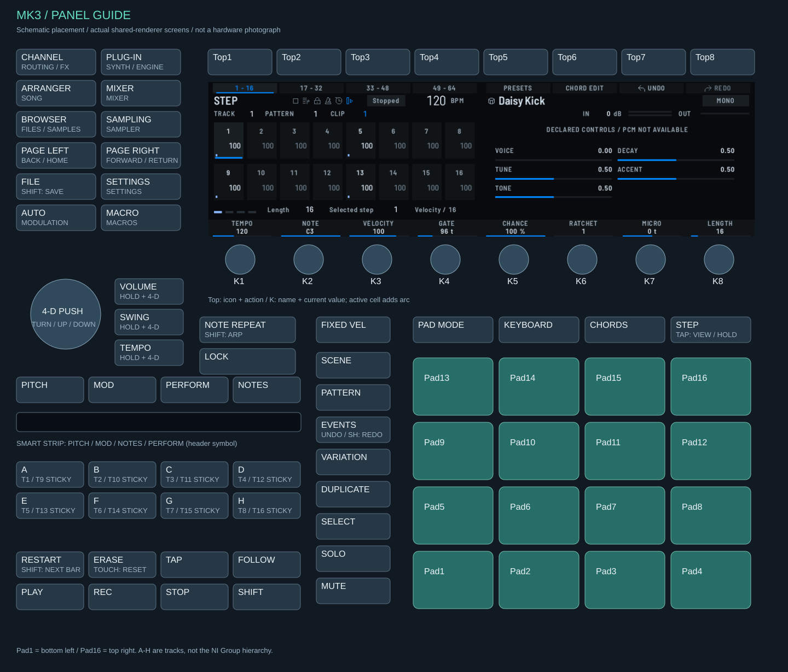

<strong>Top1–Top8</strong> are the unlabelled buttons above the left and right screens, counted from the left. <strong>K1–K8</strong> are the eight knobs below the screens. A Top button's role is always shown at the top edge of the screen, and each knob's name and current value are always shown in the two lines at the bottom. An ARC overlays the cell you touch or turn, and only the ARC disappears about 1.2 seconds after you let go. `SHIFT + Top1` means holding SHIFT while pressing Top1.

<strong>Pad1 is at the bottom left, Pad16 at the top right.</strong> The 16 STEP cells are also entered with these numbers. While operating a knob, check the Track and Pattern in the header and the sound engine name. <strong>The Pattern being edited and the Clip actually playing can be different.</strong> If you change a value and the sound does not change, check this first.

| Physical button | Action | Combined operations / notes |
|---|---|---|
| PAD MODE / KEYBOARD / CHORDS / STEP | Track/Kit performance, scale performance, chord performance, step entry | When a Kit is selected under PAD, the 16 pads are the Kit's sounds. On a normal Track, the pads play the Track |
| A–H | Select a Track in the current layer | SHIFT+A–H switches the layer and keeps it. Hold for about 400 ms to Peek MIXER; release to return to the original edit screen. The Track selection is kept |
| MUTE / SOLO / SELECT + A–H | Track Mute / Solo / select and go to CLIP | Per Track even for Kits. On CHANNEL's Group pages, Group bus 1–8 selection takes priority |
| STEP re-press / hold | A short re-press cycles 16 STEP → 64 STEP → TRACKER | Hold for about 400 ms for note editing. SHIFT+Top4 cycles the same displays |
| PLUG-IN | Opens SYNTH | Pressing again in SYNTH goes to ENGINE. SHIFT+PLUG-IN cycles through the sound engines |
| CHANNEL | Switches between ROUTING and FX | From other pages it goes to ROUTING. Within GROUP FX, Top1 "MAIN / CUE" goes to the recording page |
| MIXER | MIXER | Pressing a pad toggles the Track's Mute |
| ARRANGER / PATTERN / SCENE | SONG / CLIP / SCENE | ARRANGER is not CLIP |
| BROWSER / SAMPLING | BROWSER / SAMPLER | SAMPLING alone does not start recording |
| AUTO / MACRO | MODULATION / PERFORM's MACROS | Pressing AUTO alone does not start automatic recording of knob movements |
| FILE | PROJECT | SHIFT+FILE performs a normal save |
| SETTINGS | Settings | SHIFT+SETTINGS checks for updates while stopped. Do not use it to move between pages while producing |
| VOLUME / SWING / TEMPO | Turn the 4-D encoder while holding to change that value | Releasing the button returns the 4-D encoder to its normal role |
| 4-D rotation / up-down | Selects Steps, Clips, Scenes, Files, etc. depending on the screen | Press to execute / edit. Left/right moves between pages. In the Browser, parent / Open |
| Dedicated page left/right buttons | Go back / forward through the history of pages, sub-pages, and focus | Hold both for about 400 ms to go HOME to PAD, again for RETURN. Separate from in-screen movement with 4-D left/right |
| SELECT + Pad | Selects the target without sounding or launching it | <strong>In SCENE it saves</strong>. In a Kit's STEP it selects the Kit pad. The meaning differs by screen |
| MUTE / SOLO + Pad | Toggles Mute / Solo | When a Kit is selected, the Kit pads are the target |
| DUPLICATE | In STEP, duplicates to the next Step; elsewhere duplicates the Pattern | SHIFT+DUPLICATE doubles the length. For Pattern copy/paste use CLIP's COPY / PASTE |
| ERASE + STEP Pad | Erases that Step | SHIFT+ERASE erases the Locks of the selected Step. In SCENE it erases the Chain |
| Knob touch + ERASE | Returns a declared parameter to its initial value | The hint reads ERASE: RESET. Multiple touches can be undone together. Selection / movement knobs are excluded |
| EVENTS / SHIFT+EVENTS | Undo / Redo | Common to all pages. On confirmation screens and during name entry, that input's owner takes priority |
| FIXED VEL | Fixed Velocity ON/OFF | Plays at a constant Velocity regardless of how hard or soft you hit. Turning it off returns to the pad sensitivity setting |
| PLAY / STOP / RESTART | Play / stop / restart from the top | PLAY normally starts from the top. SHIFT+RESTART reserves a restart at the next bar line; SHIFT+STOP is Panic |
| REC | Outside SAMPLER, note recording ON/OFF | In SAMPLER it records audio from the selected bus. SHIFT+REC is Input recording in SAMPLER, and Count-in note recording elsewhere |
| TAP / SHIFT+TAP | Tap tempo / metronome ON/OFF | With STEP's SHIFT operations you set the click destination and count-in |
| NOTE REPEAT | Repeats the note you are holding | SHIFT+NOTE REPEAT is Arp. The rate is on the upper keys; the displayed settings are on K1–K4 |
| FOLLOW | Follows the STEP playback position on the display | Separate from SCENE's Top1 "FOLLOW" |
| PERFORM / Smart Strip | The performance page. Top8 AUDIO is the proper entrance | PITCH / MOD / NOTES can also be performed on other edit screens. See the Strip operations below |

Not all of the sub-labels printed on the pad surface (Undo, Redo, Quantize, etc.) correspond to functions. Undo is <strong>EVENTS</strong> and Redo is <strong>SHIFT+EVENTS</strong>. On confirmation screens, **press the 4-D encoder to confirm, and move left to cancel**. While a process is running, only cancellation is possible. For knobs such as PAN, slowly crossing the center snaps to the center, while fast turns pass through it.

---

## 3. Making your first one-bar song

### 3-1. A new project and drums

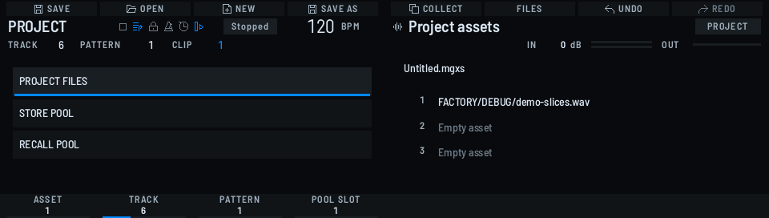
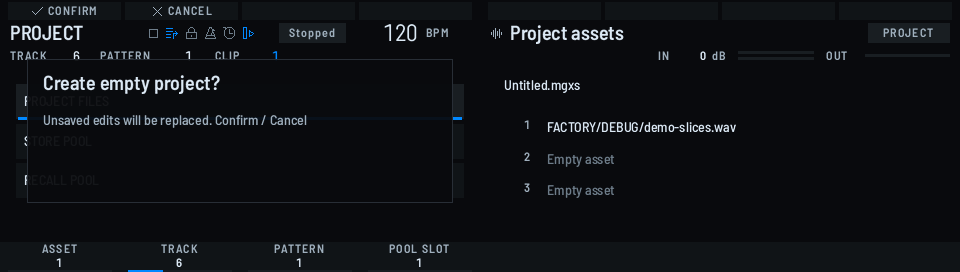

1. Save any edits you want to keep with <strong>SHIFT+FILE</strong> and wait for the completion indication.
2. <strong>FILE → Top3 "NEW"</strong>. If there are template songs on the factory Song shelf `FACTORY/DEMOS`, a list of <strong>EMPTY / templates</strong> opens. Select with K1 or the 4-D encoder and press <strong>Top1 OPEN</strong>. Top2 CANCEL takes you back. If you choose EMPTY, or there are no templates, you proceed to the usual <strong>CONFIRM / CANCEL</strong>. Existing edits are not saved automatically. The bundled image contains no template songs, so you will normally proceed to CONFIRM / CANCEL.
All 16 Tracks of EMPTY are **EMPTY** (silent, no sound engine assigned). Even when you start from a template, the song name becomes **Untitled** and the first save is **SAVE AS**. The factory original songs are not overwritten.

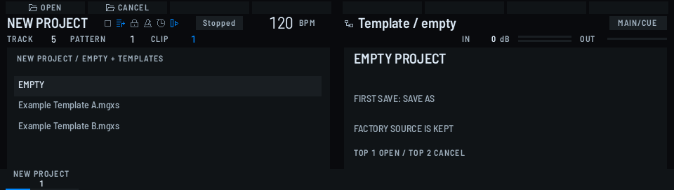

3. <strong>A → PLUG-IN → Top5 ENGINE</strong>. Select <strong>DAISY ANALOG DRUMS</strong> with K2 and press the <strong>4-D encoder</strong> to go to the sound list. From <strong>Top2 ORIGINALS</strong>, choose <strong>Daisy Analog Kick → Top6 LOAD</strong>. Selecting alone does not make it sound; press <strong>Top5 PREVIEW</strong> only when you want to hear it.
4. <strong>STEP → Top1 "1 - 16"</strong>. Set K1 `TEMPO` to 120, enter a four-on-the-floor pattern on <strong>Pad1, 5, 9, 13</strong>, and press <strong>PLAY</strong>.
5. Move to a different Track with <strong>B</strong>. LOAD <strong>Daisy Analog Snare</strong> from the same entrance as step 3, and turn on <strong>STEP → Pad5 and 13</strong>.
6. LOAD <strong>Daisy Analog Hat</strong> on <strong>C</strong>, and enter <strong>STEP → Pad3, 7, 11, 15</strong>. Lower the hat's K3 `VELOCITY` slightly. Select the step you want to change with SHIFT+Pad; once you take your hand off the pad and turn a knob, you can edit the normal Step items.

Drums can be used either as standalone Presets or as a Kit. The standalone DAISY ANALOG / SYNTH DRUMS Presets also allow VOICE editing. Factory Presets for Kick, Snare, Hat, Rim, and Tom are also provided on VA DUAL and FM 2 OP. The VA / FM / Daisy in the name tells you what generated it. You can also OPEN them directly from the Browser under <strong>FACTORY → PRESETS → DRUMS</strong>.

If you want everything on one Track, use <strong>BROWSER → FACTORY → KITS → VA + FM Percussion.mgxk → Top1 OPEN</strong>. Pad1–6 are Kick / Snare / Tick Hat / Air Hat / Rim / Tom, and 7–16 are empty. Select a sound with <strong>SELECT+Pad</strong>, release SELECT, and enter Steps. This Kit is a Sampler Kit made by rendering actual VA/FM output to WAV; you do not edit each Pad's synth knobs on it. When you want to edit from the synth itself, use the standalone Presets. The old standalone KICK / SNARE / HI HAT / NOISE engines have been removed.

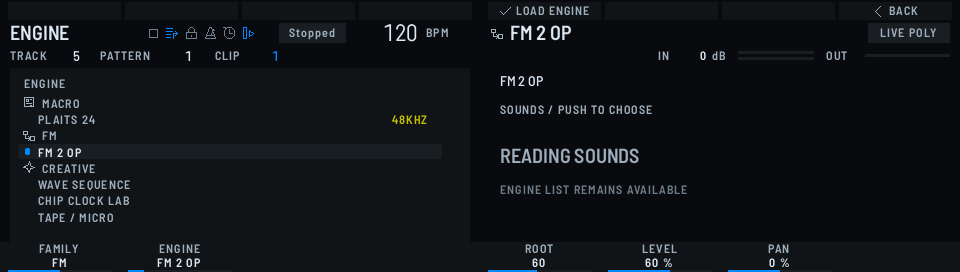
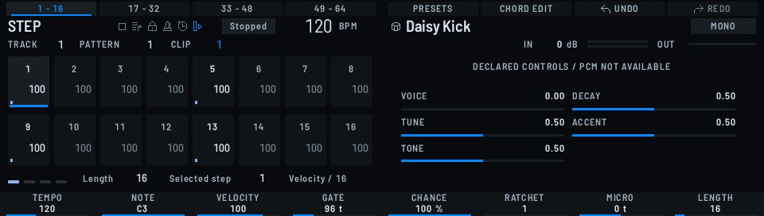

Knobs operated while you keep a pad held down may become a different kind of editing, such as a sound Lock. **To edit ordinary note values, release the pad after selecting the Step** — this avoids confusion. Pressing the same Step Pad again toggles it ON/OFF.

### 3-2. Bass and chords

1. With <strong>D → PLUG-IN</strong>, select <strong>ACID BASS</strong> or <strong>VA SAW</strong>.
2. In <strong>STEP</strong>, turn on Pad1, 7, 9, 15. Select each with SHIFT+Pad and change K2 `NOTE` to make a phrase. The pitch that sounds is determined by the combination of the sound engine's `ROOT` and the Step pitch, so check with the screen and your ears.
3. Adjust the sound with `GENERATOR` / `TONE` / `ENVELOPE` under <strong>PLUG-IN</strong>. Change ACID's CUTOFF and RESONANCE little by little. SHIFT+knob becomes a Lock on the selected Step, so release SHIFT when you want to change the overall sound.
4. Prepare a chord-friendly <strong>VA SAW</strong> or similar on <strong>E</strong>, select with <strong>CHORDS → Top1/2 SHAPE −/+ or K7 SHAPE</strong>, etc., and play the pads. KEYBOARD is single-note input; CHORDS is chord input.

**The root/tonic pads in KEYBOARD and CHORDS are white, and the other scale pads use the fixed color of the Track type.** Changing the theme does not change the LED colors, and event indications for sounding, recording, and waiting take priority.

In **KEYBOARD**, the left Top1/2 cycle through 21 SCALE types, and Top3/4 lower/raise the OCTAVE. The pads have changed from a chromatic snap scheme to 16 consecutive scale notes with no duplication. Pads that would exceed the range are blank and do not sound. K2 ROOT changes the reference note and the scale's root together; you can also adjust with K3 SCALE and K4 OCTAVE. The normal K5 VELOCITY is the Track's velocity multiplier. Only while editing a Step chord do K5/6 become STEP VEL / STEP GATE. OCTAVE does not change the Track's ROOT and is saved in the Song.

In **CHORDS**, Top1/2 are the 13 SHAPE types and Top3/4 are inversions. The current value is at the top of the screen, and each cell shows the chord name and note names. You can also select with K7/8. The left Top buttons during SHIFT are SCALE / OCTAVE. Only SCALE shapes produce diatonic triads; explicit shapes such as MAJ7 keep the specified intervals. While pressed, they are highlighted with the same surface and frame as KEYBOARD.

Use **STEP → Top6 CHORD EDIT** to edit the chord of the selected Step. Add/remove notes with the pads, and return to STEP with Top6. If you remove the principal note, the remaining notes become the principal note; if you remove the last note, the Step turns OFF. SHIFT+pad in KEYBOARD does the same editing while the screen stays on KEYBOARD. The right Top7/8 UNDO / REDO are retained.

**Selecting a sound**: Top5 PRESETS on PAD / KEYBOARD / CHORD (KITS for a Kit), or PLUG-IN → Top5 ENGINE → press the 4-D encoder to reach the same list. In ENGINE, the sounds of the currently selected engine are shown in the lower row; if there are none, it shows NO SOUNDS FOR THIS ENGINE. The default sound is ENGINE's Top5 LOAD ENGINE. In the standalone list, select silently with K1 / 4-D rotation / Top3 PREV and Top4 NEXT. Selecting alone does not load the audition original or its assets. Press Top5 PREVIEW only when you want to listen, then try it on the pads. Moving to another row stops the audition and does not automatically sound the next one. Attach with Top6 LOAD or a 4-D press. Filter with Top1 KIND, Top2 ORIGIN (MY VERSIONS / ORIGINALS), and K3 ENGINE; Top5 STOP PREVIEW returns you to the original sound. Top8 BACK / the page-back button returns to the original screen, and when you revisit, the filter and position are restored. The BROWSER key and the list's Top7 FILES are exclusively for the file shelves. SELECT+4-D left/right attaches the previous/next sound of the current type without leaving the screen. SHIFT+Top5 STORE FILE / Top6 STORE AS / Top7 DUPLICATE save to a file; STORE POOL stores into the song's 256 slots.

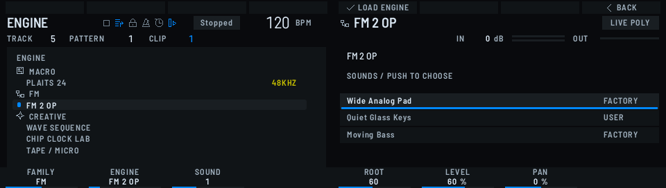

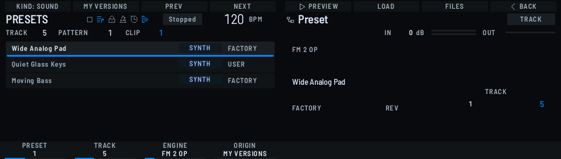

ORIGIN's MY VERSIONS prioritizes the User versions and shows the Factory version for sounds that have no User version. ORIGINALS shows the Factory originals. A position selected in ENGINE's lower row carries over to the list, and returning restores the original position.

The save format is MGXC13. Files in older formats are not migrated; an error is displayed and the current content is kept. A Kit's SMF / external MIDI is GM-converted at the boundary, and the pads' internal order does not change. Notes that SMF cannot handle are diverted to an empty Track at their original GM pitch; if there is no empty Track, the count is displayed and they are dropped. Empty has no sounding engine, so attach a sound engine before listening. An SF2 bank 128 converts the pad phrases to GM keys, while melodic banks are not converted.

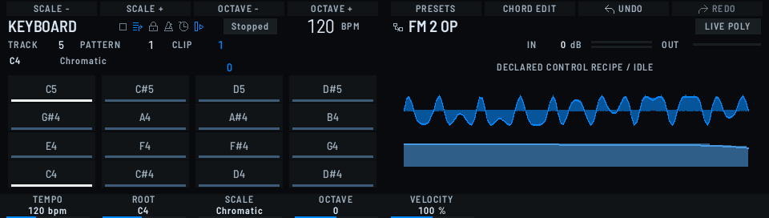
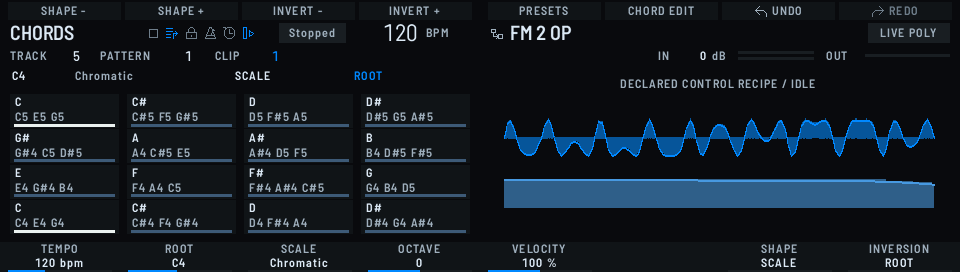

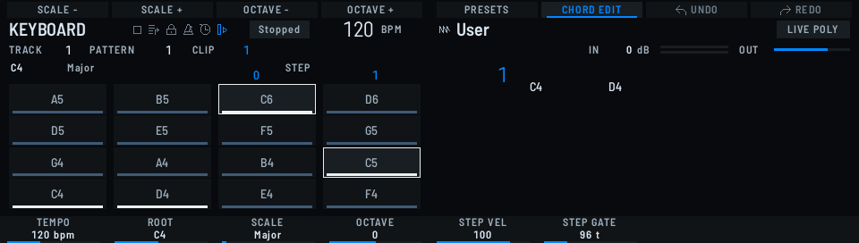

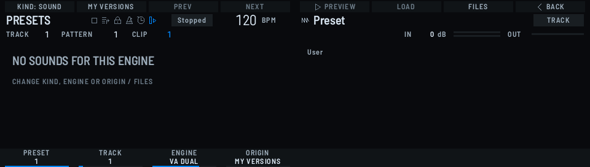

Chord saving and input allow up to 8 notes per Step, but the number of notes that sound depends on the sound engine and the availability of shared voices. Plaits follows the per-model cost, at most 1/2/4 notes; for example, model 8 is at most 2 notes. The 4 additional DSP slots and the weighted budget of 4 are shared across all Tracks. Four notes on all 16 Tracks at once are not guaranteed. The Creative family remains monophonic.

### 3-3. Recording a live performance

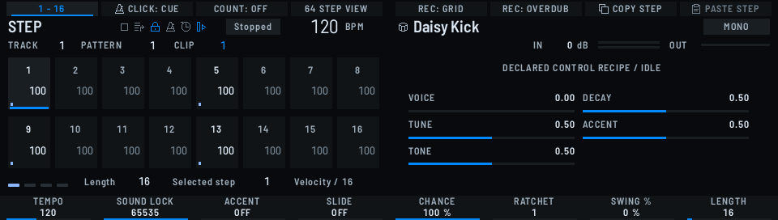

1. With <strong>STEP + SHIFT + Top5</strong>, select `REC: GRID`. If you want to keep free timing, use `REC: FREE`.
2. <strong>SHIFT+Top6</strong> sets `REC: OVERDUB`. `REC: REPLACE` erases the existing notes of the Track that REC is armed on as the play position passes, and replaces them. Start with OVERDUB.
3. If needed, use <strong>SHIFT+TAP</strong> for the click, <strong>STEP + SHIFT + Top2</strong> for `CLICK: CUE` or `MAIN`, and <strong>SHIFT+Top3</strong> for `COUNT: 1 BAR`.
4. Move to <strong>KEYBOARD</strong> or <strong>PAD MODE</strong> and press <strong>REC → PLAY</strong>. Or, while stopped, press <strong>SHIFT+REC</strong> to start recording with a count-in.
5. Play for one bar, press <strong>REC</strong> again to disarm recording, and listen back with <strong>STOP → PLAY</strong>.
6. If needed, return to STEP and use EVENTS / SHIFT+EVENTS. Note starts, length changes, and so on may become multiple Undo steps.

This REC is **note recording**. REC on the SAMPLER screen switches to audio recording. During the count-in you can play, but notes are not recorded. The count-in is not used while following an external Clock.

### 3-4. Adding groove and movement

| What you want to do | Operation | What to listen for |
|---|---|---|
| Make the hats sway | SHIFT+K7 `SWING %` in STEP | The timing of the even-numbered side changes |
| An ornament that sounds only sometimes | Select the target Step and lower K5 `CHANCE` | It does not sound every cycle. It follows conditions such as the Seed |
| Fine repeated hits | Increase K6 `RATCHET` | Listen to the Gate and overlaps |
| Darken just one hit | Select the Step → SHIFT+Cutoff knob in PLUG-IN's TONE | It returns to the base / other layer at the next Step |
| Extend to 16/32/64… Steps | K8 `LENGTH` in STEP; 4-D left/right for pages | Changing pages is not the same as changing the length |
| Generate a rhythm | VARIATION → GENERATE / RHYTHM | Rewrites the current Track. Undoable |

In a Kit, EUCLIDEAN and DICE edit the currently selected Pad. ROTATE moves all 16 Pads in the Track and the shared lock rows together. Select the target Pad with STEP + SELECT + Pad. You can undo with UNDO.

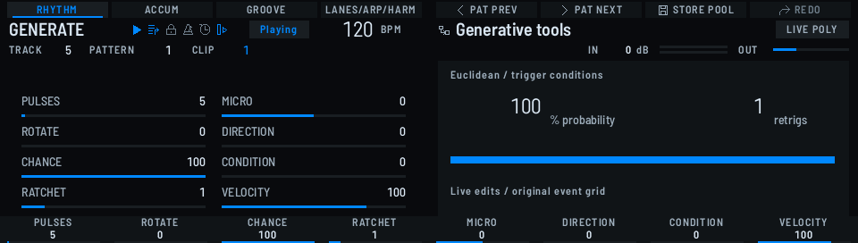

---

## 4. Building from samples / building with a DRUM KIT

### Previewing and assigning a WAV

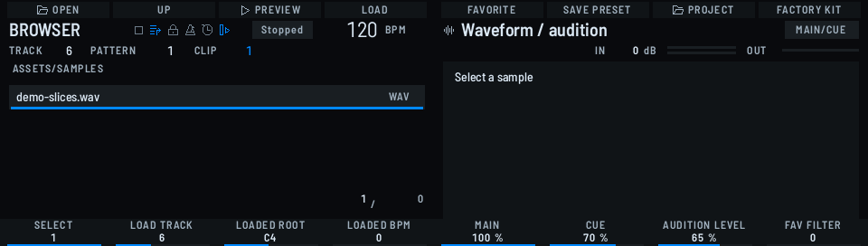

1. <strong>BROWSER</strong>. Select with 4-D rotation or K1 `SELECT`. Top1 `OPEN` enters a folder; Top2 `UP` returns to the parent. Opening a WAV works as an audition.
2. Select a WAV and press <strong>Top3 "PREVIEW"</strong>. It sounds to Cue. Check K6 `CUE` and K7 `AUDITION LEVEL`. If you are listening to Main only, you will not hear it. End with Top3 `STOP PREVIEW`.
3. Check the assignment destination with K2 `LOAD TRACK` and press <strong>Top4 "LOAD"</strong>. The Track becomes a Sampler. If a Kit is selected, the assignment goes to the selected Kit pad.
4. Move to <strong>SAMPLING</strong> and play it on a pad. The `SAMPLE ROOT` / `SAMPLE BPM` shown on K and elsewhere are the asset's metadata; they are not the result of automatic BPM analysis or values read back from a receiving device. Even if there is a saved Preset or another Track using the same asset, changing ROOT / BPM branches only to the working sound you have selected. This is not an operation that duplicates the asset PCM, and it can be undone with Undo.

Supported WAV formats are PCM 8/16/24/32 and Float32. Asset references are stored relative to the container when saving, and resolved against the DATA root at runtime. Avoid overwriting, from a PC and under the same name, a WAV that is currently sounding; load it under a different name. If loading fails, check the message and the original Track, and do not press OPEN repeatedly.

### Trim, slice, loop

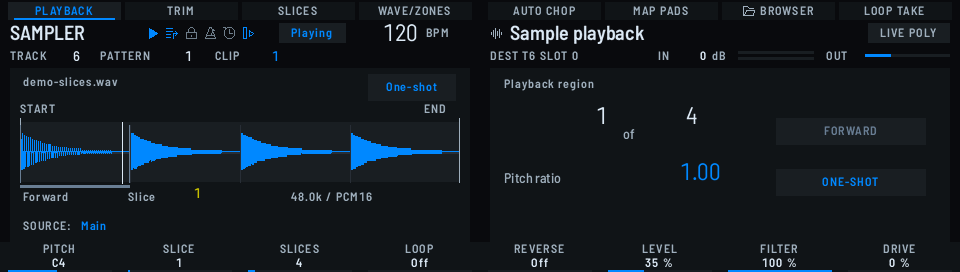
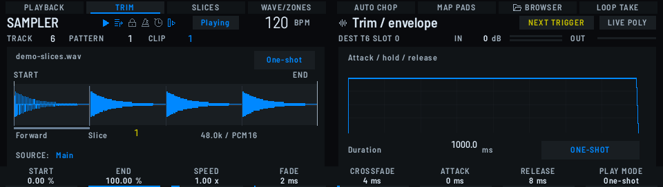
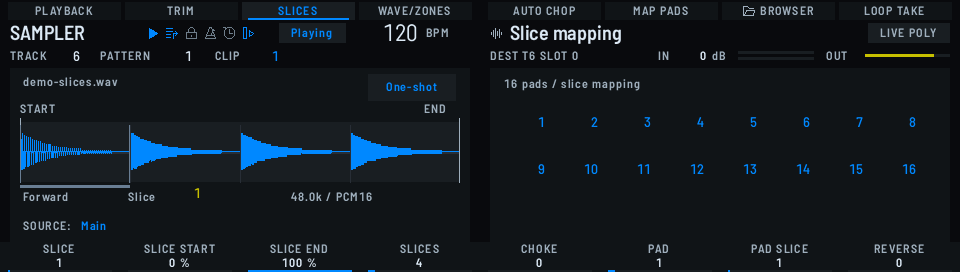

| Operation | Procedure |
|---|---|
| Trim the excess at the start and end | SAMPLING → Top2 `TRIM` → K1 `START`, K2 `END`. Adjust the boundaries with K4 `FADE` and K5 `CROSSFADE` |
| Automatic slicing | Top3 `SLICES` → Top5 `AUTO CHOP` → Top1 CONFIRM. Use K1 to select a Slice; correct the boundaries with K2/K3 |
| Put slices on the pads | Top6 `MAP PADS` → Top1 CONFIRM (without SHIFT). For a DrumKit it assigns to the 16 pads within the same Kit; for a Sampler it assigns the selected asset's slices to 16 Tracks, replacing the Track settings and the steps of the Pattern being edited. Undoable. SHIFT+Top8 `CHOP STEPS` → Top1 CONFIRM places a phrase in slice order into the step row of the selected Track |
| Use a loop stored in the WAV | On the WAVE page, SHIFT+Top8 `FILE LOOP` → Top1 CONFIRM. Only supported forward, infinite `smpl` loops. Slice and Reverse are released. The attack before the loop is not played |
| Waveform / time stretching | Move to WAVE with 4-D right. Top5 `STRETCH` opens the confirmation screen. Adjust the displayed ratio, then execute or cancel |
| Key / Velocity ranges | Move to ZONES with 4-D right. K5 `ZONE`, K6/K7 for the ranges, K8 `ROOT`. Press the 4-D encoder to switch between Key and Velocity editing |

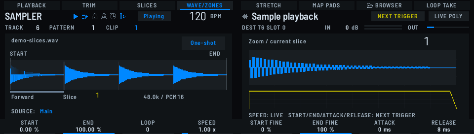
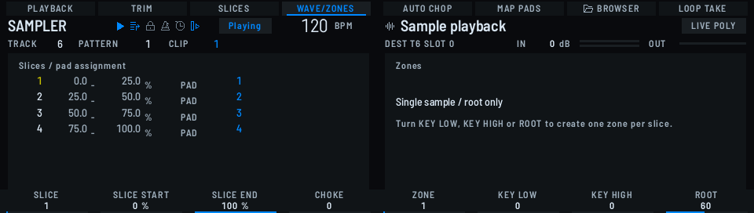

In ZONES, <strong>SHIFT+pressing the 4-D encoder</strong> toggles WARP for the selected Slice. This changes the playback speed following the asset BPM and Tempo, and is separate from the offline processing of WAVE/STRETCH. A waveform is analyzed after the asset's Preview/Load. Merely opening the Browser list does not start asset analysis or audition.

Even if you swap the asset while a note is sounding, a note being held continues to sound with the original asset and pitch reference, and the new asset is used from the next note you play.

### Entering a DRUM KIT

1. Select <strong>DRUM KIT</strong> in ENGINE, or load the default `FACTORY/KITS/Techno-01.mgxk` with the Browser's <strong>Top8 "FACTORY KIT"</strong>. The card must contain that asset.
2. In <strong>PAD MODE</strong>, the 16 pads are the sounds inside the Kit. A–H are still Track selection.
3. Select the Kit pad to edit with <strong>STEP + SELECT + Pad</strong>. Release SELECT and enter Steps. In a Sampler, too, you select the target with SELECT+Pad.
4. Use <strong>SAMPLING → LAYERS</strong> for Velocity layers and the like, and <strong>CHANNEL → FX → PAD INSERT</strong> for a Kit pad's FX. Always check the PAD number on screen.
5. <strong>MUTE/SOLO + Pad</strong> targets the sounds inside this Kit. Do not operate them thinking they are Track mutes while a Kit is selected.

---

## 5. Recording audio: choosing between the four methods

| Function | When to use it | Destination / result |
|---|---|---|
| REC INPUT / REC SOURCE | Recording external sound or an internal bus that is about to come in | `RECORDINGS/Live-NNN.wav`. Assigned to the target |
| CAPTURE | Reaching back up to 4 seconds for a sound that just played | `RECORDINGS/Take-NNN.wav`. A RAM history separate from normal recordings |
| RESAMPLE | Recording 1–4 bars of what is playing and turning it into an asset | The same Live-series WAV as a normal recording. Buses including FX can also be selected |
| OVERDUB IN / SRC | Adding input to a Sampler loop that meets the conditions | After verification and mixing, `RECORDINGS/Dub-NNN.wav`. Not unconditional overdubbing onto any loop |

### Recording the external input

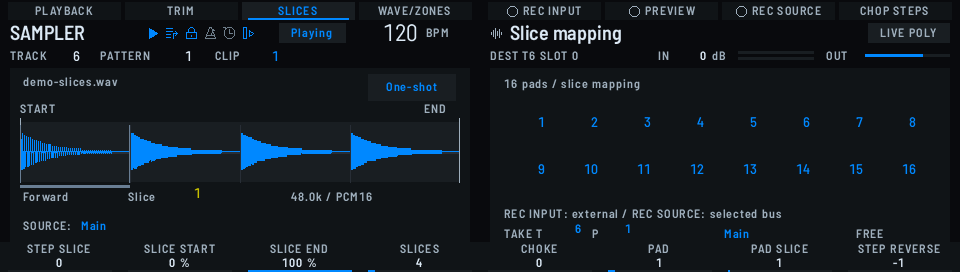

1. Connect the external sound source's LINE OUT to the MK3's LINE IN. At first, set ROUTING's `MONITOR` to OFF and keep the external source's volume low.
2. Select with A–H the <strong>Track you want the recording to go to</strong>. For a Kit, use SELECT+Pad in SAMPLING to also specify the destination pad.
3. <strong>SAMPLING + SHIFT + Top5 "REC INPUT"</strong>. This records the external Input. Even if ROUTING's CAPTURE BUS is Main, this operation is Input.
4. Make a sound. If playback is running and `REC MODE` quantization is ON, it stays `ARMED` until the next bar. **If the Transport is stopped, recording starts immediately even if the quantization setting is ON.**
5. Stop with <strong>SHIFT+Top5 "STOP RECORD"</strong>. While `STOPPING` is shown, wait for the save process to complete. The physical STOP stops the Transport; a normal free recording does not necessarily end.
6. When complete, audition on Cue with <strong>SHIFT+Top6 "PREVIEW"</strong>. Playing it on a pad or Step also applies Trim and the like. Finally, save the Project including the assignment with <strong>SHIFT+FILE</strong>.

On this instrument, **the Track, Pattern, Kit pad, source, and quantization settings at the moment you press the record button are fixed**. Even if you select another Track while recording, the recording is not assigned to that Track on its own. However, if you edit the original target so that it no longer matches, only the WAV may be saved and the automatic assignment may be refused. Watch the recording destination and source indications at the bottom and the completion message.

When you select Input with `REC SOURCE`, the sound source is the same Input, but the highlight is on the REC SOURCE side. This shows where the operation started. `BAR / FREE` indicates the **synchronization state at the start of recording**; it is not an indication of all stop-quantization behavior.

### Recording Main/Cue, a Track, or a Group

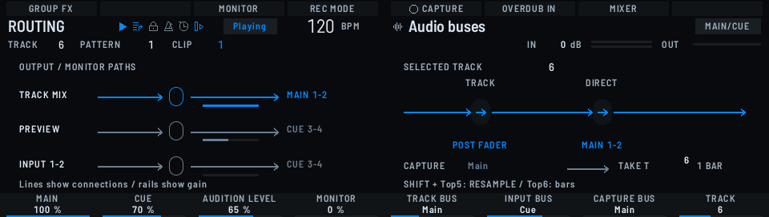
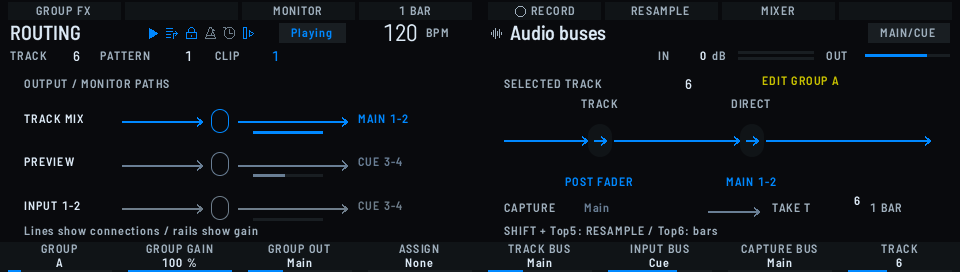

1. <strong>CHANNEL → ROUTING</strong>. If GROUP FX is showing, use Top1 `MAIN / CUE`.
2. Select the recording source with K7 <strong>CAPTURE BUS</strong>. Besides Main / Input / Cue, there are a Track's Fader / Dry / Insert, Returns, Perform, and Group. Check the Track/Group number in the same value field.
3. For continuous recording, use <strong>SHIFT+Top5 "RECORD"</strong>, or SAMPLING's <strong>SHIFT+Top7 "REC SOURCE"</strong>. Stop with the screen's `STOP RECORD` / `STOP SOURCE`.
4. For bar units, play with <strong>PLAY</strong>, select `1 BAR` to `4 BARS` with ROUTING's <strong>SHIFT+Top4</strong>, and press <strong>SHIFT+Top6 "RESAMPLE"</strong>.
5. Wait through `ARMED` → recording → completion. To cancel midway, use <strong>CANCEL RESAMPLE</strong>. It preserves the existing asset at the recording destination and removes the intermediate files owned by that process.

Audio recording and an Arrangement take cannot be started at the same time. While recording, you cannot change the recording source or the number of bars. Refreshing the Browser list is handled separately from file requests such as recording. Check the start and end of recording on the status display.

### Reaching back with CAPTURE

1. Decide ROUTING's K7 `CAPTURE BUS` first. **Changing the source erases the 4-second history.**
2. Play for a few seconds, select the destination Track / Kit pad, and press <strong>Top5 "CAPTURE" with SHIFT released</strong>.
3. Wait for the save / assignment message and audition in SAMPLING. This is separate from the 1-second Performance FX history on Main.

Capture and Overdub also fix the target at the time of the request. If you later edit the target's content so that it no longer matches, the process is refused rather than assigned to a different Track. Check the completion message.

### Conditional Overdub

1. First prepare a normal Sampler asset of exactly 1–4 bars. <strong>SAMPLING + Top8 "LOOP TAKE"</strong> is an auxiliary operation that, after confirmation, builds a Step configuration matching that asset. Read the display and press the 4-D encoder to confirm. Kits are excluded.
LOOP TAKE prepares a Track matched to the asset's root and a reference Step. Audition whether the whole bar can be played at normal speed before proceeding to Overdub.

2. The target is a playing Sampler Clip. The asset must be at the same sample rate, cover the full range, at speed 1, Forward, One Shot, with no Slice and no Reverse. Only Step1 sounds at the root note at 100% probability, and the length is the number of bars × 16. Conditions such as Pitch conversion and Arp are also restricted.
3. In ROUTING, choose Input, or a **different Track / Group that does not include the recording destination**, as the source. Even if you choose Main/Cue/Returns/Perform, in Overdub it is replaced with Input. Paths that would record and amplify itself are refused.
4. During playback, press <strong>Top6 "OVERDUB IN" or "OVERDUB SRC"</strong>. Wait for source confirmation → one bar of recording → mixing and verification → assignment.
5. If it does not work, confirm that the original asset remains. `Overdub: 1-4 bar take / Input or other track/group` is a general refusal indication and does not yet explain the individual cause.

Being able to use a wet Resample is not the same as being able to freely Overdub any loop with FX. If in doubt, RESAMPLE to a new Track and compare the assets before changing the configuration.

---

## 6. From Clips to Scenes, from Scenes to a song

### Making another pattern

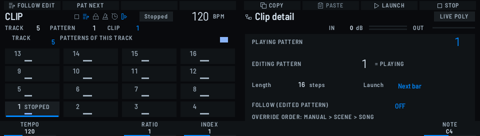

1. Go to CLIP with <strong>PATTERN</strong>. Select the edit Pattern to copy from with the 4-D encoder or SELECT+Pad, and press <strong>Top5 "COPY"</strong>.
2. Select a different Pattern with SELECT+Pad and press <strong>Top6 "PASTE"</strong>. A Pattern copy includes multiple Tracks' phrases, locks, automation, and launch-time PRESET references. The sound's attached state, the mixer, insert FX, and MIDI settings remain on the persistent Track side and are not rewound by pasting or its Undo.
3. Return to STEP and change the hat density or the bass.
4. Return to CLIP, select the Track you want, and press a pad, or use <strong>Top7 "LAUNCH"</strong>. Distinguish waiting states such as `NEXT` from the Pattern actually playing. <strong>SHIFT+Top7 "LAUNCH NOW"</strong> switches immediately.
5. <strong>Top8 "STOP"</strong> stops the selected Track's Clip. This is separate from the Transport's STOP.

A Kit's Pattern copy also includes the rows for all 16 Pads. CLIP's SHIFT-side "DOUBLE TRACK" doubles the selected Track; SHIFT+DUPLICATE doubles the whole Pattern, and the Kit's hits repeat for the same length. Automatic selection of an empty Pattern also treats a Kit's hits and automation as in use.

### Multiplying phrases quickly

After setting <strong>SHIFT+K8 COPY SCOPE</strong> in CLIP to **TRACK ONLY**, press Top5 COPY. Select a different Pattern and press Top6 PASTE, and only the phrase of the same Track number as the copy source is pasted. It includes locks, automation, and all of the Kit's Pad rows, while the other Tracks and the persistent Track settings are kept. Returning it to ALL restores the conventional whole-Pattern copy.

With <strong>SHIFT+Top6 DUP + VAR</strong>, choose **THIN / TRANSPOSE / DROP TRACK** with K1 and the density 0–100% / ±1–12 semitones / the Track to erase with K2, then press Top1 APPLY. It duplicates from the Pattern being edited to the next empty Pattern and does not change the original. THIN gives the same result for the same project seed and specification. TRANSPOSE passes through the existing scale snapping. DROP TRACK empties the phrase while leaving the sound engine. If there is no empty slot, the reason is displayed, and the whole creation can be undone with a single UNDO.

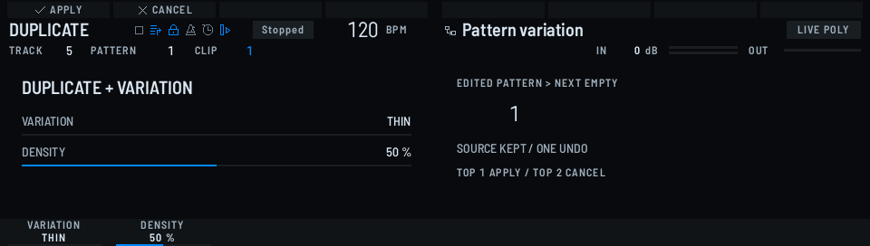

Pressing <strong>VARIATION → Top4</strong> in turn cycles through **LANES → ARP → HARMONY**. In HARMONY, select K1 SOURCE TRACK, K2 TARGET TRACK, and K3 MODE, then press <strong>Top5 GENERATE</strong>. BASS writes the root, at the target Track's octave, at the positions of the chord Steps; ARP writes normal Steps that cycle through the chord tones in 16ths. Replacing the target phrase is a single UNDO. If there are no chord Steps saved in the asset, it is refused. The same Track as itself, a Kit, or AUDIO cannot be used.

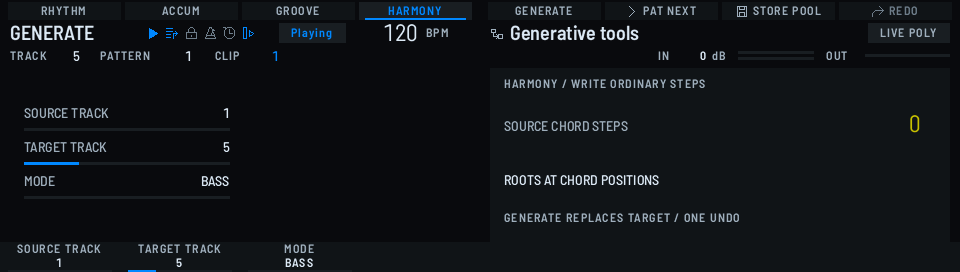

With <strong>VARIATION → Top3 GROOVE → SHIFT+Top6 APPLY ALL</strong>, you apply an EXTRACTed Groove (or, if there is none, the displayed Track's Groove) to all 16 Tracks at once, and undo it with a single UNDO. Because the current Groove is a persistent Track setting, it also affects the same Track in other Patterns. There is no named Groove library.

### Setting up Clip Follow

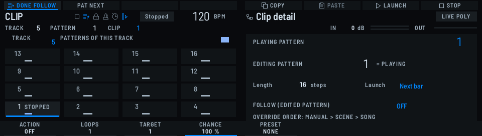

<strong>PATTERN → Top1 "FOLLOW EDIT"</strong>. K1 `ACTION` is Off / Stop / Next / Target / Random, K2 `LOOPS` is 1–64, K3 `TARGET` is 1–16, and K4 `CHANCE` is 0–100%. Select NONE / 1–256 with K5 `PRESET`. NONE keeps the current sound; specifying a number copies that pool value when the clip launches. Editing the pool after launch does not propagate to the attached destination, and STOP does not re-attach. If the slot is empty or an asset is missing, the launch is held. Return with Top1 `DONE FOLLOW`.

Example: to advance from Pattern1 to Pattern2 after Pattern1 has looped twice, set ACTION=Target, LOOPS=2, TARGET=2, CHANCE=100%. If you also set it on the Pattern2 side, they can cycle. Because there are priority relationships with manual launches and the Song, first turn the Song OFF and check it on its own.

### Telling editing and playback apart on screen

The left of CLIP is the <strong>Pattern list of the selected Track</strong>. The short bars at the bottom edge are hit density. If the **PLAYING PATTERN** and **EDITING PATTERN** on the right differ, **NOT PLAYING** is shown. FOLLOW holds the settings of the Pattern being edited. The **LIVE** on the left of SCENE is also separate from the selected Scene; the right side is the **TRACK → PATTERN** correspondence table. An amber underline indicates a Track whose assignment will change on launch.

### Saving a Scene

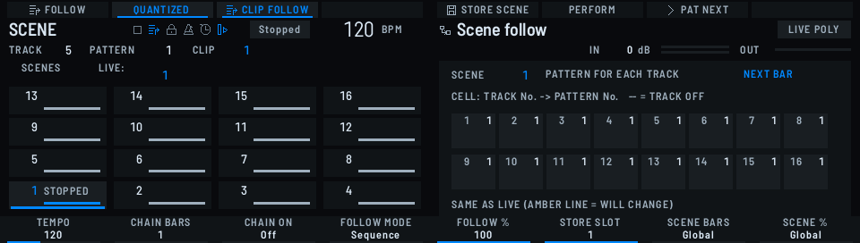

1. For an intro, launch/stop each Track's Clip and wait until the switch is actually reflected.
2. In <strong>SCENE</strong>, set K6 `STORE SLOT` to 1 and press <strong>Top5 "STORE SCENE"</strong>. Or save directly to a slot with <strong>SELECT+Pad1</strong>.
3. Build a configuration with bass and hats added and save it to slot 2.
4. Switch with SCENE's Pad1 / Pad2. Top2 `QUANTIZED / IMMEDIATE` is the switch timing.
5. Add to the Chain with SHIFT+Scene Pad, and progress automatically with Top1 `FOLLOW`. The physical FOLLOW button is for screen following, so distinguish the two.

<strong>SHIFT+Top5 DUP SCENE</strong> duplicates the selected Scene into an empty slot. Select K1 DEST SCENE and press Top1 APPLY. Duplication alone does not launch, and it can be undone with a single UNDO. Slots that are currently LIVE, waiting, referenced by a Song or Chain, or contain settings are refused. Because there is no saved flag, it cannot distinguish whether a Scene identical to the initial values was saved intentionally.

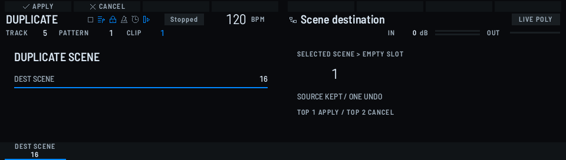

### Building a Song by hand

In an empty SONG, pressing <strong>Top6 SKELETON</strong> once places 5 sections referencing Scene1–5, of **4 / 8 / 8 / 8 / 4 bars**, and turns LOOP ON. Scenes, bar counts, and transposition can be edited with the existing knobs. If you are using 3 kinds of Scene, swap the references. If sections already exist, it refuses to overwrite, and the whole skeleton can be undone with a single UNDO.

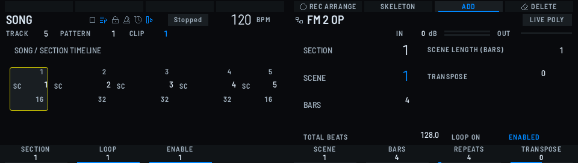

The title of SONG is always SONG. When you are only peeking at the Chain it shows **CHAIN PREVIEW**, and a span where a performance was recorded shows **SNAPSHOT (FROZEN CLIPS)**; the table on the right reads Track→Pattern in the same way as a Scene. The length under the timeline is the beat count; BARS on the right is the bar count.

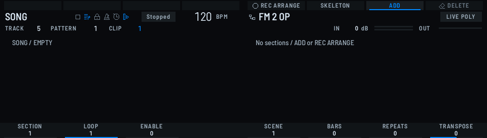

<strong>ARRANGER → SONG</strong>. Use Top7 `ADD` and Top8 `DELETE` → Top1 CONFIRM for up to 32 sections. Use K1 `SECTION`, K2 `LOOP`, K3 `ENABLE`, K5 `SCENE`, K6 `BARS`, K7 `REPEATS`, and K8 `TRANSPOSE`. As an example, make Scene1 four bars, Scene2 eight bars, and Scene1 four bars. <strong>Turn K3 `ENABLE` ON and play it as a song with STOP → PLAY.</strong> Use K2 `LOOP` to choose whether the whole song repeats.

To take in from the Chain, in an empty Song use <strong>SHIFT+Top7 "IMPORT" → Top1 CONFIRM / 4-D press</strong>. SHIFT+Top8 `CLEAR` → Top1 CONFIRM, which erases an existing Song, is also two-step. The pads are for section Mute editing, not Scene launches.

### Recording a performance into an Arrangement

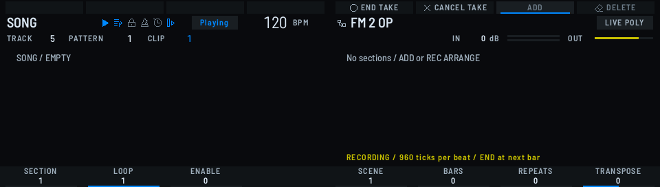
1. Finish note recording and audio recording, and <strong>STOP</strong> the Transport.
2. <strong>ARRANGER → Top5 "REC ARRANGE"</strong>. This action itself starts the Transport.
3. Move to <strong>SCENE</strong> or <strong>PATTERN</strong> and perform. Clip/Scene changes, stops, Mutes, and structural changes via Follow are recorded.
4. <strong>Return to ARRANGER → Top5 "END TAKE"</strong>. Wait for the next bar boundary, and check `Arrangement stored / one Undo restores previous Song`.
5. <strong>PLAY</strong> to listen back from the top, and <strong>SHIFT+FILE</strong> to save to disk. To cancel, use Top6 `CANCEL TAKE` while recording. After completion, you can return to the previous Song in EVENTS.

After recording, the section's K5/K6/K7 become <strong>TRACK / TICKS / PATTERN</strong>. 960 ticks = a quarter note; one bar of 4/4 is 3840 ticks. The phase and restart information of mixed Clips is retained, but <strong>playback from the middle of a selected section, and SPP/Continue to a captured phase, are not supported</strong>. This is not a recording of an audio file, nor a feature that records every knob movement. A take exceeding 32 sections fails and keeps the original Song.

---

## 7. Mixing, Automation, and performance effects

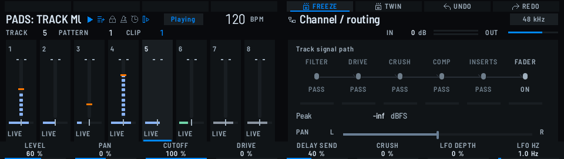

MIXER's Top5 is FREEZE and Top6 is TWIN (different from the legend in the figure above). PAT NEXT is SHIFT+Top5. For details on TWIN, see [TWIN](twin.md).

The meter body uses the Track's kind color, and the short horizontal peak-hold line uses the motion color. The warning zone is warn, and danger takes priority for excess/clipping. The MASTER and input bodies are neutral colors. Under MONOTONE, the body's kind color is projected to gray.
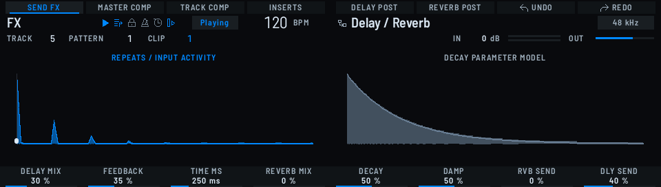
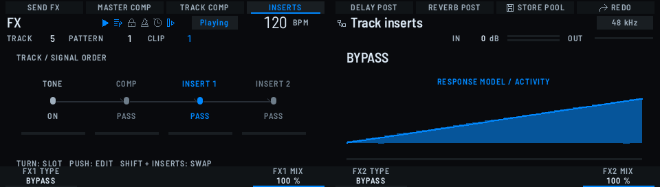

Use <strong>MIXER</strong> for levels, and move to FX with <strong>CHANNEL</strong> to adjust the Delay/Reverb Sends, the Master/Track Compressors, and INSERTS. Labels change with the selected page, so look at the names rather than memorizing K numbers alone. FX INSERTS has 2 slots, and Kit pads and Groups have their own dedicated editing. This is not an FX graph where you can wire anything freely.

<strong>MIXER → Top5 "FREEZE"</strong> renders the selected Track into audio material to reduce load. You can return to the original engine with `UNFREEZE` or Undo. Watch the screen while it runs, wait for completion, and audition whether the sound and length match the original instrument.

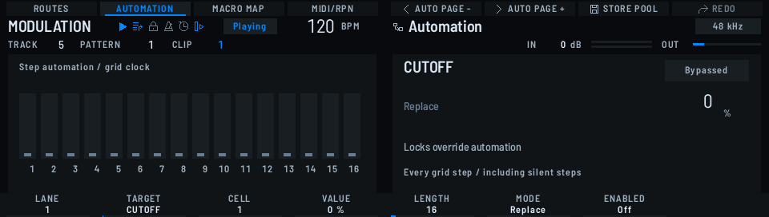
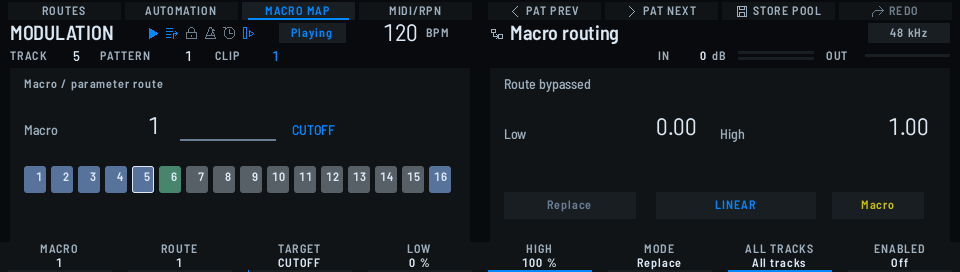

| Purpose | Procedure |
|---|---|
| Move the Cutoff periodically | AUTO → Top2 `AUTOMATION`. K1 LANE, K2 TARGET, K3 CELL, K4 VALUE, K5 LENGTH, K6 MODE, K7 ENABLED. Select Cells with the pads, move between 16-cell pages with Top5/6 |
| Move multiple targets with 1 knob | AUTO → Top3 `MACRO MAP`. Set MACRO / ROUTE / TARGET / LOW / HIGH / MODE / ALL TRACKS / ENABLED. Perform with the 8 knobs using the MACRO button |
| Move back and forth between 2 sound states | PERFORM → `STORE A`, change the sound, then `STORE B`. Operate the Smart Strip or A/B MORPH. STORE captures persistent base values and does not include temporary states such as Lock |
| Change all Tracks temporarily | PERFORM → `CONTROL ALL`. Select the target with the 4-D encoder, change relatively with the Strip, press the 4-D encoder to return to center |
| Loop a hand movement | PERFORM → Top3 `GESTURE` → RECORD → knob movements → END RECORD → PLAY LOOP. Up to 128 points |
| Performance FX | PERFORM → Top7 `LIVE FX`. Holds the FX shown on the pad display. Combined with SHIFT it latches. You can choose TRIGGER NOW/BEAT/BAR and RELEASE TAIL/DRY |

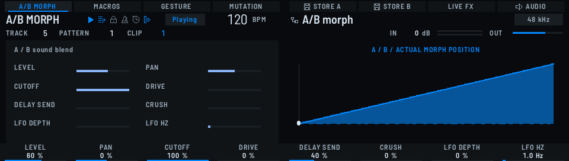
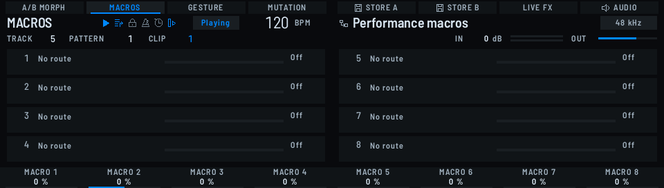
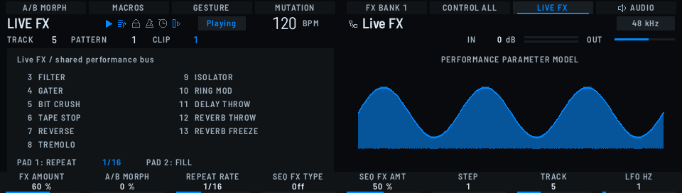
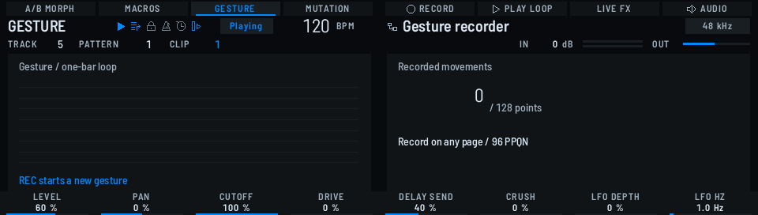

The final value of a sound is generally decided in the order <strong>base → Morph → Automation → Gesture → Macro → Lock → Control All → smoothing/Modulation</strong>. Even if you change a knob's base value, if a Lock or Macro is overriding it, the sound at that moment may not change. `RESET LIVE` clears Morph, Macro, Control All, and temporary FX, but does not erase Step-side Automation/Lock.

#### TWIN: switching a heavy engine to a prepared sampled version

**MIXER → Top6 TWIN** starts automatic capture if nothing is prepared yet. You can set the range first with
**SHIFT+Top6 TWIN**. K1 LOW NOTE / K2 HIGH NOTE /
K3 INTERVAL (semitones) / K4 VELOCITY / K5 HOLD MS / K6 LIMIT MS.
Up to 16 notes, 1 velocity layer. If the note count on the settings screen exceeds the limit, you cannot PREPARE.
Stop the Transport, or stop the target Clip. The captured sound does not go to Main/Cue, and
progress is displayed. Cancelling with Top1 CANCEL or STOP keeps the original assignment.

On a **TWIN READY** Track, pressing Top6 once switches it to
**TWIN ACTIVE** (the Sampler version) at the next bar while playback continues. Pressing the same Top6 again returns it to the synth version at the next bar. While stopped, it switches immediately. The Top6 LED is dimly lit for READY,
brightly lit for ACTIVE, and blinks fast while a switch is reserved. Editing the engine makes it **TWIN STALE** with a slow blink,
and you press Top6 to re-prepare. FREEZE is a recording of the phrase itself; TWIN is a keyboard instrument that records each pitch separately. PAT NEXT is on SHIFT+Top5.

Saving the song retains the pair and the asset references. When moving assets, also use COLLECT.
While ACTIVE, using the normal SAVE PRESET AS lets you save just the sampled version as a named Preset.
Selecting that Preset and using COLLECT takes the WAVs with it too.
Sustain loops are not generated automatically; long sounds last up to LIMIT. The first preparation needs 2 Pool slots and
1 asset slot.
For detailed constraints, see [TWIN](twin.md).

### Playing with the Strip

| Physical button | While touching the Strip | When you release your finger |
|---|---|---|
| PITCH | Adds about ±2 semitones around the center to the current Track. For MIDI OUT, 14-bit bend | Returns to the original resolved bend |
| MOD | For internal engines, adds to the filter LFO depth. For MIDI OUT, CC 1 | Removes the addition, and CC 1 returns to its original value |
| NOTES | A range of 2 octaves from the Track's root. Moving the position does old Note Off → new Note On. Applies the existing scale/transpose | Note Off |
| PERFORM | The conventional Morph/performance FX | The conventional behavior |

PITCH/MOD/NOTES can also be used outside the PERFORM screen. The target is fixed to the Track where you started touching, and release is handled on Track/Pattern changes, mode changes, STOP, Panic, and input disconnection. If the DSP queue is full, the release request is held and resent. The input identifier for NOTES is kept separate from external MIDI input and the physical pads.

The Strip's values do not rewrite saved parameter bases or the Undo history. NOTES uses the note recording path. No feature has been added to record MOD movements themselves into a new automation lane. The bend range of an external instrument also depends on the external instrument's own settings. Whether MOD is audible depends on the Cutoff, the LFO Rate, and the engine's sounding state.

#### Synth editing and how to use Top / the knobs

The left LCD arranges the existing K1–K8 names, values, and shapes in two columns. The right LCD displays actual PCM, FFT, harmonics, or a scan position according to the declaration, or a TONE/ADSR model. Read the difference between model and measurement from the caption. MIDI OUT maintains the MIDI routing and external control editing.

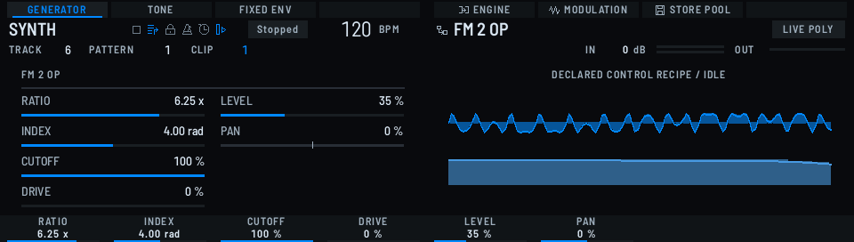
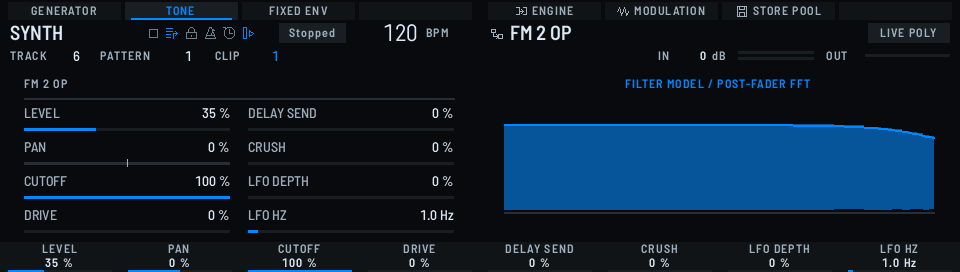
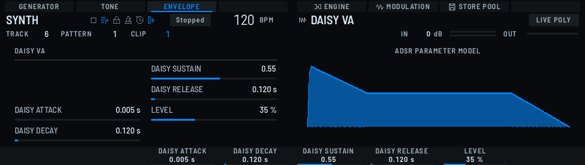
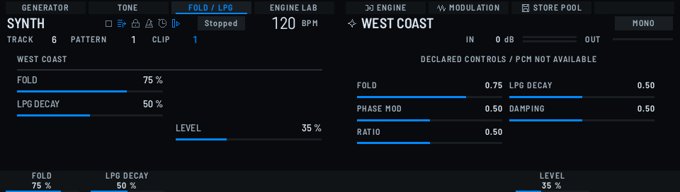

| Top | Assignment and use |
|---|---|
| 1 | GENERATOR. For MIDI OUT it is MIDI OUT; for a Drum Kit it is KIT |
| 2 | TONE. Common editing of Filter/Drive/Sends/Level/Pan/LFO |
| 3 | ENVELOPE/LPG/FOLD / LPG if editable. FIXED ENV for fixed curves. Blank/disabled for engines without support. Sampler/Kit go directly to TRIM |
| 4 | ENGINE LAB for Creative engines, INPUT / QUALITY for TEXTURE. Otherwise blank |
| 5 | ENGINE selection. Switches to dedicated knobs such as Family/Engine |
| 6 | MODULATION. Common to all engines. Sampler editing is from the physical SAMPLING button |
| 7 | STORE POOL when the slot is empty. Choose the registration destination with PROJECT K4 POOL SLOT |
| 8 | RECALL POOL only when a registered slot exists. BACK while ENGINE is being selected. SHIFT+Top4 is the MIDI OUT WAVE PROFILE |

For a Layer, the left side is Top1 LAYER / Top2 TONE, and on the LAYER page, left Top3 USE CHILD / Top4 REMOVE (an exception that uses the left frame, which has no page selection). Deletion is Top1 confirm / Top2 cancel. LOAD ENGINE on ENGINE's Top5 loads the default sound, and pressing the 4-D encoder descends into the sound list. Turning a knob alone does not load anything.

The reason a Layer cannot be loaded is displayed in the right header of the performance screen. Check `LAYER REFUSED` and the reason below it, such as budget or assets. There is no behavior that relaxes the acceptance conditions in order to make it sound partially.

For the per-engine operation names and enabled states, see the [generated Synth operation table](manual/synth-control-audit.tsv). Internal engines other than Kits proceed to BAKE PRESET with SHIFT+Top8.

#### The looper and Song AUDIO tracks

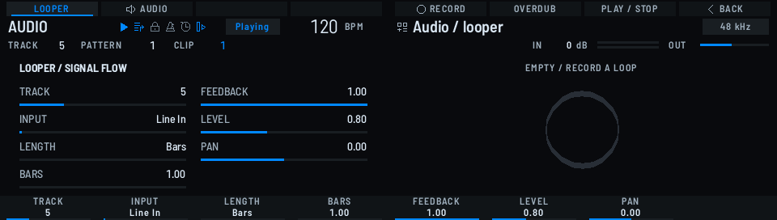

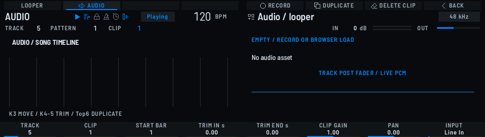

**PERFORM → Top8 AUDIO** is the proper entry point. Selecting an audio slot does not implicitly repurpose STEP/SYNTH, etc. into AUDIO. Choose **Top1 LOOPER**, **K2 INPUT**, **K3 LENGTH**, **K4 BARS**, then **PLAY → Top5 RECORD**. Pressing again while recording is STOP. Layer with **Top6 OVERDUB**, and adjust how much of the previous loop remains with **K5 FEEDBACK**. **SHIFT+Top6 TAKE UNDO**, and normally **Top7 PLAY / STOP**. There are 4 audio slots in total, and 1 recording.

With **Top2 AUDIO** you can record onto the Song timeline. Return with **SHIFT+Top8 SONG**, prepare a section and Song playback, and select Track/CLIP from the same entry point. **Top5 RECORD → press again** for bar-unit punch-in/out. **K3 START BAR**, trim with **K4/K5**, **Top6 DUPLICATE**, **Top7 DELETE CLIP → Top1 CONFIRM**, **SHIFT+Top6 TAKE UNDO**. **SHIFT+Top7 CLEAR** also goes through confirmation. Tempo does not change the audio speed. [All operations and boundaries](audio-tracks.md).

---

## 8. Saving and resuming / taking it to a PC

### Normal save, SAVE AS, and resuming

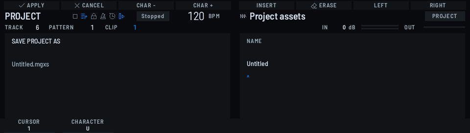

1. Finish audio recording with STOP RECORD and wait for file processing to complete. **FILE → Top1 SAVE** or **SHIFT+FILE**.
2. The first SAVE of a new song opens the naming screen. To split an existing song under a different name, use **Top4 SAVE AS**.
3. Use **K1 CURSOR** for the character position, and **K2 CHARACTER** or 4-D rotation for the character. Edit with Top5 INSERT, Top6 ERASE, Top7 LEFT, Top8 RIGHT.
4. Save with **Top1 APPLY** or a 4-D press; cancel with Top2 CANCEL. The `.mgxs` extension for songs is completed automatically (an entered MGX-family extension is also replaced). Even if you specify an existing name in SAVE AS, it will not overwrite, so enter a different name.
5. After completion, SAVE updates that song itself. Open the current song's folder with **Top2 OPEN / Top6 FILES**, and when you OPEN a different song in the Browser, subsequent saves go to that song as well. Uppercase and mixed-case MGX/MGK/MGP are also handled.
6. After a successful save/load, the startup song is remembered in `GROOVE/CURRENT.TXT`. If the startup reference is invalid or missing, it tries `FACTORY/DEBUG/Benchmark.mgxs`. After a reboot, check the song name, notes, sounds, Song, and assets. The Undo history and temporary states during performance are not resumed.

PROJECT's Tops are **SAVE / OPEN / NEW / SAVE AS / COLLECT / FILES / STORE POOL / RECALL POOL**. The asset number is **K1 ASSET**. The internal format of the MGX family is MGXC. `.mgx` / `.mgxs` / `.mgxk` / `.mgxp` are all loadable, and even if the name and contents differ, a file is opened by its internal kind. A normal SAVE keeps the existing name, and SAVE AS aligns it to the standard extension. A normal save creates no history backup, and switches over from a verified `.tmp`. OPEN also checks a same-name `.tmp` only when the original file is unusable, and displays `Recovered .tmp` when recovering. If a corrupt original file and tmp remain and SAVE is refused, recover with OPEN and save under a new name. Past `.bak` files and numbered generations are not read. There is no guarantee against power being cut during writing. Do not treat a save failure or sync warning as success; wait for completion.

### Taking it out with its assets: COLLECT

1. **FILE → Top5 COLLECT**. You can also return to the same screen from the Browser's Top7 PROJECT.
2. Check the completion display `<song name>-Export/`. Inside it are `project.mgxs` and `assets/`.
3. Finish recording and saving, turn the power off, and copy the **entire folder** from the SD's DATA to a PC. The referenced WAVs do not come with the Project alone.
4. Open the copied Project in a Desktop backend of the same version, etc., and check that no assets are missing.

COLLECT does not change the original song's normal save destination. It is not an audio mixdown either.

### Reusing Kits / Presets

| Operation | Actual procedure / save destination |
|---|---|
| Normal save of a Kit/Preset | SELECT + 4-D press, or SHIFT+Top5 STORE FILE in the sound list. A Factory item is saved as a User version |
| Named save / duplicate as a separate item | SHIFT+Top6 STORE AS / SHIFT+Top7 DUPLICATE in the sound list → name entry → Top1 APPLY |
| Load | Select a file whose internal display is KIT/PATCH in the BROWSER and LOAD. Check the target Track first |

The save destination is `PRESETS/<name>.mgxp` for a single sound and `KITS/<name>.mgxk` for a Kit. For name entry, move the cursor with K1, change the character with K2 or 4-D rotation, and save with Top5 INSERT / Top6 ERASE and Top1 APPLY. If a file with the same name exists, choose Top1 OVERWRITE / Top2 CANCEL. SHIFT+Top6 in the file-shelf BROWSER is RENAME. Even if you OPEN a Preset, the Track's volume, pan, MIDI ch, root note, and phrases are retained. FX are normally retained, and a Preset/Kit saved with INCLUDE FX ON loads its Insert/send together. Turning ON K4 DUPLICATE during name entry makes it a separate sound with a new GUID. A Kit replaces only the pad definitions and leaves the existing pad Steps.

STORE POOL / RECALL POOL use 256 slots. They also retain Kit pad definitions, MIDI OUT Program/CC, and Daisy's ADSR. Editing after RECALL is reflected only on the load destination; to change the original pool, STORE again. A named save/load registers the bundled GUID/rev definition into the pool, and reloading the same item does not increase the number of slots. A Sampler/Kit whose samples are not loaded cannot be RECALLED. If you select a Preset / single Drum Kit file in the file-shelf BROWSER, you can temporarily load it onto the selected track with Top3 PREVIEW to audition it. Top3 STOP PREVIEW returns to the original. Unlike WAV Cue audition, it uses that track's volume, FX, output destination, and mute. While stopped it auditions 1 note; while playing, it is also reflected in the selected track's phrase. It is also released by file selection, track, or screen changes, editing, Transport operations, and project loading. Even if you save during an audition, the original sound is saved, and the Undo history and pool slots do not increase. You can also cancel with STOP PREVIEW while loading.

The track name is independent of the sound name. Edit it from SYNTH with SHIFT+Top6 TRACK NAME, and leave it blank to return to the sound name / instrument name. It is saved into the song even after a sound exchange or SMF name import, and can be undone. A song's `NEW REV` is the mark that a new version exists in the library, and `EMBEDDED` is the mark that it uses the saved bundled version. It does not change to a new version automatically.

The FILES folder display is a window of 64 items at a time. Advance as you are with 4-D rotation / K1 SELECT / 4-D up/down, and check the end by the selection number / total count. If enumeration or memory allocation fails, it becomes an error, and does not display just the first 64 items as if they were all of them.

### Renaming, deleting, and creating folders

An old-format MGXC is displayed as `UNSUPPORTED` in the list and cannot be OPENed. If it is not needed, stop, choose DELETE on the SHIFT side, confirm, and delete one file at a time. There is no automatic deletion or migration of old versions.

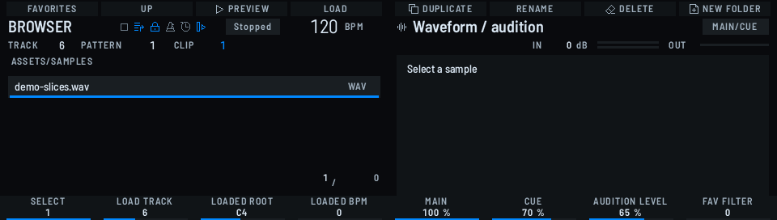
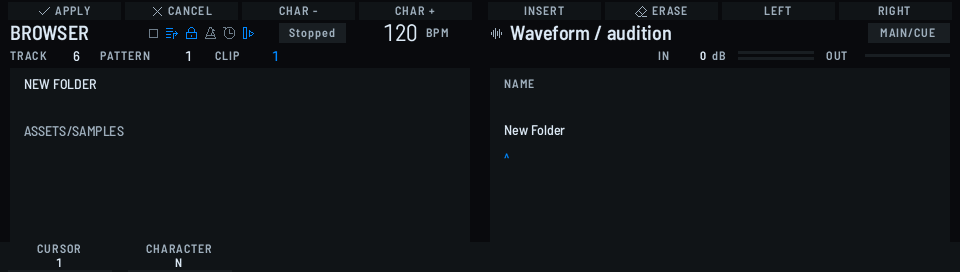

1. Stop the Transport, recording, Preview, and file jobs.
2. Select the target in the BROWSER, then <strong>SHIFT+Top6 "RENAME" / SHIFT+Top7 "DELETE" / SHIFT+Top8 "NEW FOLDER"</strong>.
3. For name entry, use 4-D rotation for characters and K1 for the cursor. 4-D left cancels, a press applies. Top3/4 `CHAR -/+`, Top5 `INSERT`, Top6 `ERASE`, Top7/8 `LEFT/RIGHT`. Confirm with Top1 `APPLY` or `DELETE`, and return with Top2 `CANCEL`.
4. Items in use, items referenced by a saved Project, protected areas, and items with unknown references are refused. Folder deletion is only for empty targets. Do not judge a refusal as "the delete feature is broken"; read the status.

For a `.part` from an interrupted recording, select it in the BROWSER and use <strong>SHIFT+Top5 "RECOVER"</strong>. It recovers only recoverable recordings into WAVs. It is not a feature that can always recover from every corrupt file or power cut.

### Passing it on as audio

There is no dedicated operation on the unit to bulk-export a Song into per-Track WAVs. Either record an internal bus with REC SOURCE into a WAV, or record via <strong>MK3 LINE OUT → an external recorder / a PC's audio input</strong>. Internal recording involves assignment to the destination Track, so use an empty Track and check the effect on the original song. When recording something long, check the SD's free space first.

Even if you connect this unit's Pi USB-C to a PC, it does not necessarily become a generic USB audio/MIDI device or SD storage. For USB-C file operations use the dedicated MGF1 CLI, and over the network use Wi-Fi FILE TRANSFER. See the transfer procedures later in this manual.

---

## 9. Working with external MIDI equipment

### Playing an external synth

1. MK3 <strong>MIDI OUT → external sound source MIDI IN</strong>, and the external sound source's Audio Out → MK3 LINE IN or a separate mixer.
2. Select an empty Track, and choose <strong>MIDI OUT</strong> in ENGINE.
3. <strong>AUTO → Top4 "MIDI"</strong>. Match K1 `CHANNEL` to the external sound source's receive channel. Enter a few notes in STEP and PLAY.
4. For CC, use K2 `CC` and K3 `CC VALUE`. Use the CC numbers from the receiver's manual. Some items become Lock editing with SHIFT.
5. To return the audio to this unit, set `INPUT BUS` and `MONITOR` in CHANNEL's ROUTING. If you want the input as audio material, use REC INPUT.

With a short MK3 MIDI OUT → MIDI IN loopback, you can exchange Note, CC, Program, Pressure, and Pitch Bend, plus Clock/transport, on all 16 channels. For details, see [Hardware](hardware.md#din-midi). The DIAGNOSTICS MIDI counter is the internal send/receive count, and is not a guarantee of delivery to external equipment. With an external sound source, first check a single note's Note On/Off before using Clock or complex CC.

### Playing this unit from an external keyboard

External keyboard MIDI OUT → MK3 MIDI IN. In <strong>AUTO → MIDI → hold SHIFT and use K1 "INPUT CH" / K2 "INPUT TRACK"</strong> to assign a channel to a Track. If it is Off, nothing sounds. The input path is saved in the project. Sustain, Pitch Bend, and Pressure are handled, but this is not MPE's independent per-note expression. Pad pressure is also a per-Track expression.

### Clock synchronization

Using AUTO / MIDI's K8 `SLAVE CLOCK` makes it follow the tempo of an external Clock. <strong>It is not a slave with completed phase lock.</strong> Check separately that the BPM display matches and that the external equipment's downbeats stay aligned over a long period. While following an external Clock, Clock echo from this unit is suppressed. Do not create a DIN loop; try one direction first.

### RPN / NRPN

<strong>AUTO + SHIFT + Top4 "RPN / NRPN"</strong>. K1 SLOT, K2 ENABLED, K3 NUMBER, K4 VALUE, K6 TYPE. 4 slots are shared per Track. Values are raw 14-bit, and the meaning and permitted values on the receiver side differ per device. Check the number you will use before enabling.

### Exchanging MIDI files with a DAW

| Direction | Procedure and limits |
|---|---|
| Export a performance for external MIDI | Start/stop with FILE → SHIFT+Top4. Saved with sequential numbers as `RECORDINGS/MIDI00.MID`, etc. These are events the Engine accepted into the output queue, not proof of physical delivery |
| Export the notes of internal engines | Start/stop with FILE → SHIFT+Top5. Records Track 1–16 to MIDI ch 1–16. This is not an operation that sends notes out |
| Import a .MID | Select a .MID/.MIDI in the BROWSER, and set K2 TRACK and K3 MIDI CH. <strong>SHIFT+Top4 "IMPORT MIDI" → press the 4-D encoder to confirm</strong>. Replaces the Steps of the Pattern/Track at confirmation time in bulk. Can be cancelled on the left while in progress. Failure/cancellation retains the original data; success can be undone in EVENTS |

Export is SMF0, with 1ms SMPTE time. It does not completely preserve the song's tempo map, Clock, Transport, SysEx, or all sound Modulation. Import covers SMF0/1, up to 256KiB, 4096 events on the selected channel, 256 Steps, 8 notes/Step, and 2 free Automation lanes. <strong>The tempo map is ignored</strong>. Check the conversion/omission messages, compare by listening in your DAW, and then adopt it. To pass the sound itself, you need a WAV.

---

## 10. Worked example: making a song throughout

In this chapter, you create one new song, and operate in order through drums and hand-recorded FM, FX, recording the song, and saving and resuming. Each example is independent, so you may refer only to the ones you need. The examples continue on the same song, using Track A = Kick, B = FM, and C = internally recorded material.

### Getting ready

If you have edits you want to keep, wait for SAVE to complete. Prepare the MK3 and Pi, and equipment to hear the output. To hear Main and Cue separately, use both the listening destination of LINE OUT and PHONES (with only one of them, you can still proceed with the examples other than hearing them separately).

On screen, Top runs 1–8 from the left, the knobs below are K1–K8, and Pad1 is at the bottom left.

### Sounding drums in a new song

Create a new song with **FILE → Top3 NEW → 4-D press CONFIRM**. From **A → PLUG-IN → Top5 ENGINE**, choose KICK with K1 FAMILY / K2 ENGINE, and confirm with Top5 LOAD ENGINE. In **STEP → Top1 "1 - 16"**, set K1 TEMPO = 120 and K8 LENGTH = 16, press **Pad1, 5, 9, 13**, and **PLAY**.

The 4 steps on screen, the pad LEDs, and the four-on-the-floor output all agree. The pressed display does not remain after you release a pad.

### Recording FM by hand, and touching the sound and the Strip

Select FM with **B → PLUG-IN → Top5 ENGINE**. **KEYBOARD → REC**, play just 2 notes in one bar while it plays, and press **REC** again to release. Listen to the recording with **STOP → PLAY**. Change **PLUG-IN → Top1 GENERATOR → K2 INDEX** slightly, then **EVENTS → SHIFT+EVENTS**. Move **Top2 TONE → K3 CUTOFF**. **PITCH → move the Strip and release, MOD → the same, NOTES → the same**. If the MOD change is hard to hear, move TONE's K8 LFO HZ and lower the Cutoff slightly and listen.

The hand-played notes are reproduced as they are, and the INDEX value, figure, and sound move together. You can undo operations with Undo/Redo. When you release the Strip, the pitch/modulation additions return, and the additional notes from NOTES stop. FM's Top3 FIXED ENV is not an editable ADSR.

### Hearing FX and Main/Cue separately

With B still selected, move to FX with **CHANNEL**, then **Top1 SEND FX**. Raise K8 DLY SEND and K1 DELAY MIX slightly and listen to the repeated sound. Return to **CHANNEL → ROUTING**, and switch K5 TRACK BUS **Main → Cue → Main**. If GROUP FX appears, use Top1 MAIN / CUE.

The FX display and the audible effect correspond, and B's direct sound moves to the specified output. A's Kick keeps sounding on Main. The Send's reverberation is a separate path, so listen to it distinguished from the direct sound.

### Recording the song, and adjusting the waveform and trim

Keep playing, and on empty **C → CHANNEL → ROUTING**, set K7 CAPTURE BUS = Main, **SHIFT+Top4** for 2 BARS, **SHIFT+Top6 RESAMPLE**. After the recording-start display, switch to **D**, wait for completion, and return to **C → SAMPLING**. Listen to the recording with **SHIFT+Top6 PREVIEW**, and stop it with the displayed STOP PREVIEW. In **Top2 TRIM**, look at the waveform and K1 START / K2 END, and move START slightly. Play the edited material with **STOP → PAD MODE → Pad3**.

The recording ends in 2 bars, and the material is assigned to C. D is unchanged. The Kick and FM are recorded, and the waveform and trim position are displayed. The Preview sounds on Cue and can be stopped. If you can hear Main and Cue separately, the original song on Main keeps playing during the Preview too.

### Giving it a name, saving, and reopening

With recording and Preview finished, enter an unused song name (e.g. `My Song 01`) with **FILE → Top4 SAVE AS**, and press **Top1 APPLY**. After completion, change **STEP → K1 TEMPO** to 123 and overwrite-save with **SHIFT+FILE**. Now change just the Tempo to 110, and without saving, go to **FILE → Top2 OPEN**. Select the song you just saved in the Browser, press **Top1 OPEN**, and when the confirmation screen appears, choose CONFIRM.

The song gets its name, and the Tempo returns to the saved 123. With PLAY, A's and B's notes, sounds, and FX are reproduced, and C's material and trim remain as well.

### Resuming production from the next startup

The next time you power on and start up, the saved song opens automatically. **PLAY**, and you can also sound C's material with **STOP → PAD MODE → Pad3**. The song name, Tempo 123, A's and B's performance, sounds and FX, and C's material/trim are all retained as they were. The Undo history and the Strip position during performance are not restored.

### Adding a looper and AUDIO tracks

Add a looper and a linear AUDIO track to the same song.

- **Wet loop and overdub** — On empty D, PERFORM → Top8 AUDIO → Top1 LOOPER. Set K2 INPUT to B's Insert or Fader, K3 Bars, K4 to 2. During PLAY, press Top5 RECORD. After it finishes in 2 bars, mute B, and you can hear the recorded sound and FX from D. Restore B, set K5 FEEDBACK to 0.5, Top6 OVERDUB → wait for completion → SHIFT+Top6 TAKE UNDO. Stop/restart with Top7. The loop works at bar heads, and you can hear the difference between the overdub and the Undo. The loop display and the output correspond.
- **Recording linear audio** — Prepare and enable an 8-bar section in the Song. Switch empty E to Top2 AUDIO, and set K8 INPUT to Main. During Song PLAY, press Top5 RECORD, wait at least 1 bar, and press again. Move the placement back by 1 bar with K3, and trim the edges slightly with K4/K5. Top6 DUPLICATE, Top7 DELETE CLIP → Top1 CONFIRM, SHIFT+Top6 TAKE UNDO. Listen to the placement with **STOP → PLAY**. The recording start position, movement, trim, and duplication agree in figure and sound. If you save, D's loop and E's placement remain at the next startup too.

### Even if you change the Pattern, the sound design and mix remain

Set B's volume, pan, and insert, duplicate it to another Pattern with CLIP COPY/PASTE. Change just 1 hit, launch them alternately, and also perform an Undo of the PASTE. Only the phrase switches; the sound, volume, pan, and insert you set remain.

### PRESET launch-time copies and NONE

Specify a slot you STORE POOLed yourself with CLIP → FOLLOW EDIT → K5 PRESET and launch it. After launching, edit the same pool slot, move to a NONE Pattern, and then re-launch the specified Pattern. Editing the pool alone does not change the sound being played, the loaded sound is maintained even with NONE, and it changes to the new pool value when the specified Pattern is re-launched. STOP alone does not reload it.

### Combining with external equipment

These are examples for when you have external equipment connected via DIN. If you don't have any, skip them.

- **Sounding an external sound source via DIN, and recording that sound** — Connect **MK3 MIDI OUT → external sound source MIDI IN**, and make the external sound source's audio audible. Make empty D MIDI OUT in ENGINE, and match **AUTO → Top4 MIDI → K1 CHANNEL** to the receive channel. Repeat 1 note with **STEP → Pad1 → PLAY**, and stop with **STOP**. The external sound source sounds at the specified pitch, and no notes remain after stopping. If a LINE connection is also possible, go external sound source OUT → MK3 LINE IN, set ROUTING's MONITOR to OFF, and use empty **E → SAMPLING → SHIFT+Top5 REC INPUT**. Record a few seconds with PLAY, and after **SHIFT+Top5 STOP RECORD** completes, STOP, and listen with **SHIFT+Top6 PREVIEW**. The actual sound is in E's WAV, and it plays in the intended one-channel/both-channel configuration.
- **Playing an internal engine from an external keyboard, and recording the notes** — Remove the DIN output cable, and connect **external keyboard MIDI OUT → MK3 MIDI IN**. Make empty F an internal engine such as VA SAW. With **AUTO → Top4 MIDI → SHIFT+K1 INPUT CH / K2 INPUT TRACK**, assign the keyboard channel to F (Track6). Move to **KEYBOARD**, press and release 1 note on the keyboard, and F sounds and stops after the set Release. With **REC → PLAY**, play 2 notes in 1 bar, release REC, and **STOP → PLAY**. The recorded notes remain on F and are reproduced. SAMPLER's REC is audio recording, so this example uses KEYBOARD.
- **Following the tempo of an external Clock** — With the same one-way DIN connection, make an external device that can send Clock the master, and set **AUTO → MIDI → K8 SLAVE CLOCK = ON**. Play briefly at 120 BPM, and when you change it to 100 BPM, this unit's Tempo and performance speed follow. This is tempo following, not phase synchronization of the downbeats. When finished, return SLAVE CLOCK to OFF.

### Trying engines: WAVETABLE and VA

- **Continuous change in WAVETABLE** — Select WAVETABLE in SYNTH → Top5 ENGINE, or load `WT Glass Motion.mgxp` from the BROWSER's FACTORY/Presets. Sound it with the keyboard/pads, and turn GENERATOR's K1 POSITION, K2 SCAN DEPTH, K3 SCAN RATE. Change the attack and afterglow with K4 ATTACK and K5 RELEASE. The change in waveform position appears continuously in the sound, and when you release a note it falls silent after the release. The Curve paints the waveform model of the table asset, and the band below displays the declared scan range and the actual scan position. When silent, it is a still model at the declared POSITION.
- **VA waveforms and ADSR** — Load VA DUAL in ENGINE, or `VA Wide Saw.mgxp`. Move GENERATOR's K1 OSC 1, K2 OSC 2, K3 DETUNE, K4 OSC MIX, K5 CUTOFF. Change Top3 ENVELOPE's K3 ATTACK / K4 DECAY / K5 SUSTAIN / K6 RELEASE. The waveform, mixture, beating, and filter, and the envelope while held and after release, correspond to the operations. Detailed values such as PWM/SUB/NOISE/RESONANCE are retained in the Preset / declaration schema.

### Baking a performance into a Preset (BAKE PRESET)

Create a 1-bar phrase on an engine Track, and proceed to BAKE PRESET with SYNTH's SHIFT+Top8. The initial input is after that Track's Fader. PLAY, set the number of bars with SHIFT+Top4, and record with SHIFT+Top6 RESAMPLE. When it completes, the same Track becomes a Sampler and moves to TRIM. Adjust the edges with K1 START / K2 END, and go to Top8 ROOT / ZONE. Set K8 ROOT to the reference key of the recorded sound, and set the range to sound with K6 KEY LOW / K7 KEY HIGH (initially 1 zone, the full key range, root 60). Top8 SAVE PRESET → name entry → Top1 APPLY → PROJECT Top5 COLLECT.

This creates `PRESETS/<name>.mgxp` and `PRESETS/<NAME IN UPPERCASE>-EXPORT/PRESETS/preset.mgxp` plus `ASSETS/`. You can take out the entire Export folder and load it, and the pitch changes on the keyboard. If an asset is missing or the CRC does not match, it does not load, and keeps the original sound. At the end, Top8 DONE. SHIFT+Top8 ends the guide.

BAKE's entry point is for a single internal-engine Track. For a Kit, assign to each Pad with the normal recording operations. BAKE is pitch playback of a single recording. It is not automatic multisample capture. The recording destination is the selected Track, and it replaces that engine with a Sampler. If you also want to keep the original editable synth sound, first save it as a named Preset. The Track's volume and FX remain after recording too. If you baked an input that includes FX, bypass the original FX as needed and adjust for double application. The guide ends on a Track change / Project load, and does not proceed if recording fails. If you cancel name entry, you can resume from Top8 SAVE PRESET. During the guide, everything other than Top8 remains normal operation. COLLECT exports a saved Preset with its assets, so if you changed the sound design after saving, save it again.

### Feature entry points

Features not covered in the basic flow can be tried from the following entry points when you use them. For details of each operation, see the relevant chapter of this manual.

| Feature | Entry point |
|---|---|
| Kit/Slice | Sound 2 pads with the FACTORY KIT in chapter 4, or AUTO CHOP → MAP PADS on recorded material |
| Clip/Scene/Arrangement | Following the procedure in chapter 6, duplicate 1 Pattern and change 1 hit → save 2 Scenes → launch them in order with REC ARRANGE → END TAKE → PLAY |
| Lock/Automation/Macro/Morph | Choose 1 feature to use from chapters 3 and 7, and move just the Cutoff |
| Overdub | Layer Input once onto a 1-bar take that meets the conditions in chapter 5 |
| Save-as / asset export | In chapter 8, save under a different name with SAVE AS → OPEN the original song, or open the entire COLLECT folder on a PC |
| SMF exchange | In chapter 9, record 1 bar as .MID → check it in a DAW → IMPORT MIDI into an empty Track |
| Browser management | RENAME 1 unused asset, and NEW FOLDER → DELETE an empty folder |

---

## Sound engines in detail

### Additional engines RESONATOR / TEXTURE

Select with **PLUG-IN → Top5 ENGINE → K1 PHYSICAL → K2 ENGINE → 4-D press**. RESONATOR is an engine that sounds an internal exciter with pads/notes, and TEXTURE is an engine that continuously processes a selected input.

| Engine / page | Top buttons and knob operations |
|---|---|
| RESONATOR | Top1 RESONATOR. K1 Model, K2 Structure, K3 Brightness, K4 Damping, K5 Position, K6 Level, K7 Pan |
| EXCITER | Top3 EXCITER. K1 internal Polyphony 1/2/4, K2 FM (semitones), K3 Transpose (0–60 semitones) |
| GRAINS | TEXTURE's Top1. K1 Mode, K2 Position, K3 Size, K4 Pitch, K5 Density, K6 Texture, K7 Freeze, K8 Level |
| BLEND | Top3. K1 Dry/Wet, K2 Spread, K3 Feedback, K4 Reverb, K5 Level, K6 Pan |
| INPUT / QUALITY | Top4. K1 Input source, K2 Quality, K3 Freeze, K4 Trigger, K5 Gate |

To use an external sound with TEXTURE, select **Top4 → K1 Line In** and feed the signal into the MK3's LINE IN. In TEXTURE's MODE=GRANULAR, set **Top1 → K5 DENSITY to 75–100%** to bring out the grains. Around the centre, grain generation stops, as in the original. To process an internal sound, use the same K1 to select `Dry 1`, `Fader 1`, `Group A` and so on. The internal bus adds one frame of latency. On both engines, Top2 TONE adjusts the common body filter and the like. TEXTURE's modulation settings are on Top6 MODULATION.

There are four quality settings: `32k 16b ST / MO` and `16k 8b ST / MO`. As in the original, lower quality and Mono give longer recording time, and the sound changes too. Once sound has been captured, turn Freeze ON to hold it. If changing the mode or quality has reinitialised the original's buffer, **BUFFER RECORDING / BUFFER FROZEN** in the centre of the screen shows the actual state. Turn Freeze OFF→ON to hold the sound again. Trigger fires once on OFF→ON; Gate is active while ON. A note input also fires the Trigger.

Saving a Project saves the setting values. TEXTURE's recording memory, frozen audio and reverb tails are not saved. To keep a sound, turn it into a WAV with the existing REC SOURCE / Resample first, then save and COLLECT. TEXTURE processes its input even while stopped. After a Panic, resume with Start, a note, or by reselecting the engine.

The screens are images generated by the renderer (not photographs of the real LCDs).

#### Worked examples

- **Playing RESONATOR** — Select it from ENGINE on an empty Track, play the pads and switch between the three models with K1 on Top1. Setting Polyphony to 4 on Top3 EXCITER makes chords and runs of notes ring over each other.
- **TEXTURE input and Freeze** — Play a sound on another Track, and on TEXTURE's Top4 INPUT / QUALITY → K1 select that Track's `Dry`. Raise Density to 75% or more on Top1, and set Dry/Wet to 100% on Top3 BLEND. Try each mode once, feed sound in for a few seconds, then turn Freeze ON. After changing the quality, turn Freeze OFF→ON to hold the sound again, and watch the BUFFER display and the change in sound.
- **Saving the settings** — SAVE→OPEN a Project containing both engines, and the Model/Mode, Input, Quality and knob values come back. Frozen TEXTURE audio is not saved, so Resample it to a WAV first if you want to keep the sound.

### Editing Plaits

The ENGINE's Plaits is "PLAITS 24". There is no "PLAITS OSC". Under SYNTH → CORE, choose MODEL and HARMONICS / TIMBRE / MORPH / DECAY / COLOR. MODEL offers 24 models, and the five values are displayed as 0–100%. FM's RATIO / INDEX use the same system of declared-value controls.

### FM 6 and DX7 banks

Separately from the regular FM, you can select **FM 6** from ENGINE. Use CORE's K1 PATCH (0–95), K2 BRIGHTNESS, K3 ATTACK, K4 RELEASE and K5 MOD DEPTH. ATTACK / RELEASE take effect from the next note. The FM6 Electric Piano / Wineglass / Metal Pad in FACTORY/Presets are also entry points.

For an external 32-voice bank, stop playback, select a `.syx` in the BROWSER and **OPEN** it. This creates 32 named `.mgxp` files in `Presets/DX7-<number>` and opens that folder. Select a sound to load and try it. Each Preset contains the original patch, so the original syx is not needed, and the 256-slot pool stays empty. Changing the PATCH=-1 of an imported sound switches it to the internal bank.

- **Worked example** — Load Electric Piano / Wineglass / Metal Pad in turn and play them. Turn BRIGHTNESS and MOD DEPTH, and play again after changing ATTACK / RELEASE. OPEN one of your own 32-voice syx files, load one of the 32 files, save it and load it again. The sound, the release and the controls are all reflected, and the original bank is kept.

### SoundFont banks

Select a `.sf2` in the BROWSER and **OPEN** or **LOAD** it. The first sound in the bank is loaded onto the selected Track. Edit with K1 **BANK**, K2 **PROGRAM** (both 0-based), K3 **TUNE** and K4 **GAIN** under **SYNTH → CORE**. A BANK / PROGRAM combination that does not exist is silent. If the manufacturer's sound list is 1-based, subtract 1 from PROGRAM. You can use `FACTORY/DEBUG/SF2-Sine.mgxp` as an entry point.

A normal SAVE PRESET creates a small `.mgxp` that references the SF2's path and CRC. To carry a sound out, use COLLECT, which moves the Preset together with the SF2 in assets as a folder. If the original SF2 is changed or deleted and the CRC no longer matches, loading is held and the current sound is kept. SF2 files are read into RAM. Very large banks, and reproduction of every SF2 feature, are not guaranteed.

- **Worked example** — Play the debug sine and check that the sound stops when you release the key. OPEN one of your own SF2 files, choose a sound by BANK / PROGRAM, then SAVE PRESET → COLLECT, and load the bundled Preset again. The sound, velocity, key range and release are reproduced as they were. A program that does not exist is silent, and if a material is missing the current sound is kept.

### Opening a large SoundFont

When you OPEN an SF2 or a SoundFont Preset in the Browser, the current sound is kept while loading runs. A separate worker — apart from the screen, input and audio — decodes the bank and loads it on completion. If you change the destination Track or the engine assignment during loading, the load is cancelled rather than overwriting the new content. If the size, CRC or material verification fails, the original sound is kept. Not every SF2 is guaranteed to load.

### Additional engine: ADDITIVE / PHASE DIST

1. Select ADDITIVE under SYNTH → ENGINE and LOAD it. Use knobs 1–5 on GENERATOR to change BRIGHTNESS, ODD / EVEN, FOCUS, WIDTH and MOTION.
2. Move to Top3 ENVELOPE and use knobs 3–6 to change ATTACK / DECAY / SUSTAIN / RELEASE. Play the keyboard pads — press, hold and release — and listen.
3. Switch to PHASE DIST and work with GENERATOR's WAVE / DISTORTION / ENV DEPTH / MOTION / RATE and the ENVELOPE.
4. You can also load ADD Organ / ADD Moving Glass / PD Pulse Bass / PD Curved Pad from FACTORY/Presets in the Browser.

### LAYER

1. On a single-engine SYNTH → PROJECT, select an empty slot with K4 POOL SLOT and register a child Preset with STORE POOL (4-D press) from the list. Register as many children as you need the same way.
2. Select LAYER under ENGINE and press Top5 LOAD ENGINE. On the LAYER screen after loading, select a candidate pool with knob 3, then Top3 USE CHILD. Move to the next Child with knob 2 and add up to four layers.
3. With K8 EDIT PAGE=MIX, every layer sounds across the full range on the same note. Changes to knob 4 LEVEL / 5 PAN / 6 DETUNE take effect from the next note. Top4 REMOVE → Top1 CONFIRM removes a child.
4. You can save it as a named Preset in the Browser, carry it out with COLLECT and load it again. Changing the pool does not change the sound of a saved Layer.
5. Setting KEY LOW/HIGH and VEL LOW/HIGH with K8 RANGE switches which children sound by key range and velocity. K8 FX 1/FX 2 edits the Inserts, and SENDS edits the Sends and LEAF FX. The outer Track FX can be used at the same time.
6. If you play repeated notes with a long release and the VOICE COST exceeds the CAPACITY (a CAPACITY EXCEEDED indication), some new notes will not sound. Existing notes are never cut off in only one layer.

### VA DUAL polyphony

VA DUAL **guarantees 16 simultaneous voices in total; 32 voices are best effort**. The shared voice pool has 32 slots, shared with other engines and Layers. This does not prohibit selecting 32 voices, and it does not change sounds, quality or saved data. The fixed 16-voice performance window is not a guarantee of deadlines when switching Projects, stopping, or using every FX at once. If the DSP budget would be exceeded, the reason is displayed, loading is refused, and the sound and quality currently playing never change on their own.

### Operating the synth extensions

Select **FORMANT** under ENGINE, and switch FORMANT / VOSIM with K1 MODE on **GENERATOR**. Move the vowel continuously with K2 VOWEL, and change the voice's resonance with K3 FORMANT SHIFT, K4 SHAPE and K5 MOD DEPTH. **ENVELOPE** is K3 ATTACK / K4 DECAY / K5 SUSTAIN / K6 RELEASE, and **TONE** is the usual track-common processing.

**GRANULAR** is an engine that plays a sample from the keyboard, separate from TEXTURE's input effect. Select GRANULAR under ENGINE and OPEN a WAV in the BROWSER, and the material is assigned while keeping that engine. Set the Browser's ROOT to the material's reference key. GENERATOR is K1 POSITION / K2 SIZE / K3 DENSITY / K4 TEXTURE / K5 SPREAD. The ENVELOPE uses the same ADSR layout as FORMANT. JITTER / FREEZE / PITCH OFFSET are detail parameters and are not added to the body's performance knobs. FREEZE becomes effective 256 ms after the initial buffer fill. Its dedicated resources are four voices across the whole body; at the limit, the oldest voice of a normal sound is replaced. If a material is missing or the CRC does not match, loading is stopped and the current sound is kept.

VA DUAL's existing performance knobs are unchanged. The detail categories include HARD SYNC / CROSS MOD / PITCH ENV・DECAY / SUB WAVE / FILTER TYPE / SVF MODE / FILTER MORPH. There is no detail editor body, so these cannot be edited from the body's performance knobs.

Under **FX → INSERT**, the TYPE can be **PITCH SHIFT** (SHIFT is −12 to +12 st, MIX is the common slot MIX) or **ROTARY** (SPEED = SLOW / FAST / BRAKE, DRIVE, and the common MIX). The B operation for Pitch is blank. Rotary displays two rotors and a branch line; Pitch displays the processing path and the dry/wet merge. The diagrams explain the structure; they are not measured displays of the rotation phase.

The **K3 INCLUDE FX** of **SAVE PRESET AS / OVERWRITE PRESET** is OFF when a save operation starts (the choice is kept through a name-conflict confirmation). With it ON, the track's two Inserts and its Delay / Reverb Sends are saved. On loading they are applied together with the sound, and a single Undo returns them too. A Preset saved with it OFF does not change the destination's FX. Track volume, pan, compressor and master FX are not included. A Preset output trim set on the host is saved and LOADed regardless of INCLUDE FX, and is applied after the Layer / Kit-wide Inserts. An existing file without a trim plays at unity gain. No extra editing knobs are added to the body. Pool registration does not include the outer Track FX. Each Layer child has its own independent LEAF FX, kept regardless of the outer INCLUDE FX. PREVIEW temporarily applies bundled FX if there are any, and on stopping returns to the original sound, FX and trim. For a sound without FX, PREVIEW uses the current Track's FX. To carry a sound out, bundle its materials with COLLECT as usual.

### Tempo-synced LFO

**MODULATION → Top1 ROUTES → K5 LFO SYNC=ON.** K2 changes from HZ to DIVISION. Raise K3 DEPTH and PLAY, and the LFO syncs to the beat position. There are 12 divisions from 2/1 to 1/16 (including dotted and triplet values). Changing SYNC or the division during playback takes effect from the next beat; STOP halts the sync phase, and starting PLAY from the top returns to beat 0. With it OFF, the LFO free-runs at the original HZ. The right screen shows the applied division and the live phase. LFO SYNC and LFO DIVISION can also be assigned to Locks, Automation and Macros.

The new save format is MGXC13. Songs, Presets and Kits from MGXC12 and earlier are rejected, not migrated. GUID identity is maintained.

The Factory Library holds 187 items in MGXC13 format (163 Presets + 24 Kits). Filter by KIND and ENGINE to choose, and PREVIEW plays only when you explicitly operate it. The save screen's INCLUDE FX targets the outer Track FX; the LEAF FX inside a Layer is kept as part of the child's sound definition.

---

## Performance features in detail

### Per-engine Morph and carrying materials out

PERFORM's STORE A / STORE B save the common control values and each engine's declared values into the selected set. The four A/B sets also include MODEL and ADSR. When you change a Track's engine to another engine, all of that Track's sets are aligned to the current values, so the previous sound's Morph values are not applied to the new engine. UNDO returns the engine and the four sets. Group / Master Morph is unaffected.

PROJECT's COLLECT gathers not only the song's Tracks but also the materials referenced by the Preset pool, AUDIO, freeze and sample locks. Materials that are not used are not included in the output. The original song and WAVs are not changed. SAVE PRESET for WAVESEQ / Tape Micro / Spectral also saves material references. Built-in waveforms via empty slots are valid, but a Preset whose specified WAV cannot be found is stopped from loading.

### Locks, automation and Macros per engine

Under AUTO's Top2 AUTOMATION / Top3 MACRO MAP, and with SHIFT+Top6 CONTROL ALL in PERFORM A/B MORPH, you choose either a common control value or the selected engine's parameters from the target list. An engine-specific target shows its owning engine's name. For example, setting FM's RATIO and then changing to Plaits does not make it act on Plaits' HARMONICS. Change back to FM and the original edit applies again. In the Macro target Track display, Tracks with a different engine are dimmed. The selection mask itself is kept.

LEVEL / PAN / CUTOFF and the like are common targets across engines. MODEL is also a target for automation / Macros / Locks / Gestures and takes effect from the next note. Holding a pad in STEP and turning K2 MODEL Locks the MODEL to that step. SHIFT+K2 is the usual SOUND LOCK selection. Choosing an engine-specific target in Control All applies it to that engine only. A new Project's Macro 3 default target is REVERB SEND.

- **Worked example** — On an FM Track, Lock RATIO to a step and choose the same engine's target under AUTO. Change to Plaits, and the FM settings do not act on any other parameter. Change back to FM and the settings apply again, and the target engine survives SAVE / OPEN. A MODEL change takes effect from the next note.

The current save format is MGXC13. Older formats are not read. A Song / Preset / Kit containing an unregistered engine displays `Unsupported engine / current content kept`, is not loaded, and the current content is maintained. Keeping unknown data in the codec alone is a separate contract from normal loading. A Lock / automation / Macro / Gesture that points at an unsupported declaration of a registered engine keeps its GUID, declaration number and value saved, but is not applied in playback. The screen displays `Unavailable`, and that value cannot be edited. You can reselect the target to a supported declaration. Unknown references are limited to 64 GUIDs per Project, with declaration numbers 0–31. Exceeding the limit refuses the load and keeps the current Project.

### Vocoder INSERT

Play a sustained sound to serve as the carrier on a Track, then under FX → INSERT set **K1 FX1 TYPE = VOCODER**. Choose the input L / R / L+R with **K2 MODULATOR**, set **K3 CARRIER = SLOT SIGNAL**, and set the amount of effect with **K4 MIX**. Connect a microphone or the like to the MK3's existing input at an appropriate signal level. To use an external sound as the carrier, set K3 to INPUT L / R / L+R. An L+R modulator is averaged mono; the carrier is stereo. With no input, the wet sound is silent.

The screen's upper half shows the analysis of the input sound; the lower half shows the 16-band application to the carrier. FX2 and pad/group INSERTs use the same choice names and routing meanings.

- **Worked example** — Play a sustained VA or similar sound and set the Vocoder up as above. Send a voice or a changing sound into the input, and switch MODULATOR L/R, internal/external CARRIER and MIX to compare. Stop the input and the wet sound decays; BYPASS returns the original sound. The settings survive SAVE / OPEN.

### The TRACKER display in STEP

**Briefly pressing STEP again** cycles through 16 STEP / 64 STEP / TRACKER. SHIFT+Top4 does the same. TRACKER shows four Tracks on each LCD, eight Tracks in total. The 4-D knob moves left/right between Tracks, up/down and rotation between steps, and a press toggles note ON/OFF. NOTE / VELOCITY and the like edit the same data as the original STEP knobs. The Pads keep the usual 16-step layout.

Light **FOLLOW** and PLAY, and each column's playing step is held in the centre while the data above and below flows. Because each Track wraps at its own length, columns with different lengths or speeds show different centre numbers. Even in reverse playback, up and down follow the step-number order; it is not a preview of the next firing order. A column where another pattern's clip is running shows the editing pattern statically. Starting to edit releases FOLLOW and shows the selected step in an amber frame. Resume with FOLLOW.

A cell shows the **step number / saved NOTE / velocity**. `*` indicates the presence of a ratchet, microtiming, a non-standard gate, a Lock or the like. For details, return to the existing SHIFT knobs / STEP. A DrumKit shows the simultaneous hit count (H) and the maximum velocity; AUDIO is not a step target. NOTE is the saved value, not the final pitch after transpose and the like are added.

- **Worked example** — Play two Tracks of lengths 7 and 12. With TRACKER+FOLLOW, watch each column's centre hold and independent wrap, stop editing with 4-D up/down, and change a press, NOTE and VELOCITY — the same step has changed when you return to 16 STEP. Undo returns it. Add a ratchet or microtiming and a `*` appears. FOLLOW resume and left/right Track selection are operated on the same screen.

### MULTITIMBRAL

1. Load sounds onto the Instrument Tracks you will use, and STORE POOL only the sounds you need into the pool. AUDIO / Looper slots are not MIDI sound targets.
2. SETTINGS → move with 4-D left/right to MIDI → 4-D up/down to MULTITIMBRAL → set K1 to On. Playback stops, and the screen shows the MIDI Channel→Track mapping. A notice is displayed on entry, and `MODULE` is shown at all times on the performance screens. Pressing PLAY during MULTITIMBRAL displays the guidance `SETTINGS > MIDI > MULTITIMBRAL: OFF / THEN PLAY`.
3. Send Note On/Off from an external keyboard or DAW to Ch1, Ch2 and Ch16, and only Tracks 1, 2 and 16 respond respectively. Sustain and CC120 / 123 are also answered.
4. With CC0=0 and CC32=0/1 → Program Change 1–128 (raw values 0–127), you can select pool 1–256. Selecting an empty slot keeps the current sound.
5. An external Start / Stop does not start the sequencer. Select MULTITIMBRAL under SETTINGS → MIDI and set K1 to Off to return to normal. Restart by pressing PLAY; the normal MIDI input routes from before are restored.

---

## Reading the screens

### Extended screens and knob list

In STEP's TRACKER display, touching a knob shows the ARC + value in that knob's cell only; the selected row and the body's positions do not move. Knob names and current values are always displayed. About 1.2 seconds after you release the knob, only the ARC closes. The same rule applies on other pages.

Briefly pressing STEP again cycles through 16 STEP / 64 STEP / TRACKER, and a long press of about 400 ms enters note editing.

### Text, legend and temporary displays

One line at the bottom of the screen always shows the short names of K1–K8. The ARC + value floats up in only the touched or turned knob's cell, and each disappears individually about 1.2 seconds after you release that knob. There are no full-width bands and no duplicated names. The body and the TRACKER's selected row do not move. Holding a page-opening button for about 400 ms as it is displays the "operation > effect" hints usable in that state, and releasing it closes them. STEP still enters note editing as before. DIAGNOSTICS keeps its entry on Top8. Normal input is accepted during animations too.

When you reserve a NEXT BAR launch with CLIP or SCENE during PLAY, the reservation destination and the frame's progress are displayed in step with the bar position, and the reservation display disappears when the switch happens.

The screen list is in the [page × theme index](manual/screens.html).

### Reading the icons

Read Top1–8 by picture + text; the operations are as before. ENGINE = engine selection, the waveform line = MODULATION, the disc = STORE/SAVE, the box with a return arrow = RECALL, the box with heat lines = BAKE. SETTINGS' seven categories also keep their text. Parameter names, values and file names are not turned into icons.

The small marks in the left header mean the following, from the left.

| Position | Meaning / lighting condition |
|---|---|
| 1 | Triangle = playing, square = stopped, circle = recording. Record standby is the circle's outline; during playback / recording it is filled. A text badge is shown alongside |
| 2 | Line + arrow = FOLLOW active |
| 3 | Padlock = Lock editing (SHIFT / held step) |
| 4 | Metronome = click active |
| 5 | Clock = external Clock follower setting. Not a display that guarantees sync accuracy |
| 6 | Vertical Strip + shape = PERFORM / PITCH / MOD / NOTES. The current assignment is also distinguished by shape |

The marks at the start of the right header and in the ENGINE list are the engine families. The shape and meaning are the same in all nine themes; they are not judged by colour alone.

### Reading the visualizations

The Top buttons and the K1–K8 operation targets are as before. On SYNTH, read the value on the left as "name + value at a fixed position + shape". A continuous value is a bar at the lower edge, a bipolar value such as PAN has a centre mark, a stepped value is segments, and a choice is a chip. SETTINGS follows the same rule; the Browser is large primary information, small secondary information and the state on the right; MIXER is vertical meters + volume and PAN.

| Display | What it draws / worked example |
|---|---|
| Scope | A filled waveform of the PCM or of an analysed WAV peak. Common to SYNTH normal engines, the SAMPLER, Browser auditioning and recording input. The Browser's thin lower strip is the actual Cue audio, and the vertical line is the actual audition position. A material's peak is kept in 440 columns even while stopped or being re-analysed. Only the final completed waveform of the same material is kept |
| Spectrum | A real FFT of post-fader audio from TEXTURE / RESONATOR and the like. At 48 kHz, 512 points ≈ 10.7 ms, mono `(L+R)/2`. TEXTURE's Freeze and quality are also shown in the caption. Not a diagram of particle positions or of the whole stereo peak |
| Bars | ADDITIVE's relative components, with the recipe's largest partial as 1, × the real envelope. While stopped it is the NORMALIZED HARMONIC RECIPE. The FX VOCODER uses 16 real followers, which decay when the input disappears. Values of a Pad's individual routes that are not published are displayed as FOLLOWERS NOT PUBLISHED |
| Ring | The actual playback position of PERFORM → AUDIO/LOOPER, the recorded section and the input level. The inside is the previous take kept for Undo. Overdubs are mixed into the WAV and saved; this is not a display of the number of independent layers. Position-type Live FX also show the real phase |
| Curve | For WAVETABLE, the waveform model of the real table asset, the scan-range band and the actual position; for ENVELOPE, the ADSR model with the real level; for PERFORM's Morph, the real position between A/B. DELAY / REVERB are decay models calculated from the settings |
| Response | A response model calculated from the TONE / Filter and each Insert's settings. The faint FFT is the real audio. COMPRESSOR overlays the real detector and GR, and Chain shows the actual Tone→Comp→Insert 1→Insert 2 order and activity |

`MODEL` / `RECIPE` explain the settings; `LIVE PCM` / `MEASURED FFT` / `ACTUAL` are captured data. If the FFT has not been captured, that is displayed. In silence the display also settles, and when the CPU is busy, visualization updates are thinned out. Audio quality and voice count are never lowered for the sake of this display. Immediately after switching the input source, results from the old source are not used.

Silent generators such as PLAITS display the names and values of their declared parameters and a static bar (not PCM, and they do not draw a waveform-like half-sine from the values either). A Scope that is sounding switches to a display filled from the centre line with the real PCM. WAVETABLE's waveform is the table model, and the band below is the scan range and current position. Headings, captions and the text positions of value rows follow the common rules.

### Operation grammar

The left Top1–4 are the faces and ranges of the same target; the right Top5–8 are processing and exits. The document operations of BROWSER / PROJECT are an exception that keeps their existing positions. LAYER's left Top3 USE CHILD / Top4 REMOVE are also exceptions, performing in-face operations in a frame that has no face-specific page. In the sound lists PRESETS / KITS, the left Top filters and selects, and the right Top is PREVIEW / LOAD / FILES / BACK. ENGINE is right Top5 LOAD ENGINE / Top8 BACK, and a 4-D press descends into the sound list. Confirmation is Top1 CONFIRM / Top2 CANCEL; a 4-D press and the left button have the same role. Name entry is common to all save destinations. Pressing both page buttons at the same time for about 400 ms performs HOME / RETURN.

To select a Track, press that Track's button (A–H). Selecting while holding SHIFT switches the target while keeping the upper layer. Holding MUTE / SOLO / SELECT and choosing a Track designates it as that operation's target. A long press of a Track gives a temporary display (Peek), and releasing it returns to the original screen. In CHANNEL's Group pages, A–H select buses.

SHIFT+RESTART reserves a restart at the top of a bar; RESTART alone restarts immediately.

GENERATE is entered from the physical VARIATION, and generates note recipes with RHYTHM / ACCUM / GROOVE / LANES・ARP. Pressing Top4 again toggles between LANES and ARP. PERFORM is left Top1 A/B MORPH, Top2 MACROS, Top3 GESTURE, Top4 MUTATION. Mutation handles the mutation amount and seed of existing notes, with right Top5 GENERATE / Top6 COMMIT, and FREEZE / REVERT under SHIFT. Live FX is Top7, and the audio frame is Top8 AUDIO.

SETTINGS is the left Top's three categories + Top4 MORE, or seven categories with 4-D left/right. Select a row with up/down, and edit its value with K1 alone. Editing is also possible by rotating after a 4-D press. SYSTEM's SPACE UNIT switches the DATA capacity display between GiB and MiB. AUDIO Top5 ROUTING, MIDI Top6 MIDI ROUTES, and SYSTEM Top7 DIAGNOSTICS / Top8 UPDATE are the associated exits. DIAGNOSTICS is a single monitoring screen where USB / HID / AUDIO / MIDI / LOG are visible at the same time.

The channel layout is in the order LEVEL / PAN / CUTOFF / DRIVE / DELAY SEND / CRUSH / LFO DEPTH / LFO HZ, common to MIXER, SYNTH TONE and Morph/Gesture. SYNTH GENERATOR lays out the engine's declared values from K1 and does not mix in contextual values such as TEMPO. DrumKit CORE is child-Pad selection type with K1 PAD; on instrument-type PAD MODE, K1 is TEMPO, and Pad selection is SELECT+Pad or the 4-D. Pressing ERASE while touching a knob returns it to its initial value. Turning PAN slowly makes it snap to the centre.

BROWSER's K7 is AUDITION LEVEL and K8 is FAV FILTER. Starting and stopping auditioning and FAVORITE registration are on Top. COLLECT is only on FILE / PROJECT's Top5. PROJECT selects PROJECT FILES / STORE POOL / RECALL POOL with the 4-D and a press; the registration destination pool is specified with K4 POOL SLOT. The SAMPLER's left is the waveform work face; the right is the playback appearance and values. Normally Top5 is AUTO CHOP / STRETCH on the WAVE face, Top6 MAP PADS, Top7 BROWSER, Top8 LOOP TAKE. Under SHIFT, Top5 is recording, Top6 auditioning, Top7 source recording, and Top8 is normally CHOP STEPS, FILE LOOP on the WAVE face, and CLEAR ZONES on the ZONES face. Replacements and deletions go through a confirmation.

For images, see the [full-screen index](manual/screens.html); for the knob assignment list, see the [generated table](manual/controls.tsv).

### Reading colours, peaks and samples

The fixed colour chip above a PAD's name is the engine kind (SYNTH / SAMPLER / KIT / LAYER / AUDIO / MIDI / EMPTY). The pad LEDs, the mixer's strips and the PAD chips are unified in the current kind colour of the target Track. SYNTH blue / SAMPLER green / KIT orange / LAYER purple / AUDIO light blue (including the Looper) / MIDI pink / EMPTY grey. The same kind is the same colour, distinguished by number, name and selection brightness. Under MONOTONE 1, the ground colour and chips are grey, and the recording, playback and warning colours are as before. In STEP / KEYBOARD / KIT, the kind colour of the Track being edited is used. The PAD Track map is 1 at bottom-left and 16 at top-right. In SYNTH / FX / ROUTING / AUDIO / Modulation and the like, where you choose a Track while holding SELECT, the same 4×4 map is displayed temporarily, and releasing returns to the editing screen. The numbers and playing operations of Kit / Notes / Steps do not change. The mixer and Tracker are reading-order lists, not diagrams of the physical pad positions. The Keyboard keeps the existing scale-note layout, lighting the root note at 100%, the other constituent notes at 55%, and invalid notes off. Notes chosen with StepChord are also 100%. The samples on the right of LIGHTS and the 16 Pad preview on the left are displayed in colours approximated to the wire colours' hue and brightness steps.

In addition to the moving bar, MIXER holds the highest reached segment with a white mark for about one second, then lowers it at 9 dB/second. The `Peak … dBFS` on the right is the same held value. PAN is a separate row, and the small tick at the top of the meter is 0 dBFS.

On the right of the Sampler's SYNTH GENERATOR is the waveform of the saved material, whether silent or sounding. Areas outside the range are darkened, `START` / `END` and the current position are overlaid, and `SPEED` is shown numerically. Touching K1 START / K2 END under SAMPLING → TRIM makes the corresponding marker and label become the accent. The previous waveform is kept even while the same material is being re-analysed. During the first analysis of a different material, the previous material is not shown; ANALYZING is displayed. On explicit page switches in TONE / TRIM, the filter or envelope is displayed.

### Step SLIDE / ACCENT

In STEP, turn the 4-D knob to select the target step. While holding SHIFT, turn **K3 ACCENT** or **K4 SLIDE** to the right for ON, to the left for OFF. The normal K3 VELOCITY / K4 GATE, and the Top page selection / COPY STEP / PASTE STEP / UNDO / REDO, can be used as they are. While you are holding a pad, the usual sound Lock editing takes priority, so release the pad when changing an attribute.

To reach the TRACKER, use the display cycle of pressing STEP again, or the display switch with SHIFT+Top4. Select a row with the 4-D knob and a Track with left/right, and edit with the same SHIFT+K3 / K4. A triangular mark is ACCENT; a bending line is SLIDE. The same marks appear in the 16/64-step grids with the same meanings. Attributes can be kept on disabled steps too, but the marks are dimmed and they do not sound. This operation is not added to a Drum Kit's pad lanes.

Attach SLIDE to the step being slid into. When the same ACID BASS, POLY SAW or FM monophonic sound continues from before, even if the previous GATE is short, it connects to the next arrival, keeps the envelope and oscillation phase, and moves the pitch over 80 ms. For the first note, after the previous gate has ended, and when moving to a chord / arp / ratchet / Layer or a different engine or SOUND LOCK, the note plays normally. Even during a continuous SLIDE, the engine's DECAY proceeds, and a note that has decayed naturally is not retriggered. To connect notes for a long time, set DECAY longer. ACCENT strengthens the volume and the filter-envelope response on ACID BASS. It does not change the VELOCITY value. On other engines ACCENT has no effect on the sound, but the data and marks are saved. No automatic pitch-bend or accent velocity conversion is sent to MIDI OUT / SMF.

Saving is the normal PROJECT → SAVE / SAVE AS operation. The attributes are kept in MGXC13 / PSEQ4, and MGXC12 and earlier are rejected, not migrated.

---

## Settings

### Brightness, pad sensitivity and settings retention

1. Change the screen brightness with SETTINGS → DISPLAY's SCREEN LEVEL. This is pixel intensity, not backlight control. The setting is kept after the next boot too.
2. Change LIGHTS' K1 LED LEVEL to Low / Medium / High. Something that is off stays off, and standby blinking can be distinguished from playing states.
3. Changing PAD's K1 VELOCITY to Linear / Soft / Hard changes the response to soft and hard hits. With FIXED VEL the strength is constant.
4. SYSTEM displays DATA FREE. When the save-pending display after a settings change disappears, the save is complete. The body settings are maintained even when you switch songs.

### Input gain and tuner

1. SETTINGS → AUDIO. K1 INPUT GAIN is digital, −24 to +24 dB. Connect an external input and you can check it on the L/R meters. It is also applied to the recording and monitor paths.
2. Select TUNER INPUT with 4-D up/down and choose L / R / L+R with K1. With a stable single note, the note name, Hz and cents are displayed. In silence, no note name appears. The reference is A4=440 Hz; single notes 40–1200 Hz.
3. On other pages too, the header shows the IN gain and the L/R meters. When the display is red, lower the gain. Merely opening the tuner does not enable monitoring.

### MIDI Local Control

1. Turn SETTINGS → MIDI's K1 LOCAL CONTROL Off. The body's Pads / Keyboard / Chords transmit on the Track's MIDI channel. A Kit's transmit notes are 36+pad (pad1=36).
2. In a state with no OUT→IN loop or DAW echo, internal sounding stops, while external reception and the sequencer still sound. Even while OFF, notes that come back from outside sound.
3. Switching while holding a Pad leaves no sound behind. Return it to On and you can play on the body. The setting is saved separately from the song.

---

## Files, connections and startup

### Organizing DATA and files

For save destinations and the DATA layout, see [DATA and content layout](data-content.md). New saves are songs `.mgxs`, Kits `.mgxk` and Presets `.mgxp`, and the Browser displays the internal kind as SONG / KIT / PATCH.

Long engine names and sample names scroll sideways within their frame. They hold 1.2 seconds each at the head and the tail and travel back and forth at 28 px/second. The engine selection's K2 is also displayed without abbreviation. The update screen also applies SETTINGS' current theme and pixel order, and after a CANCEL the whole normal screen is redrawn.

### Adding and carrying out files over Wi-Fi

**Wi-Fi is disabled in the 0.9.0 build.** The official image disables it for WLAN licensing reasons. Use Ethernet or USB-C for file transfer (next section).

These are illustrative screens generated with the common renderer. They are not photographs of the real device, and the displayed numbers are examples.

The operation on the real device is **SETTINGS → SYSTEM → Top5 FILE TRANSFER**. **Top1 AP** on the left connects to the body's own Wi-Fi; **Top2 STATION** joins a network already configured in DATA. Once you have chosen, press **Top5 START** on the right. During this time, performance is stopped and Pad / knob editing is halted. Use the SSID, CONNECTION CODE and ADDRESS on the screen.

1. For AP, connect your phone or PC to the screen's `Groovebox-...`. Keep it as a Wi-Fi network with no internet connection, and open the displayed `http://192.168.76.1/`. For STATION, open the screen's ADDRESS on the same network as the body. Use `groovebox.local` in environments where it can be discovered; if it does not open, use the IP address.
2. Enter the body's code into the browser's **Connection code** and **Connect**. Choose a shelf from **Songs / Presets / Kits / Samples / SoundFonts / MIDI / Recordings**. Check the free space and the list.
3. Add files with **Add / replace files** or by drag & drop. The save destination is decided automatically from the content. Even if an MGX name's extension is wrong, it is judged by the internal kind. A large SF2 shows progress and can be cancelled with **Cancel**. Maximum 1 GiB; only `.mgxs/.mgxk/.mgxp/.wav/.mid/.syx/.sf2` are accepted. A `.syx` expands a DX7 32-voice bank into 32 Preset files and does not register them into the pool automatically.
4. Carry files out with **Download** in the list, and delete with **Delete** → confirmation. The currently open song and declared materials cannot be deleted. A same-name upload replaces the file only after verification of length, SHA256 and content kind. The current song and its referenced materials refuse overwriting too.
5. End the transfer with **Top6 BROWSER** on the real device and move to the Browser. Songs enter **PROJECTS**; select one and **OPEN** it. You can also end with **Top8 CLOSE**, and it ends automatically after 10 minutes. After it ends, HTTP cannot be connected to. Resume performance with **PLAY**.

A COLLECTed bundle has its container at `PROJECTS/project.mgxs` or `PRESETS/preset.mgxp`, and its materials in the same bundle's `ASSETS/SAMPLES` / `ASSETS/SOUNDFONTS`. Adding the container and the needed materials keeps the relative references. If you add the container alone and materials are short, it does not sound with some other sound instead. Same-name existing files are replaced, so check the save name when handing a bundle to another environment too.

If, in that boot, you want to change to a different method after having chosen Ethernet / AP / STATION, a reboot is required. AP is an open network, and the file API is authenticated with the code on the screen. AP / HTTP are not started during normal performance. For transfer over USB-C, see the next section, "USB-C transfer and the device theme".

COLLECT's material copies get short index / CRC names. A long-named EXPORT folder becomes an abbreviation + an identifying hash, while the original song, sound and material file names are kept. Check the actual destination in the completion display.

### USB-C transfer and the device theme

In addition to the everyday Wi-Fi Web, a development host can transfer Songs and materials directly from the [USB file CLI](reference/usb-files.md). A PUT replaces a same-name file only if it verifies, and the open song and declared referenced materials are protected. During recording or file processing the reply is BUSY. After the USB session closes, OPEN the transferred .mgxs under BROWSER → PROJECTS.

For the theme: SETTINGS → DISPLAY → select THEME with the 4-D → K1. The right LCD's 3×3 list shows the fixed nine names. CYBER 2 is the default. A selection is reflected in the display immediately, is saved to DEVICE.CFG, and is not overwritten by loading or saving a song.

### The boot display and standard data

After the MK3's USB enumeration, the left screen stays black and the right screen shows the YADOKARI splash — the hermit-crab mark, the YADOKARI wordmark and the VIBE GROOVEBOX tagline — with the firmware version stamped across the bottom by the firmware itself; when initialisation finishes it moves to the operation screen. The NI standard screen from power-on to USB enumeration cannot be changed from software. At the first boot, right after an update, and so on, the standard data is verified, so it takes longer than a normal boot. Normally only the existence and size are checked. Save work in progress under a different name in PROJECTS.

The additional 79 sounds are selected and OPENed from BROWSER → FACTORY → PRESETS → LIBRARY, and the 24 kits from BROWSER → FACTORY → KITS → LIBRARY. The original PRESETS/KITS are kept and can be used for editing. For restoring the factory originals and handling shared materials, see the [library](factory-library.md).

---

## Limitations

The limitations of the features are collected in [Known limitations](known-limitations.md).
